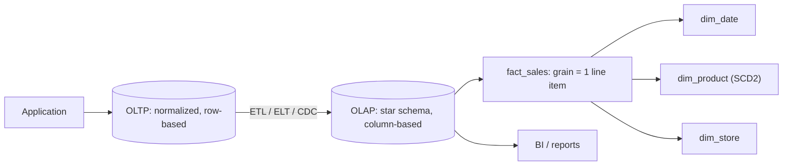

## 1. Core Concept

**OLTP** (online transaction processing) serves **applications**: millions of **short, per-record operations** (placing an order, logging in) needing millisecond latency and ACID. **OLAP** (online analytical processing) serves **analytics**: **few queries but scanning and aggregating a huge amount of data** (revenue by month, by region). These two loads **conflict in how data is stored and modeled**, so they need two different systems/models — OLTP is **normalized and row-stored**; OLAP is **denormalized into a star schema and column-stored**.

**Mental model:** OLTP is **a checkout counter**: serving each customer quickly, handling **one receipt** at a time. OLAP is **the month-end analysis room**: sitting and looking at **millions of receipts at once** to total by store and product. These two jobs need **different desks**.

## 2. How It Works

**OLTP vs OLAP**
- **OLTP**: many short transactions, reading/writing a few rows by key, **normalized (3NF)** to avoid duplication, **indexes** for lookups, ACID, **current** data. **OLAP**: few heavy queries, scanning millions to billions of rows but **only a few columns**, **denormalized**, **historical** data, tolerates batch loading/latency.

**Columnar vs row storage**
- **Row store**: a row's columns sit next to each other → optimized for **reading/writing a whole row**. **Column store**: **each column is stored separately** → a `SUM(amount)` query **reads only the needed column**, **compresses extremely well** (similar values: run-length, dictionary → usually **5–10×**), processed in **vectors**. Example: a 100-column table where a query uses only 3 columns reads **~3%** of the data instead of 100%.

**Star schema (Kimball)**
- **Fact table**: **events/measurements** (quantity, revenue) at a clear **grain**, holding **foreign keys** to dimensions. **Dimension table**: **descriptive** attributes (customer, product, date, store). A query = join the fact with a few dimensions then `GROUP BY`. A **snowflake** normalizes dimensions further (less common because of more joins).
- **Grain first**: decide "what one fact row represents" (for example **one line item of an order**) **before** choosing dimensions/measures; mixing several grains in one table is a classic mistake. Fact types: **transaction**, **periodic snapshot**, **accumulating snapshot**. **Additive** measures (can be summed) vs **semi-additive** (balances: not summable over time).

**Slowly Changing Dimensions (SCD)**
- Dimension attributes **change over time** (a customer moves city). **Type 1**: overwrite (history lost). **Type 2**: **add a new row** with `valid_from`, `valid_to`, `is_current` → **preserving point-in-time history**, with facts pointing to the right version. **Type 3**: add an "old value" column (limited history).

**Surrogate key**
- A **meaningless integer key** generated by the warehouse, in place of the business (natural) key: **stable** when the source key changes, **required for SCD Type 2** (one customer has multiple rows), joins faster than long strings.

```sql
-- Revenue by month and region: reads only 3 fact columns, joins 2 dimensions
SELECT d.year_month, s.region, SUM(f.net_amount) AS revenue
FROM fact_sales f
JOIN dim_date d  ON d.date_key  = f.date_key
JOIN dim_store s ON s.store_key = f.store_key
WHERE d.year = 2026
GROUP BY d.year_month, s.region;
```

## 3. Visual Diagram



## 4. Rules of Thumb & Trade-offs

| Situation / Need | What to choose |
| --- | --- |
| Short transactions, read/write by key | OLTP (row store, normalized) |
| Scan and aggregate large volumes | OLAP (column store, star schema) |
| Need the history of attribute changes | SCD Type 2 + surrogate key |
| Only the latest value matters | SCD Type 1 |
| Reports on the same transactional system, small load | A read replica; no separate warehouse yet |
| Many sources, many analytics teams | A warehouse/lakehouse with a dimensional model |

- **What you gain:** fast analytical queries, a model that is easy for BI to understand. **What you lose:** denormalization means **repeated data** that must be synchronized from OLTP (latency) and extra ETL infrastructure.

## 5. Must Remember / Production Pitfalls

- **Heavy reports slow down the application → analytical queries run on the transactional DB → move them to a replica/an OLAP warehouse**.
- **Fact numbers do not reconcile → several grains mixed in one table → declare the grain first, one grain per fact**.
- **Historical reports are wrong when customers change details → the dimension is SCD1 overwriting → SCD Type 2 with surrogate keys**.
- **Warehouse queries are slow from long-string joins → business keys as strings are used → integer surrogate keys**.
- **Summing balances over time gives nonsense → a semi-additive measure → use the period-end/average value**.
- Interview trap: "OLTP vs OLAP?" → **OLTP: short transactions, row store, normalized; OLAP: large scans/aggregation, column store, star schema**; "what is SCD Type 2?" → **a new row on each change, keeping history**; "why is a column store fast for analytics?" → **it reads only the needed columns + compresses well**.

## 6. Search Hooks

- `OLTP vs OLAP` — the two kinds of load and their systems.
- `star schema fact dimension tables` — the dimensional model for analytics.
- `slowly changing dimensions SCD type 2` — keeping dimension change history.
- `columnar vs row storage` — why column storage is fast for analytics.
- `Kimball dimensional modeling grain` — declare the grain first.
- `surrogate keys` — stable substitute keys for the warehouse.
