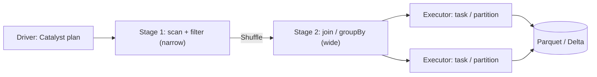

## 1. Core Concept

**Apache Spark** is a **distributed in-memory** data processing engine for batch and streaming, modeled with **DataFrames/SQL**. Spark splits data into **partitions** processed in parallel across a cluster and builds an **optimized execution plan (Catalyst)** — solving the problem of processing TBs that a single machine cannot handle. Performance is decided by **shuffle, partitions and skew**.

**Mental model:** Spark is like **a team of many chefs splitting the ingredients**: each handles **their own portion (a partition)**, but when they need to **combine by group (group/join)** the ingredients must be **moved back and forth between kitchens (a shuffle)** — the slowest part. If one chef is overloaded (skew) the whole team waits.

## 2. How It Works

**Driver, executor, job, stage, task**
- The **driver** plans; **executors** run **tasks** on partitions. An **action** (count, write) triggers a **job**, split into **stages** at **shuffle** boundaries, each stage consisting of many **tasks** (1 task per partition).

**Lazy evaluation and narrow vs wide**
- **Transformations** (filter, select) are **lazy**; only an **action** runs. **Narrow** (filter/map): needs no data from other partitions. **Wide** (groupBy, join, repartition): **shuffles** data over the network and disk → expensive.

**Catalyst and Tungsten**
- **Catalyst** optimizes logically (predicate/projection pushdown, reordering joins) and picks a **physical plan**; **Tungsten** manages memory/codegen. Prefer **DataFrames/SQL** over RDDs and limit **Python UDFs** (slow, they block optimization); use built-in functions/Pandas UDFs.

**Join strategies**
- **Broadcast hash join**: a small table (< `spark.sql.autoBroadcastJoinThreshold`, default ~10 MB) is **sent to every executor** → **no shuffle** of the large table. **Sort-merge join**: both large → shuffle + sort. Use the `broadcast()` hint when you know a table is small.

**Partitions and `spark.sql.shuffle.partitions`**
- The default is **200** partitions after a shuffle: too few → large tasks, spilling; too many → overhead. Target partitions of **~100–200 MB**. **AQE** (Adaptive Query Execution) automatically coalesces small partitions, handles skewed joins and changes join strategy at runtime.

**Data skew**
- A few keys hold most of the data → **one task runs very long** while the rest finish. Remedies: **AQE skew join**, **salting** (adding a random suffix to the key), **broadcast**, handling hot keys separately.

**Cache/persist, coalesce vs repartition**
- `cache()` when a DataFrame is **reused** several times; remember `unpersist`. **`coalesce(n)`** reduces partitions **without a shuffle**; **`repartition(n)`** shuffles and rebalances; when writing files beware of **small files**.

```python
orders = spark.read.parquet("s3://lake/orders")
dims   = spark.read.parquet("s3://lake/dim_product")
res = (orders.join(F.broadcast(dims), "product_id")      # small table -> no shuffle of the large table
             .where("order_date >= '2026-11-01'")
             .groupBy("category").agg(F.sum("amount").alias("rev")))
res.write.mode("overwrite").parquet("s3://lake/gold/rev_by_cat")
```

## 3. Visual Diagram



## 4. Rules of Thumb & Trade-offs

| Situation / Need | What to choose |
| --- | --- |
| Join a large table with a small one | Broadcast join |
| A few keys are too hot | AQE skew / salting |
| Tasks spill to disk, OOM | Raise partitions/memory, reduce data per task |
| Reusing a DataFrame several times | `cache()` / `persist()` |
| Reduce file count when writing | `coalesce` (no shuffle) |
| Heavy custom logic | Pandas UDF, avoid plain Python UDFs |

- **What you gain:** horizontal scale, a high-level API, automatic optimization. **What you lose:** shuffle costs network/disk, partition/memory tuning, cluster cost, skew is hard to debug.

## 5. Must Remember / Production Pitfalls

- **The job is slow because one task drags on → data skew → AQE skew join, salting, handle hot keys**.
- **OOM/spilling to disk → partitions too large or too few → raise `shuffle.partitions`, enable AQE**.
- **Joining a small table still shuffles → over the threshold/no hint → `broadcast()`**.
- **Many small files on write → too many partitions → `coalesce`/compaction**.
- **A Python UDF is slow → row-by-row serialization blocks optimization → built-in functions/Pandas UDFs**.
- **The cache overflows memory → forgot `unpersist` → cache only when reused, release afterward**.
- Interview trap: "narrow vs wide transformation?" → **wide causes a shuffle**; "why does a job have one slow task?" → **data skew**; "what does a broadcast join do?" → **sends the small table to every executor, avoiding a shuffle of the large one**.

## 6. Search Hooks

- `Spark shuffle partitions` — moving data between partitions and how to tune it.
- `Spark Catalyst optimizer` — query plan optimization.
- `Spark data skew salting` — handling skewed keys.
- `Spark broadcast join` — a shuffle-free join for small tables.
- `Spark Adaptive Query Execution AQE` — runtime optimization.
- `Spark cache persist` — storing reused DataFrames.
