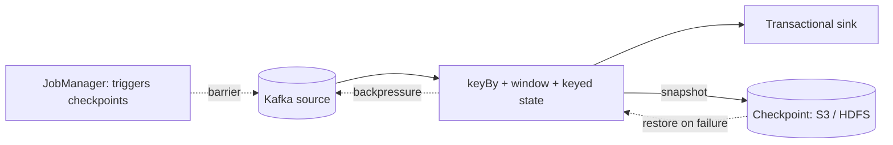

## 1. Core Concept

**Apache Flink** is a **stateful stream processing** engine that processes **each event** with millisecond latency and guarantees **exactly-once for state** thanks to **checkpoints**. It solves continuous computation over infinite streams (windowed counts, stream joins, fraud detection) while still **recovering precisely after failures**.

**Mental model:** Flink is like **a production line with state notes**: each station remembers information (state) about what it has seen, and periodically **photographs the whole line (a checkpoint)**. When a station breaks, you go back to **the latest photo** and replay events from the position recorded in it, so the result is as if nothing ever failed.

## 2. How It Works

**Dataflow and parallelism**
- A job is a **source → operator → sink** graph split into many **parallel subtasks**. `keyBy(key)` routes events with the same key to **the same subtask**, enabling local **keyed state**.

**State and state backends**
- **Keyed state** (ValueState, MapState…) is stored per key. **HashMap backend**: state in the heap, fast but limited by RAM. **RocksDB backend**: state on **local disk** (hundreds of GB–TB), slightly slower, supports **incremental checkpoints**.

**Checkpoints and barriers**
- Flink injects **checkpoint barriers** into the stream; when an operator receives a barrier it **snapshots its state** to durable storage (S3/HDFS), together with the **source offsets** (Kafka). On failure: **restore state + rewind the source offsets** → reprocess from the snapshot point. This is **exactly-once for state**; for **end-to-end exactly-once** you need a **transactional/idempotent** sink (two-phase commit, Kafka transactions).
- A **savepoint** = a **manual, durable** checkpoint used to **upgrade a job/change parallelism** and restart from exactly that state.

**Event time, windows, watermarks**
- Use **event time**; **watermarks** report progress to close **windows** (tumbling/sliding/session). `allowedLateness` + a **side output** handle late data.

**Backpressure**
- When a sink/operator is slow, the system **propagates pressure backward** and slows the source reading (without losing data). Signs: full buffers, long checkpoints. Remedy: find the **bottleneck operator**, increase parallelism, optimize I/O.

**Joins and state TTL**
- A stream–stream join keeps state on both sides → **state grows without bound** unless there is **state TTL**/an interval join. Configure TTL for state that is no longer needed.

```java
env.enableCheckpointing(60_000);                 // snapshot every 60s
env.getCheckpointConfig().setCheckpointingMode(CheckpointingMode.EXACTLY_ONCE);
env.setStateBackend(new EmbeddedRocksDBStateBackend(true)); // incremental
stream.keyBy(Order::getUserId)
      .window(TumblingEventTimeWindows.of(Time.minutes(5)))
      .allowedLateness(Time.minutes(1))
      .sum("amount");
```

## 3. Visual Diagram



## 4. Rules of Thumb & Trade-offs

| Situation / Need | What to choose |
| --- | --- |
| Millisecond latency, complex state | Flink |
| Large state (>GB) | RocksDB + incremental checkpoints |
| Small state, speed needed | HashMap backend |
| Upgrade a job without losing state | Savepoint |
| End-to-end exactly-once | A transactional/idempotent sink |
| Near real-time, already using Spark | Spark Structured Streaming |

- **What you gain:** low latency, powerful state, precise recovery. **What you lose:** complex operations (state, checkpoints, watermarks), 24/7 infrastructure cost, a learning curve.

## 5. Must Remember / Production Pitfalls

- **Checkpoints are slow/keep failing → backpressure or state is too large → RocksDB incremental, reduce state, raise parallelism**.
- **State grows without bound → joins/keyed state are not cleaned → state TTL, interval joins**.
- **Duplicate results at the sink despite Flink's exactly-once → the sink is not transactional → two-phase commit/an idempotent sink**.
- **Cannot upgrade a job → no savepoint/operator uid → set an operator `uid`, use savepoints**.
- **Windows never close → the watermark is stuck because of an idle partition → configure idleness**.
- **A hot key overloads one subtask → a skewed key → add a salt/two-phase aggregation**.
- Interview trap: "Flink's exactly-once?" → **checkpoints (state) + a transactional sink (end-to-end)**; "savepoint vs checkpoint?" → **a savepoint is manual for upgrades, a checkpoint is automatic for recovery**; "what is backpressure?" → **pressure propagated backward that slows the source, without losing data**.

## 6. Search Hooks

- `Flink checkpointing exactly-once` — snapshotting state for precise recovery.
- `Flink state backends RocksDB` — where state is kept and the trade-offs.
- `Flink savepoints` — manual snapshots for upgrading jobs.
- `Flink watermarks event time` — event-time windows.
- `Flink backpressure` — the backward-pressure mechanism.
- `Flink state TTL` — cleaning state that is no longer needed.
