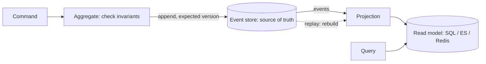

## 1. Core Concept

**CQRS (Command Query Responsibility Segregation)** separates the **write model** (handling **commands**, protecting business rules) from the **read model** (serving **queries**, optimized for display) — because the needs of writing (checking invariants, transactions) and reading (joins, aggregation, speed) **conflict**. **Event Sourcing (ES)** stores **an immutable sequence of events** as the source of truth instead of the current state; the state = **a fold over the events**. The two techniques are **independent** but often used together; both are only worth it for **complex domains**, not ordinary CRUD.

**Mental model:** event sourcing is like **an accounting ledger**: you never delete/edit a balance, you only **append each transaction**; the current balance is **the sum of the transactions**, and you can **rewind to any point in time**. CQRS is like **separating the order desk (write) from the information display board (read)**: the display board is redrawn from the ledger, very convenient for viewers but **possibly updated a few seconds late**.

## 2. How It Works

**CQRS → Two models**
- **Command side**: receives commands (`PlaceOrder`), **checks invariants** on the **aggregate**, writes. **Query side**: a **denormalized read model (projection)** shaped exactly to each screen (SQL/Elasticsearch/Redis), updated **asynchronously** from events → **eventual consistency** between writes and reads. It lets you **scale and pick technology separately** for reads and writes.

**Event sourcing → State is a function of events**
- Store `OrderPlaced`, `ItemAdded`, `OrderPaid`… in the **aggregate's stream**; restoring = **replaying** the events. Benefits: **complete audit, point-in-time queries, debugging "what happened", rebuilding new read models from history**. The price: complexity, **event schema evolution**, a change in mental model.

**Projections and rebuild**
- A **projection** turns events into a read model; it can be **deleted and fully rebuilt** by replay when display requirements change. It must be **idempotent** (handle duplicates) and track **the position processed**.

**Snapshots**
- Replaying thousands of events every time you load an aggregate is slow → store a **snapshot** (for example every 100 events) and replay only what follows.

**Optimistic concurrency → Expected version**
- When **appending** events, send the stream's **expected version**; if the stream already has new events (a different version) → **reject** and retry/merge. It protects invariants without locks.

**Event evolution → Upcasting**
- Stored events are **immutable**, but the schema changes → an **upcaster** converts old-version events to the new one when reading; **old events are never edited**.

**Privacy → Crypto-shredding**
- GDPR's "right to be forgotten" conflicts with an immutable log → **encrypt personal data with a per-subject key**, and to delete it **delete the key** (the data remains but is unreadable).

```python
class Account:
    def __init__(self): self.balance, self.version = 0, 0
    def apply(self, e):                       # state = fold(events)
        if e["type"] == "Deposited": self.balance += e["amount"]
        elif e["type"] == "Withdrawn": self.balance -= e["amount"]
        self.version += 1
def withdraw(acc, amount):                    # command: check invariants then emit an event
    if acc.balance < amount: raise InsufficientFunds()
    return {"type": "Withdrawn", "amount": amount}
store.append(stream_id, [event], expected_version=acc.version)   # rejected if the version changed
```

## 3. Visual Diagram



## 4. Rules of Thumb & Trade-offs

| Situation / Need | What to choose |
| --- | --- |
| Simple CRUD | No need for CQRS/ES |
| Reads and writes need different models/scale | CQRS |
| Complete audit, point-in-time queries, a complex domain | Event sourcing |
| An aggregate with many events | Snapshots |
| Prevent concurrent overwrites | Expected version (optimistic) |
| The event schema changes | Upcasting |
| Deleting personal data in an immutable log | Crypto-shredding |

- **What you gain:** audit, the ability to rebuild, separately optimized reads/writes. **What you lose:** large complexity, eventual consistency between writes and reads, hard ad-hoc queries on the event store, schema evolution.

## 5. Must Remember / Production Pitfalls

- **Using CQRS/ES for simple CRUD → unnecessary complexity → use it only for complex domains with a clear need**.
- **A user writes and does not see the result right away → the read model updates late → design the UI to tolerate lag (optimistic UI), or read from the write side in special cases**.
- **Old events cannot be read after a schema change → no upcasting → event versioning and upcasters, only add optional fields**.
- **Replay is slow when an aggregate is long → no snapshots → periodic snapshots**.
- **A projection processes duplicates and corrupts numbers → not idempotent → track position/deduplicate**.
- **A personal-data deletion request → an immutable log cannot be erased → crypto-shredding, or keep raw PII out of events**.
- Interview trap: "Does CQRS require event sourcing?" → **no, they are independent techniques**; "What is the expected version for?" → **optimistic concurrency when appending events**; "Deleting personal data in an event store?" → **crypto-shredding**.

## 6. Search Hooks

- `CQRS pattern` — separating the write and read models.
- `event sourcing` — storing a sequence of events as the source of truth.
- `projections read model rebuild` — building read models from events.
- `event upcasting schema evolution` — evolving event schemas.
- `optimistic concurrency expected version` — preventing overwrites on append.
- `crypto-shredding GDPR event sourcing` — deleting personal data in an immutable log.
