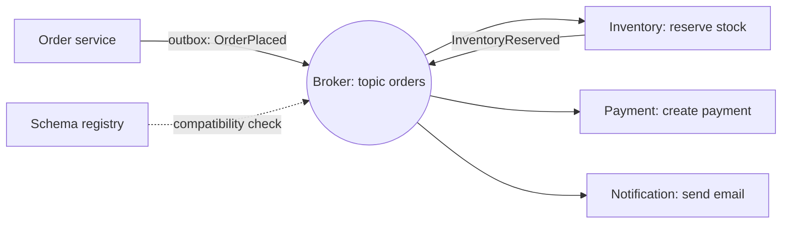

## 1. Core Concept

**Event-driven architecture (EDA)** lets components communicate through **events** — "something that has happened" (`OrderPlaced`) — instead of calling each other directly. A producer **emits an event without knowing who receives it**; consumers **decide for themselves how to react**. The result is **loose coupling**, easy addition of new consumers and spike tolerance thanks to queues — in exchange for **hard-to-see causality**, **eventual consistency** and the problem of **ordering/duplication**.

**Mental model:** like **the notice board in an apartment building**: whoever posts a notice ("floor 3 water cut soon") does not need to know who reads it; interested households react on their own. It is easy to add new readers, but to learn **what consequences a notice caused** you must trace through each household.

## 2. How It Works

**Event vs command**
- A **command**: a request to do something, sent **to one specific receiver** ("PlaceOrder"). An **event**: **a fact that already happened**, named in the **past tense** (`OrderPlaced`), broadcast to **many listeners**, immutable.

**Event notification vs Event-carried state transfer**
- **Notification**: a **thin** event (just an id), the consumer **calls back the API** for details — data is always fresh but **runtime-dependent** on the producer. **Event-carried state transfer**: the event **carries enough data**, the consumer keeps a **local copy** — fewer cross-calls and higher autonomy, in exchange for **duplicated data** and larger events.

**Choreography vs Orchestration**
- **Choreography**: each service reacts to events and emits the next — **no center**, loose but the **business flow is hard to see** when there are many steps. **Orchestration**: an **orchestrator** coordinates each step explicitly (a state machine) — easier to understand and monitor, at the cost of a central component.

**Delivery and consistency**
- Most brokers are **at-least-once** → consumers must be **idempotent**. Emit events reliably together with the DB write using a **Transactional Outbox**. **Ordering** exists only within a partition/key. Data is **eventually consistent**.

**Event contracts → Schema registry**
- Events are a **public API**: use **Avro/Protobuf/JSON Schema** with a **schema registry** checking **compatibility** on change (**backward**: new consumers read old data; **forward**; **full**). The safe rule: **only add optional fields with defaults**, never remove/retype. **CloudEvents** standardizes the **envelope** (`id`, `source`, `type`, `specversion`, `time`, `data`) for interoperability between systems.

```json
{ "specversion": "1.0", "id": "evt-7f3a", "source": "/orders-service",
  "type": "com.example.order.placed.v1", "time": "2026-11-21T09:30:00Z",
  "datacontenttype": "application/json",
  "data": { "orderId": "o-1001", "customerId": "c-42", "total": 250000 } }
```

## 3. Visual Diagram



## 4. Rules of Thumb & Trade-offs

| Situation / Need | What to choose |
| --- | --- |
| Many systems must react to one change | Publish an event (pub/sub) |
| Consumers need the latest data and can call back | Event notification |
| Reduce runtime dependence, autonomous consumers | Event-carried state transfer |
| Few steps, maximum looseness | Choreography |
| A multi-step process needing tracking/compensation | Orchestration (saga) |
| Emit events reliably together with a DB write | Transactional Outbox |
| Evolving event contracts | Schema registry + compatible changes |

- **What you gain:** looseness, easy extension, spike tolerance. **What you lose:** harder flow tracing, eventual consistency, handling duplicates/ordering, harder debugging.

## 5. Must Remember / Production Pitfalls

- **Nobody knows what an event triggers ("event spaghetti") → multi-step choreography without documentation/observability → distributed tracing, correlation ids, documented flows, or orchestration**.
- **A consumer processes duplicates and causes side effects → at-least-once → an idempotent consumer (dedupe by event id)**.
- **A producer changes the schema and breaks consumers → an incompatible change → a schema registry, only add optional fields with defaults**.
- **Replaying events triggers side effects (sending an email again) → the consumer cannot tell a replay → idempotency and a replay flag**.
- **Events that are too large or carry too much → hard to evolve → keep events compact, carrying only the necessary data**.
- Interview trap: "How does an event differ from a command?" → **an event is a fact that happened with many listeners; a command is a request sent to one place**; "Choreography vs orchestration?" → **no center (flow hard to see) vs coordinated (easy to follow)**; "A safe schema change?" → **add an optional field with a default**.

## 6. Search Hooks

- `event-driven architecture` — architecture that communicates through events.
- `event notification vs event-carried state transfer` — thin events versus events carrying state.
- `choreography vs orchestration` — two ways to coordinate services.
- `schema registry Avro compatibility` — managing event schema evolution.
- `CloudEvents specification` — the standard event envelope.
- `transactional outbox pattern` — emit events reliably together with a DB write.
