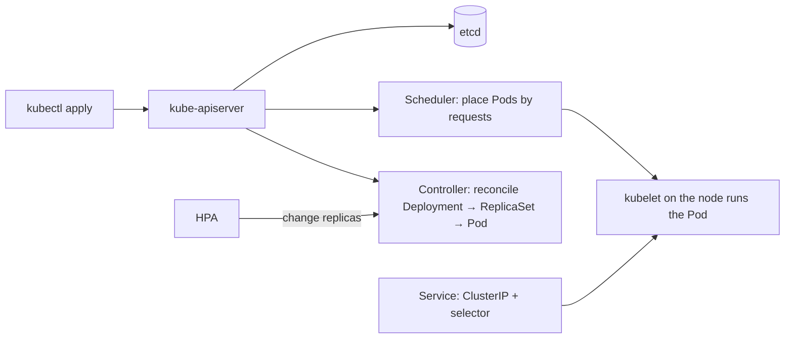

## 1. Core Concept

**Kubernetes (K8s)** is a **container orchestration** platform: you **declare the desired state** ("run 3 copies of this app, 500 MB RAM each") and Kubernetes **continuously adjusts reality to match** — restarting, replacing, scaling, updating without downtime and distributing traffic. The core is **a declarative model + a reconciliation loop**, not "a command that runs a container".

**Mental model:** Kubernetes is like **an automated building manager**: you hand over a **blueprint of requirements** (YAML) and the manager continuously **compares it with the current state** — a missing unit gets built, a broken one replaced, an overloaded one gets another floor. You do not order each task; you **describe the destination**.

## 2. How It Works

**Architecture**
- **Control plane**: **kube-apiserver** (the only entry into the cluster), **etcd** (the state store, based on Raft), the **scheduler** (picks a node for a Pod), the **controller-manager** (the reconciliation loops). **Node**: the **kubelet** (runs Pods on the node), **kube-proxy** (Service networking), the **container runtime** (containerd). Everything talks through the API server.

**Pod, ReplicaSet, Deployment**
- **Pod**: the smallest unit, one or a few containers **sharing network and volumes**, **disposable** (do not treat it as durable). A **ReplicaSet** keeps exactly **N copies** of a Pod. A **Deployment** manages ReplicaSets and supports **rolling updates** (`maxSurge`, `maxUnavailable`) and **rollback**. Others: **StatefulSet** (stable identity, dedicated volumes), **DaemonSet** (one Pod per node), **Job/CronJob**.

**Service, ClusterIP and Ingress**
- Pods come and go and **their IPs change**; a **Service** provides a **stable IP/DNS** and load-balances across Pods matching a **label selector**: **ClusterIP** (inside the cluster), **NodePort**, **LoadBalancer** (cloud). An **Ingress** (+ an **Ingress Controller** such as nginx/Envoy) routes **HTTP L7** by host/path and terminates TLS. **ConfigMap/Secret** separate configuration from the image.

**Probes → Three kinds, three purposes**
- **Liveness**: is the container still alive (**failure → restart**). **Readiness**: is it ready to take traffic (**failure → removed from the Service**, no restart). **Startup**: protects **slow-starting** applications from being killed early by liveness.

**Requests and limits**
- **Requests**: the **guaranteed** amount of resources, used for **scheduling** (the scheduler only places a Pod on a node with room). **Limits**: the **ceiling**: exceeding **CPU** gets you **throttled**, exceeding **memory** gets you **OOMKilled**. QoS: **Guaranteed** (requests = limits), **Burstable**, **BestEffort** (evicted first when resources are short).

**Autoscaling**
- **HPA** changes the number of Pods: `desired = ceil(current × currentMetric / targetMetric)`; for example 4 Pods at 90% CPU with a 60% target → `ceil(4 × 90/60) = 6`. HPA computes **% relative to requests**, so **requests must be set**. **VPA** adjusts requests/limits; **Cluster Autoscaler/Karpenter** adds nodes when Pods are **Pending**. A **PodDisruptionBudget** keeps a minimum number of Pods during maintenance.

```yaml
apiVersion: apps/v1
kind: Deployment
metadata: { name: api }
spec:
  replicas: 3
  strategy: { rollingUpdate: { maxSurge: 1, maxUnavailable: 0 } }
  selector: { matchLabels: { app: api } }
  template:
    metadata: { labels: { app: api } }
    spec:
      containers:
      - name: api
        image: registry/api:1.4.2
        resources: { requests: { cpu: 250m, memory: 256Mi }, limits: { memory: 512Mi } }
        readinessProbe: { httpGet: { path: /ready, port: 8080 }, periodSeconds: 5 }
        livenessProbe:  { httpGet: { path: /healthz, port: 8080 }, initialDelaySeconds: 20 }
```

## 3. Visual Diagram



## 4. Rules of Thumb & Trade-offs

| Situation / Need | What to choose |
| --- | --- |
| A stateless application | Deployment |
| Stable identity/volumes (DB) | StatefulSet (or a managed DB) |
| Run on every node (a log agent) | DaemonSet |
| Receive traffic only when ready | Readiness probe |
| Slow startup | Startup probe |
| Scale with load | HPA (set requests!) |
| HTTP routing by path/host | Ingress |
| Reduce disruption during maintenance | PodDisruptionBudget |

- **What you gain:** self-healing, scaling, zero-downtime updates, portability. **What you lose:** large operational complexity (networking, security, upgrades), a steep learning curve; many small projects are fine with a PaaS/container service.

## 5. Must Remember / Production Pitfalls

- **Pods are OOMKilled repeatedly → the memory limit is below real needs → measure and set sensible requests/limits**.
- **The app is slow although node CPU is idle → a CPU limit causes throttling → consider dropping the CPU limit and keeping requests**.
- **HPA does not scale → no requests, so it cannot compute % → set CPU/memory requests**.
- **A slow-starting Pod is restarted right away → liveness too strict → a startup probe/`initialDelaySeconds`**.
- **Traffic reaches a Pod that is not ready → no readiness → a readiness probe that really checks dependencies**.
- **A Pod stays `Pending` forever → no node has enough requests available → add nodes/Cluster Autoscaler, lower requests**.
- **`CrashLoopBackOff` / `ImagePullBackOff` → an application error / a wrong image or missing pull permission → `kubectl logs/describe`**.
- Interview trap: "Liveness vs readiness?" → **liveness decides restarts, readiness decides whether to receive traffic**; "Requests vs limits?" → **requests are for scheduling (a guarantee), limits are a ceiling (CPU throttling, memory OOM)**; "Deployment vs StatefulSet?" → **stateless vs stable identity/volumes**.

## 6. Search Hooks

- `Kubernetes architecture control plane` — the control plane and node components.
- `Pod ReplicaSet Deployment` — three layers of workload management.
- `Kubernetes Service ClusterIP Ingress` — networking and routing.
- `liveness readiness startup probes` — three kinds of health checks.
- `Kubernetes resource requests limits` — scheduling and resource limits.
- `Horizontal Pod Autoscaler` — autoscaling by metric.
