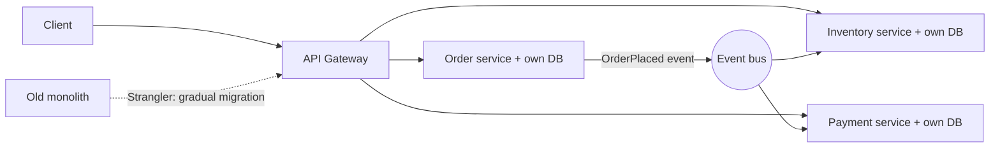

## 1. Core Concept

**Microservices** split a system into many **small, independently deployable services**, each **owning one business capability and its own data**. The goal is **team autonomy, frequent deployments and scaling parts independently** — in exchange you take on all the complexity of a **distributed system** (partial network failures, eventual consistency, observability, operations). For many organizations a **modular monolith** is the right starting point; microservices are **a solution to organizational/scale problems**, not a goal.

**Mental model:** a monolith is like **a one-kitchen restaurant**: easy to coordinate, but the whole kitchen must change the menu together. Microservices are like **a food court of independent stalls**: each stall decides its own dishes and opens/closes on its own, but for a "complete meal" a customer must visit several stalls and **if any stall is closed**, the meal is missing a dish.

## 2. How It Works

**Monolith → Modular monolith → Microservices**
- **Monolith**: one deployment unit, in-process function calls (fast, ACID transactions are easy). **Modular monolith**: still one deployment unit but with **clear module boundaries** and little cross-dependency — many of the benefits without network cost. **Microservices**: many deployment units communicating over the network.

**Bounded context → The right service boundary**
- From **Domain-Driven Design**: each **bounded context** is a business area with **its own model and language** (for example "Product" in Catalog differs from "Product" in Billing). Service boundaries should **coincide with bounded contexts** for **high cohesion, low coupling**; cutting by technical layer (a "database" service, a "UI" service) is wrong.

**Database per service → Data ownership**
- **Each service owns its own schema** and nobody else reads/writes it directly; access goes through **APIs or events**. **Sharing a database** turns services into a **distributed monolith** (a schema change breaks many services). Consequence: **no joins/transactions across services** → use **sagas** and **eventual consistency**.

**Communication**
- **Synchronous** (REST/gRPC): simple but **couples runtime** — one slow service drags down the chain (needs timeouts, circuit breakers). **Asynchronous** (events/queues): looser, more fault-tolerant, but harder to reason about.

**Strangler fig → Gradual migration from a monolith**
- Put a **facade/proxy** in front, **move features one by one** to new services (route by URL/feature flag), and the monolith **shrinks** until it is replaced — instead of a risky "rewrite everything".

**Anti-pattern: the distributed monolith**
- Many services but with **tight synchronous dependencies, a shared DB and the need to deploy together** → you have **all the costs** of microservices with **none of the benefits**.

**Conway's law**
- "A system mirrors the communication structure of the organization that builds it." If you want a given architecture, **organize the teams** accordingly (the **inverse Conway maneuver**): one team owns one or a few services **end to end** (build, run).

**The price you pay**
- Network latency and failures (the **fallacies of distributed computing**), **centralized tracing/logging**, **per-service CI/CD**, **contract testing** (Pact), API version management, a platform (service discovery, config, secrets).

```yaml
# Signs of a distributed monolith: every service must be deployed together and reads one DB
order-service:    { db: shared-db, depends-sync: [inventory, payment, shipping] }
inventory-service:{ db: shared-db }
```

## 3. Visual Diagram



## 4. Rules of Thumb & Trade-offs

| Situation / Need | What to choose |
| --- | --- |
| A small team, a new product, an unclear domain | Modular monolith |
| Many teams needing independent deployment, different scaling hot spots | Microservices |
| Migrating a legacy system | Strangler fig |
| Determining service boundaries | Bounded context (DDD) |
| You need another service's data | An API or events, never read its DB directly |
| Transactions across services | Saga + eventual consistency |

- **What you gain:** team autonomy, independent deployment, selective scaling, fault isolation. **What you lose:** distributed complexity, operations/observability, data consistency, infrastructure cost; **small organizations usually lose out**.

## 5. Must Remember / Production Pitfalls

- **Several services must be deployed together to work → a distributed monolith (tight synchronous coupling, shared DB) → database per service, loose communication, contract testing**.
- **One slow service takes down the whole chain → chained synchronous calls without timeouts → timeouts, circuit breakers, bulkheads, async where possible**.
- **Data is inconsistent between services → expecting ACID transactions across services → sagas, outbox, accept eventual consistency**.
- **Services cut too small ("nanoservices") → network/operations cost beats the benefit → cut by bounded context, start coarse**.
- **No visibility during incidents → no tracing → distributed tracing and centralized logging from the start**.
- Interview trap: "When should you NOT use microservices?" → **a small team, an unclear domain, no operational platform yet**; "What is a distributed monolith?" → **many services but tightly coupled (shared DB/deployed together)**; "Strangler fig?" → **migrate features gradually behind a facade**.

## 6. Search Hooks

- `microservices vs monolith vs modular monolith` — three levels of deployment architecture.
- `bounded context domain-driven design` — how to determine service boundaries.
- `database per service pattern` — each service owns its own data.
- `strangler fig pattern` — gradual migration from a monolith.
- `distributed monolith anti-pattern` — microservices that are still tightly coupled.
- `Conway's law` — architecture mirrors organizational structure.
