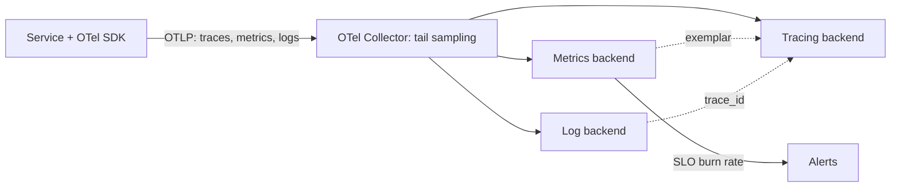

## 1. Core Concept

**Observability** is the ability to **understand a system's internal state from the data it emits**, especially to answer **questions you did not anticipate** ("why was customer X's request slow at 3 a.m.?"). Three complementary signals: **logs** (detailed events), **metrics** (aggregated numbers over time) and **traces** (the path of one request across several services). Monitoring answers known questions; observability helps you discover **"unknown unknowns"**.

**Mental model:** metrics are **the gauges on a dashboard** (they tell you something is wrong), traces are **the route map** of a trip (they tell you **which leg** was slow), logs are **the detailed journal** (they tell you **what happened** on that leg). You need all three, linked by **the same trace id**.

## 2. How It Works

**The three signals**
- **Logs**: should be **structured (JSON)**, with `trace_id`, level and context; expensive at high volume. **Metrics**: a **counter** (only increases), a **gauge** (the current value), a **histogram** (latency distribution → p95/p99); cheap and good for alerting. **Traces**: a **trace** consists of many **spans** (one per operation, with parent–child links), showing **the time spent in each service**.

**Distributed tracing and the W3C `traceparent`**
- The standard header **`traceparent: 00-<trace-id 32 hex>-<span-id 16 hex>-<flags>`** is **propagated on every call** (HTTP, messages) so spans of the same trace can be linked. A missing **context propagation** in one service **breaks the trace**.

**OpenTelemetry (OTel)**
- An **open, vendor-neutral** standard: **API + SDK** (instrument code, auto-instrumentation), a **Collector** (receive, process, export), and the **OTLP** protocol. It lets you **switch backends** (Jaeger, Tempo, Datadog…) without changing code.

**Sampling → Controlling cost**
- **Head-based**: decide whether to keep a trace **right at the start** (for example 1%) — cheap, but **may miss error/slow traces**. **Tail-based**: **wait for the trace to complete** and then decide (keeping **every error and slow trace**) — more useful but needs a **Collector buffering** all spans.

**High-cardinality metrics**
- Each combination of labels is **one time series**. Labels such as `user_id`, `request_id` create **millions of series** → exploding cost/crashing Prometheus. Use **labels with few values** (route, status, method); put high-cardinality data in **logs/traces**. An **exemplar** links a metric point to a specific trace.

**SLI, SLO and error budget**
- **SLI**: the measured indicator (the share of successful requests, p99 < 300 ms). **SLO**: the target (**99.9% over 30 days**). **Error budget** = 1 − SLO: 99.9% / 30 days ≈ **43.2 minutes** of allowed failure. **Alert on burn rate** (burning the budget too fast) instead of raw thresholds; **alert on symptoms users see**, not internal causes. **RED** for services, **USE** for resources.

```yaml
# OpenTelemetry Collector: tail sampling keeps error and slow traces
processors:
  tail_sampling:
    decision_wait: 10s
    policies:
      - { name: errors, type: status_code, status_code: { status_codes: [ERROR] } }
      - { name: slow,   type: latency,     latency: { threshold_ms: 1000 } }
      - { name: rest,   type: probabilistic, probabilistic: { sampling_percentage: 5 } }
```

## 3. Visual Diagram



## 4. Rules of Thumb & Trade-offs

| Situation / Need | What to choose |
| --- | --- |
| Know something is wrong, alert | Metrics (RED/USE, SLO burn rate) |
| Know which service a request is slow in | Distributed tracing |
| Know the details of what happened | Structured logs + trace_id |
| Keep error/slow traces at low cost | Tail-based sampling |
| Avoid vendor lock-in | OpenTelemetry |
| Per-user/per-request data | Logs/traces, not metric labels |

- **What you gain:** fast diagnosis, accurate alerts, reliability measurement. **What you lose:** storage and ingest cost, instrumentation overhead, the operational complexity of the Collector.

## 5. Must Remember / Production Pitfalls

- **Prometheus runs out of memory → high-cardinality labels (user_id) → only low-cardinality labels, move details to logs/traces**.
- **A trace breaks midway → one service does not forward `traceparent` → ensure context propagation on every call (HTTP, messages)**.
- **You cannot see the trace of a failed request → head sampling too low → tail-based sampling keeping errors/slow ones**.
- **Noisy, fatiguing alerts → alerting on thresholds/causes → alert on symptoms and SLO burn rate**.
- **Logs are unstructured and unsearchable → free text → JSON + trace_id**.
- Interview trap: "The three pillars of observability?" → **logs, metrics, traces**; "Head vs tail sampling?" → **head decides early (cheap, misses things), tail waits for the whole trace (keeps errors/slow)**; "What error budget is 99.9%?" → **~43.2 minutes per 30 days**.

## 6. Search Hooks

- `observability logs metrics traces` — the three kinds of signals.
- `OpenTelemetry OTel` — the open standard for collecting signals.
- `distributed tracing W3C traceparent` — propagating trace context between services.
- `SLI SLO error budget` — measuring reliability and the error budget.
- `tail-based sampling` — keep error/slow traces based on the final outcome.
- `high cardinality metrics` — time series explosion caused by labels.
