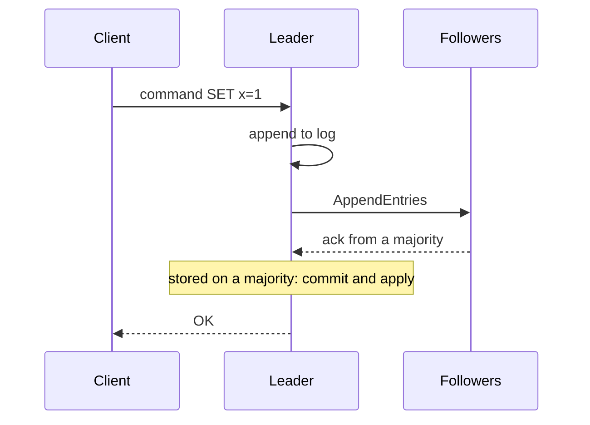

## 1. Core Concept

**Consensus** is the problem of getting **many nodes to agree on a value/a sequence of commands** even though **some nodes or the network fail**. **Raft** is an **understandable** consensus algorithm (which replaced Paxos in practice) used to build a **replicated state machine**: every node applies **the same log of commands in the same order**, and therefore reaches **the same state**. Raft underlies **etcd, Consul, CockroachDB, TiKV** — that is, the foundation of Kubernetes and many distributed systems. It **favors consistency (CP)**: without a majority it **makes no progress**.

**Mental model:** a **voting council with a chair**: only one **leader** receives proposals, writes them in the shared ledger and treats them as **official** only once **a majority of members** have copied them. If the chair disappears the council **elects a new one**, and the election rule guarantees **the new chair always holds all the official decisions**.

## 2. How It Works

**Roles and terms**
- Each node is a **follower**, **candidate** or **leader**. Time is divided into **terms** (an increasing number); each term has **at most one leader**. A node that sees **a higher term** immediately **steps down to follower**.

**Leader election**
- The leader sends **heartbeats** (empty AppendEntries). A follower that **hears no heartbeat within the election timeout (random, for example 150–300 ms)** becomes a **candidate**: it **increments the term, votes for itself and sends `RequestVote`**. **Receiving a majority of votes → it becomes leader.** The **random** timeout reduces the chance of several simultaneous candidates (split vote). Each node casts **one vote per term**, and **only for a candidate whose log is at least as up to date as its own** (guaranteeing the new leader has every committed entry).

**Log replication → Commit on a majority**
- A client sends a command to the **leader** → the leader **appends it to its log** and sends **`AppendEntries`** to followers → once the entry is stored on **a majority of nodes** it is **committed**, **applied to the state machine** and the client gets a reply. **Log matching**: if two logs have an entry with the same index and term then every earlier entry is identical; the leader **forces followers to match** its log.

**Quorum and fault tolerance (2f + 1)**
- **A cluster of N = 2f + 1 nodes tolerates f failures**: 3 nodes tolerate 1, **5 nodes tolerate 2**. **An even number adds no fault tolerance** (4 nodes still tolerate only 1), so use **an odd number**. On a network partition: **the minority side cannot commit** → avoiding **split brain**; an isolated old leader **cannot commit** and steps down when it sees a new term.

**Performance and operations**
- A commit costs **1 RTT to a majority + the log's fsync** → latency depends on the network/disk; **spreading across Regions** slows commits by the longest RTT within the majority. **Snapshots/log compaction** keep the log from bloating. **Consistent reads** go through the leader (read index/lease); reading from a follower may be stale. Membership changes use **joint consensus**.

**Paxos vs Raft and the ecosystem**
- As safe as Paxos, but Raft **separates** election and replication more clearly, making it easier to implement. **etcd** (Kubernetes), **Consul**, **ZooKeeper** (uses ZAB) provide **distributed locks, leader election, configuration** — **do not implement consensus yourself**, use them.

```bash
etcdctl endpoint status --cluster -w table     # see the leader, term, raft index
etcdctl member list
```

## 3. Visual Diagram



## 4. Rules of Thumb & Trade-offs

| Situation / Need | What to choose |
| --- | --- |
| Distributed locks, leader election, consistent configuration | etcd / Consul / ZooKeeper |
| Tolerate 1 node failure | 3 nodes |
| Tolerate 2 node failures | 5 nodes |
| Node count of a consensus cluster | An odd number |
| Multi-Region | Consider commit latency by the longest RTT within the majority |
| You want an algorithm that is easy to understand | Raft over Paxos |

- **What you gain:** strong consistency, automatic fault tolerance, no split brain. **What you lose:** **unavailable when a majority is lost**, write latency equal to 1 RTT to a majority, lower throughput than one node; writes do not scale (there is only one leader).

## 5. Must Remember / Production Pitfalls

- **The cluster cannot write when it loses a majority → this is the CP design working → keep ≥ f+1 healthy nodes, spread across racks/AZs**.
- **Using 4 or 6 nodes thinking it is better → an even number adds no fault tolerance → use 3 or 5**.
- **The leader keeps changing (flapping) → high network/disk latency, timeouts too sensitive → tune the election/heartbeat timeouts to the RTT, use fast disks**.
- **Writes are slow when spread over several Regions → RTT to a majority → keep a majority close together, consider another architecture**.
- **Reading from a follower shows stale data → reads do not go through the leader → linearizable reads via the leader/read-index**.
- **Implementing consensus yourself → subtle safety bugs → use etcd/Consul/ZooKeeper**.
- Interview trap: "How many nodes does Raft need to tolerate 2 failures?" → **5 (2f+1)**; "Is Raft CP or AP?" → **CP, it stops when it loses a majority**; "How does Raft prevent split brain?" → **only the majority side can commit, an old leader steps down when it sees a higher term**.

## 6. Search Hooks

- `Raft consensus algorithm` — an understandable consensus algorithm.
- `Raft leader election` — electing a leader with terms and random timeouts.
- `replicated state machine` — the same command log leads to the same state.
- `quorum fault tolerance 2f+1` — how many nodes can fail.
- `Paxos vs Raft` — comparing two consensus algorithms.
- `etcd ZooKeeper Consul coordination` — coordination services built on consensus.
