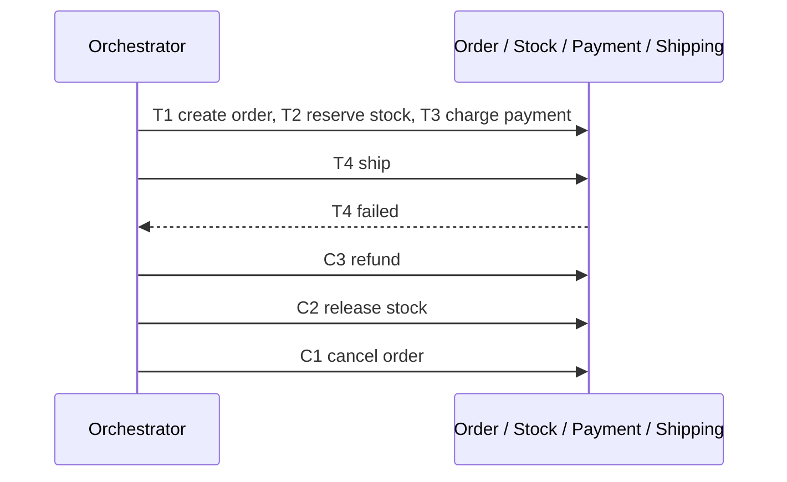

## 1. Core Concept

When a business operation spans **several services, each with its own DB**, there is no longer an **ACID transaction** across services. A **Saga** solves this by splitting the operation into **a chain of local transactions**; if a step fails, it runs **compensating transactions** to **undo the completed steps in business terms**. A saga guarantees **eventual consistency** and has **no** isolation (the I in ACID).

**Mental model:** like **booking a package tour**: book the flight → the hotel → a rental car. If the car rental fails, you **cannot "roll back" as if nothing happened**; you must **cancel the hotel and refund the ticket** — compensating actions that can cost fees, take time, and during which **others may see the half-finished state**.

## 2. How It Works

**Why not 2PC**
- **Two-Phase Commit** (prepare, then commit) **locks resources and blocks** when the coordinator dies, is **not feasible** across different services/DBs/brokers, lowers availability and **does not scale**. A saga trades **isolation** for **availability and autonomy**.

**A chain of local transactions + compensation**
- Order example: **T1** create the order → **T2** reserve stock → **T3** charge payment → **T4** ship. Each step has a **compensation**: **C1** cancel the order, **C2** release stock, **C3** refund. If **T4 fails**, run **C3 → C2 → C1** in reverse order.
- **Compensations must be idempotent and retryable** (safe to run many times) because they can fail too; they are a **semantic undo** (a refund, not deleting the payment record). Some steps are **not compensable** (sending an email) → put them **last**. The **pivot transaction** is the step that decides "go forward or not"; the steps after it are **retriable** (they must succeed).

**Choreography vs Orchestration**
- **Choreography**: each service reacts to an event and emits the next (no center; hard to follow). **Orchestration**: a **saga orchestrator** (a state machine) commands each step and compensation — **easy to understand and observe**, with a central component that needs HA.

**Lack of isolation → Anomalies and countermeasures**
- Because steps commit locally right away, other transactions may **see half-finished data** (dirty read) or **overwrite** (lost update). **Countermeasures**: a **semantic lock** (a `PENDING` flag on the record), **commutative updates**, a **pessimistic view** (reordering steps to reduce risk), **reread value**, **versioning**, **by-value** (choose the level of protection by risk).

**Saga durability**
- Saga state must be **stored durably** to survive crashes: use a **state table + outbox** or **durable execution** (**Temporal**, **AWS Step Functions**) that stores progress, retries, timeouts and compensation for you. Use a **correlation id** for tracking.

```python
saga = [("create_order", "cancel_order"), ("reserve_stock", "release_stock"),
        ("charge_payment", "refund_payment"), ("ship", None)]
done = []
for step, compensate in saga:
    try: run(step); done.append(compensate)
    except Exception:
        for comp in reversed(done):          # compensate in reverse order
            if comp: run_with_retry(comp)    # idempotent, retried
        raise
```

## 3. Visual Diagram



## 4. Rules of Thumb & Trade-offs

| Situation / Need | What to choose |
| --- | --- |
| A business operation across services with separate DBs | Saga |
| Few steps, loose | Choreography |
| Many steps needing clear tracking and compensation | Orchestration |
| Durability and automatic retries | Durable execution (Temporal/Step Functions) |
| Avoid reading half-finished data | Semantic lock (`PENDING`) |
| Within a single DB | An ordinary ACID transaction |

- **What you gain:** cross-service eventual consistency, high availability. **What you lose:** **no isolation**, compensation must be designed for every step, complexity and hard testing; not everything can be compensated.

## 5. Must Remember / Production Pitfalls

- **A saga gets stuck halfway after a crash → state is not durable → store state + outbox or use durable execution**.
- **A compensation runs twice and double-refunds → not idempotent → idempotency keys, check the state before compensating**.
- **A user sees an order "stock reserved" and then it vanishes → lack of isolation → a semantic lock (PENDING), notify about intermediate states**.
- **A compensation fails and nobody knows → no monitoring → retries with backoff, alerts, a DLQ for manual intervention**.
- **A non-compensable step (sending an email) placed first → cannot be undone → put it last after the pivot**.
- Interview trap: "Why not 2PC between microservices?" → **it blocks, the coordinator is a single point of failure, it does not scale and does not support many systems**; "Does a saga have isolation?" → **no, you need countermeasures like semantic locks**; "How does compensation differ from rollback?" → **compensation is a semantic undo via a new transaction, it does not erase history**.

## 6. Search Hooks

- `saga pattern microservices` — cross-service transactions via a chain of local transactions.
- `compensating transaction` — semantically undoing completed steps.
- `two-phase commit vs saga` — why 2PC does not suit microservices.
- `saga isolation countermeasures semantic lock` — dealing with the lack of isolation.
- `durable execution Temporal` — durably storing saga progress.
- `choreography vs orchestration` — two ways to coordinate a saga.
