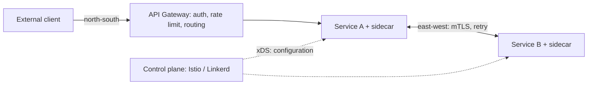

## 1. Core Concept

An **API Gateway** and a **service mesh** are both infrastructure layers that handle **cross-cutting** concerns (authentication, encryption, retries, rate limiting, observability) so you **do not rewrite them in every service**, but they work on **two different traffic directions**: the **gateway handles "north–south"** (external clients → the system) and the **mesh handles "east–west"** (service ↔ service inside). Understanding this boundary avoids using the wrong tool and unnecessary complexity.

**Mental model:** the gateway is **the building's reception desk and security gate** (it checks outside visitors, directs them to the right room, limits entries); the mesh is **the elevators, key cards and cameras inside the building** (everyone moving between rooms is authenticated, recorded and routed).

## 2. How It Works

**API Gateway → North–south**
- The single entry point for clients: **authentication/authorization (JWT, OAuth)**, **rate limiting**, **TLS termination**, **routing** by path/host, **versioning**, **caching**, **request transformation/aggregation**, hiding the internal architecture. Examples: Kong, AWS API Gateway, Apigee, Envoy Gateway. **Do not put business logic in the gateway.**

**Backend for Frontend (BFF)**
- Each client type (web, mobile) gets **its own backend** that aggregates data to its exact needs (reducing over/under-fetching and giving frontend teams autonomy) instead of one shared "one size fits all" gateway.

**Service mesh → East–west through sidecars**
- Each Pod has a **sidecar proxy (Envoy)** intercepting all inbound/outbound traffic → the mesh provides **mTLS**, **retries/timeouts**, **circuit breaking**, **advanced load balancing**, **traffic shifting**, **telemetry (metrics/traces)** **without changing application code**. The **control plane** (Istio `istiod`, Linkerd) distributes configuration to the **data plane** (the proxies) over **xDS**. There is an **ambient mesh** model (no sidecars) to reduce cost.

**Automatic mTLS**
- Each workload has an **identity (SPIFFE)** and a **short-lived, auto-rotated certificate**; the two sides **authenticate each other** and encrypt internal traffic → the foundation of **zero trust**, along with policies such as "service A may call B".

**Canary and traffic shifting**
- Split traffic by **weight** (90% old / 10% new) or by **header/user**, increase gradually if the metrics look good, **roll back instantly** if they look bad — low-risk deployment.

**The price of a mesh**
- Added **per-hop latency** (a few milliseconds), **RAM/CPU per sidecar**, **operational complexity** and harder debugging. With few services, a library (Resilience4j) + a gateway is usually **enough**.

```yaml
# Istio: a 90/10 canary by weight
apiVersion: networking.istio.io/v1
kind: VirtualService
metadata: { name: reviews }
spec:
  hosts: [reviews]
  http:
  - route:
    - { destination: { host: reviews, subset: v1 }, weight: 90 }
    - { destination: { host: reviews, subset: v2 }, weight: 10 }
```

## 3. Visual Diagram



## 4. Rules of Thumb & Trade-offs

| Situation / Need | What to choose |
| --- | --- |
| Authentication, rate limiting, routing for external clients | API Gateway |
| Encryption and authentication between services, uniform retry/timeout | Service mesh |
| Each client type needs different data | BFF |
| Canary/traffic shifting without code changes | Mesh (or a gateway/ingress with weights) |
| Few services, a small team | A resilience library + a gateway, no mesh yet |
| Sidecar cost too large | Ambient mesh |

- **What you gain:** uniform policy, security and observability without code changes. **What you lose:** an extra hop/latency, resources, operational complexity; the gateway/mesh is a **potential point of failure** that needs HA.

## 5. Must Remember / Production Pitfalls

- **Business logic piles up in the gateway → the gateway becomes a bottleneck that every team edits → the gateway handles only cross-cutting concerns, logic stays in services**.
- **The gateway is a single point of failure → running one instance → several instances behind an LB, multi-AZ HA**.
- **Using a mesh for 5 services → cost/complexity outweigh the benefit → use a library + gateway until you need it**.
- **Retrying in both the mesh and the application → doubled load (retry amplification) → retry at one layer, a retry budget**.
- **mTLS is on but certificates expire and cause errors → rotation is not automatic → let the control plane manage short-lived auto-rotated certificates**.
- Interview trap: "Gateway vs mesh?" → **the gateway handles north–south (client → system), the mesh handles east–west (service ↔ service)**; "What does a sidecar do?" → **an Envoy proxy intercepts traffic to provide mTLS/retries/telemetry**; "What is a BFF?" → **a dedicated backend for each frontend type**.

## 6. Search Hooks

- `API gateway vs service mesh` — north–south versus east–west.
- `sidecar proxy Envoy` — a proxy intercepting traffic beside each service.
- `Istio Linkerd control plane` — the mesh's control plane.
- `mTLS mutual TLS service mesh` — two-way authentication between services.
- `canary deployment traffic shifting` — gradually shifting traffic to a new version.
- `backend for frontend BFF` — a dedicated backend for each client type.
