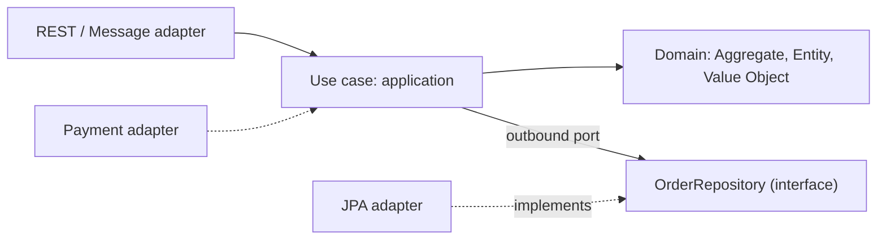

## 1. Core Concept

**Clean/Hexagonal Architecture** puts **business logic (the domain) at the center**, independent of frameworks, DB and UI; technical details plug in through **ports/adapters**. **DDD** (Domain-Driven Design) adds a way to **model the domain** with Entities, Value Objects, Aggregates and a shared language. Both solve: **the business is not tied to technology**, so it is easy to test, easy to swap the DB/framework and does not become a "big ball of mud".

**Mental model:** the domain is **the core of an onion**; the outer layers (use cases, adapters, frameworks) wrap around it. **Dependency arrows always point inward**: the core knows nothing about the outer layers. A DB or REST is just **a replaceable detail**.

## 2. How It Works

**The Dependency Rule**
- Code **only depends inward**: infrastructure → application → domain. The core defines **interfaces (ports)** like `OrderRepository`; adapters outside (JPA, REST) **implement** them (Dependency Inversion). Result: you test the domain **without a DB/Spring**.

**Hexagonal (Ports & Adapters)**
- **Inbound ports** (driving): use cases that the outside calls (a REST controller, a message listener). **Outbound ports** (driven): what the core needs (a repository, sending email, a payment gateway). An **adapter** is the concrete implementation of each port.

**Entity vs Value Object**
- **Entity**: has an **identity** (`orderId`), equal by id, with a changing lifecycle. **Value Object**: **no id**, **immutable**, equal by **value** (`Money(100,"USD")`, `Address`), so it validates itself at creation. Prefer Value Objects to avoid "primitive obsession".

**Aggregate and Aggregate Root**
- An **aggregate** is a cluster of objects treated as **one consistent unit**, and the **root** is the only gateway for changes and protects the **invariants** (total = sum of lines). Rules: **one transaction = one aggregate**, reference other aggregates **by id**, keep aggregates **small**. Access through a **repository** per root.

**Anemic Domain Model**
- Entities have only getters/setters and logic piles up in "services" → **OOP loses its meaning**, invariants are scattered and easily violated. A **rich domain model**: behavior lives in entities/aggregates (`order.addItem()`, `order.pay()`), with non-public setters.

**Bounded Context and Ubiquitous Language**
- Each **bounded context** has **its own model and terms** (Customer in Sales ≠ Customer in Billing); boundaries often correspond to a **microservice**. **Ubiquitous language**: developers and domain experts use the same terms, reflected in the code.

```java
public class Order {                                  // Aggregate Root: protects invariants
    private final OrderId id; private final List<OrderLine> lines = new ArrayList<>();
    private Status status = Status.DRAFT;
    public void addLine(ProductId p, int qty, Money price) {
        if (status != Status.DRAFT) throw new IllegalStateException("Order is locked");
        if (qty <= 0) throw new IllegalArgumentException("qty");
        lines.add(new OrderLine(p, qty, price));
    }
    public Money total() { return lines.stream().map(OrderLine::subtotal).reduce(Money.ZERO, Money::plus); }
}
```

## 3. Visual Diagram



## 4. Rules of Thumb & Trade-offs

| Situation / Need | What to choose |
| --- | --- |
| Complex, long-lived business logic | Clean/Hexagonal + DDD |
| Simple CRUD | Not needed; avoid over-engineering |
| A measured value (money, address) | An immutable Value Object |
| Need to protect invariants | Aggregate Root, one transaction per aggregate |
| Many teams, different terminology | Bounded Context |
| A domain with only getters/setters | Move to a rich domain model |

- **What you gain:** a domain that is easy to test, painless technology swaps, clear business logic. **What you lose:** many layers, mapping between layers, a high start-up cost; not worth it for a small CRUD application.

## 5. Must Remember / Production Pitfalls

- **The domain imports framework/DB annotations → leaking dependencies → keep the domain pure, map in the adapter**.
- **One transaction changes several aggregates → wide locks, hard to scale → one transaction per aggregate, eventual consistency via domain events**.
- **An aggregate that is too large (loading the whole tree) → slow, conflicts → keep it small, reference by id**.
- **A service holds all the logic and entities only have setters → anemic → move behavior into the aggregate**.
- **One model shared across several contexts → ambiguity, coupling → bounded contexts + an anti-corruption layer**.
- **Applying full DDD to CRUD → needless complexity → use it only at the complex business core**.
- Interview trap: "the dependency rule?" → **dependencies only point inward**; "entity vs value object?" → **an identity vs immutable by value**; "what is an aggregate root for?" → **protecting invariants, the only gateway to change the aggregate**.

## 6. Search Hooks

- `Hexagonal architecture ports and adapters` — the domain at the core, adapters plugged in outside.
- `Clean Architecture dependency rule` — dependencies point inward.
- `DDD aggregate root` — the consistency unit protecting invariants.
- `Entity vs Value Object` — identity versus immutable value.
- `anemic domain model` — the anti-pattern lacking behavior.
- `bounded context DDD` — the boundary of a model and its terms.
