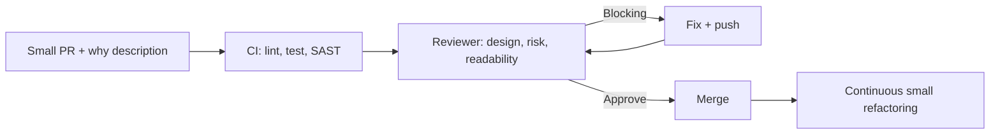

## 1. Core Concept

**Code review** is the mechanism for **sharing understanding and catching bugs before merge**; **refactoring** is **improving structure without changing external behavior**, done in **small steps protected by tests**. Both address **accumulated technical debt** and the risk of "only one person understands this code". The goal of review is **quality & knowledge sharing**, not catching trivial mistakes or showing off.

**Mental model:** code review is like **two people checking the blueprint before pouring concrete**; refactoring is like **tidying the kitchen while cooking**: clean a little, often, without halting the whole kitchen for a deep clean.

## 2. How It Works

**Effective review**
- **Small PRs** (< ~400 lines; review quality drops sharply on big PRs), **one purpose**, describing **why** and not only what. Reviewers prioritize in this order: **design/correctness → security/risk → readability/maintainability → style** (leave style to a **linter/formatter**). Feedback is **specific and polite**, classified as **blocking** versus **nit**. **Automate** what machines can do (lint, tests, SAST) so people focus on what needs judgment.

**Code smells and the refactoring catalog**
- **Smells**: signs of poor structure such as **long method**, **large class**, **duplicate code**, **feature envy**, **shotgun surgery** (one change requires edits in many places), **primitive obsession**, **long parameter list**. Tools: **Extract Method**, **Extract Class**, **Rename**, **Replace Conditional with Polymorphism**, **Introduce Parameter Object**, **Move Method**.

**Refactoring safely**
- Have **covering tests** (if not: first write **characterization tests** that capture current behavior), take **small** steps, run tests after each step, **separate refactoring commits from behavior-changing commits** (easier for reviewers). IDE tooling automates safe refactorings.

**The Boy Scout Rule and technical debt**
- **Boy Scout Rule**: leave the code **cleaner than you found it** (small cleanups within the scope you are editing). **Technical debt**: a deliberate (prudent) or accidental shortcut; it has **"interest"** that makes every later change slower. Record it, **prioritize by impact** (frequently changed areas), set aside a regular share of time; no big rewrites.

**Reviewing AI-generated code**
- AI writes fast but **syntactically correct is not necessarily business-correct**. Watch for: **invented APIs/libraries** (hallucination), **skipped edge cases and error handling**, **security holes** (SQL injection, hard-coded secrets), **duplication**, **tests that only assert the obvious**. Rules: **the submitter is responsible for understanding every line**; run and read the tests; ask for a design explanation.

```diff
- if (order.status == 1 || order.status == 2) { total = order.sum * 0.9; }
+ // Refactor: Replace magic number + Extract Method (behavior unchanged, tests unchanged)
+ if (order.isEligibleForDiscount()) { total = order.discountedTotal(); }
```

## 3. Visual Diagram



## 4. Rules of Thumb & Trade-offs

| Situation / Need | What to choose |
| --- | --- |
| A very large PR | Split it, stacked PRs |
| Arguments over style | A linter/formatter, no hand debates |
| Old code without tests | Characterization tests, then refactor |
| Accumulated technical debt | Boy Scout + a regular time budget |
| AI-generated code | Review edge cases, security and that APIs really exist |
| Changing structure and behavior | Separate refactor and feature commits |

- **What you gain:** fewer bugs, shared knowledge, maintainable code. **What you lose:** review takes time and can become a bottleneck; over-eager refactoring without tests is risky.

## 5. Must Remember / Production Pitfalls

- **A 2,000-line PR gets an instant "LGTM" → too large to read closely → split it, cap the size**.
- **A long style argument → no automated standard → a formatter/linter in CI**.
- **A refactor breaks behavior → no protecting tests → characterization tests, small steps**.
- **One change needs edits in many places → shotgun surgery/duplication → gather the logic in one place**.
- **Merging AI code nobody understands → business/security bugs → the submitter must understand and explain each part**.
- **Slow reviews block the whole team → no SLA → aim to respond within ~1 working day, share review load**.
- Interview trap: "what is refactoring?" → **changing structure, not behavior, with tests**; "what do reviews prioritize?" → **design and correctness first, style after (automated)**; "how is technical debt handled?" → **record it, prioritize by impact, pay it down gradually**.

## 6. Search Hooks

- `code review best practices` — effective review practices.
- `code smells refactoring catalog` — signs of bad code and how to fix them.
- `Boy Scout Rule technical debt` — continuous small cleanups and managing technical debt.
- `characterization tests` — tests that capture current behavior before refactoring.
- `reviewing AI-generated code` — what to check when AI writes the code.
- `shotgun surgery feature envy` — common smells.
