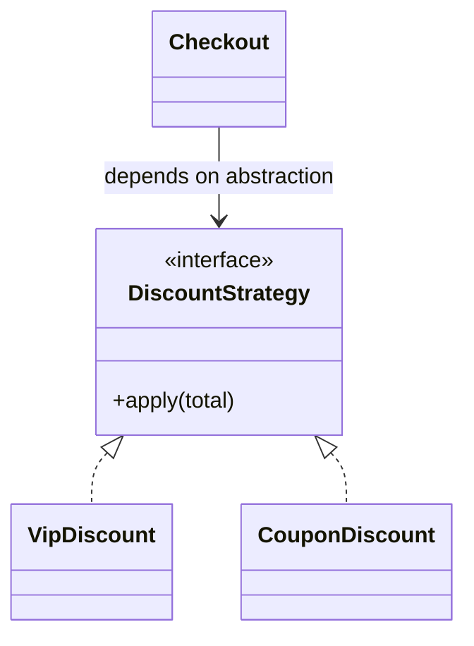

## 1. Core Concept

**SOLID** is five object-oriented design principles that make code **easy to change without breaking**; **design patterns** are recurring solutions to familiar design problems (Strategy, Factory, Observer, Decorator…). They address the **cost of change**: good code is code where **a new requirement only needs additions, not edits to the old parts**. But applying them wrongly (abstracting too early) is worse than not applying them.

**Mental model:** like **a standard electrical outlet**: a device (module) plugs in through **a fixed interface (an abstraction)**, and swapping the device does not require chiseling the wall (editing core code). But do not install outlets everywhere when nobody needs to plug anything in yet.

## 2. How It Works

**Pragmatic SOLID**
- **S** (Single Responsibility): a class has **one reason to change** (not "does one thing"). **O** (Open/Closed): **extend without modifying** — add behavior with new code. **L** (Liskov): a subclass **can replace** its parent without breaking the contract (a square inheriting from a rectangle is the counterexample). **I** (Interface Segregation): **small interfaces shaped by client needs**, not forcing implementation of unused methods. **D** (Dependency Inversion): high-level modules **depend on abstractions**, not on concrete implementations.

**Dependency Injection vs Dependency Inversion**
- **Inversion** is a **principle** (depend on abstractions). **Injection** is a **technique** of passing dependencies in from outside (via the constructor) instead of calling `new` yourself. Injection helps achieve inversion and makes code **easy to test** (pass in fakes).

**Strategy pattern**
- Encapsulates **interchangeable algorithms** behind an interface, chosen at runtime → replacing `if/else`/`switch` chains by type (discount types, payment gateways). Adding a new strategy = adding a class (Open/Closed).

**Composition over inheritance**
- Inheritance creates **tight coupling** (fragile base class) and rigid structure. **Composition** assembles behavior from small objects (has-a) → flexible, changeable at runtime. Use inheritance only when it is truly **is-a** and stable.

**Rule of Three and the wrong abstraction**
- **Rule of Three**: wait for **the third repetition** before abstracting. Abstracting early from **two examples** usually guesses the axis of variation wrong → **"duplication is far cheaper than the wrong abstraction"**: afterward everyone bends the abstraction with flags/parameters.

```java
interface DiscountStrategy { Money apply(Money total); }
class Vip implements DiscountStrategy { public Money apply(Money t){ return t.times(0.9); } }
class Coupon implements DiscountStrategy { public Money apply(Money t){ return t.minus(Money.of(5)); } }

class Checkout {                                   // depends on the abstraction, received via the constructor
    private final DiscountStrategy discount;
    Checkout(DiscountStrategy d) { this.discount = d; }
    Money total(Money cart) { return discount.apply(cart); }
}
```

## 3. Visual Diagram



## 4. Rules of Thumb & Trade-offs

| Situation / Need | What to choose |
| --- | --- |
| Many algorithm variants, chosen at runtime | Strategy |
| Need fakes when testing | Dependency Injection |
| Sharing behavior between classes that are not truly is-a | Composition |
| You have only seen the second repetition | Accept the duplication, wait for the third |
| An interface keeps ballooning | Interface Segregation |
| A subclass breaks its parent's contract | Revisit Liskov, use composition |

- **What you gain:** localized change, easy testing, safe extension. **What you lose:** more classes/indirection, hard to read if abstracted too early or needlessly.

## 5. Must Remember / Production Pitfalls

- **Every new requirement means editing a `switch` in many places → an Open/Closed violation → Strategy/polymorphism**.
- **An abstraction full of boolean flags/optional parameters → the wrong abstraction → inline it again, duplicate and then abstract correctly**.
- **A subclass throws `UnsupportedOperationException` → a Liskov violation → split the interface/use composition**.
- **A "God class" doing everything → an SRP violation → split by reason to change**.
- **A deep inheritance tree is hard to change → a fragile base class → composition**.
- **Patterns applied everywhere → over-engineering → start simple, refactor when a real need appears**.
- Interview trap: "DI vs DIP?" → **DIP is a principle, DI is the technique of injecting dependencies**; "what does SRP mean?" → **one reason to change**; "when to abstract?" → **the Rule of Three**.

## 6. Search Hooks

- `SOLID principles` — the five object-oriented design principles.
- `Strategy pattern` — interchangeable algorithms behind an interface.
- `dependency injection vs dependency inversion` — a technique and a principle.
- `composition over inheritance` — preferring composition to inheritance.
- `Liskov substitution principle` — a subclass can replace its parent.
- `wrong abstraction rule of three` — avoiding abstracting too early.
