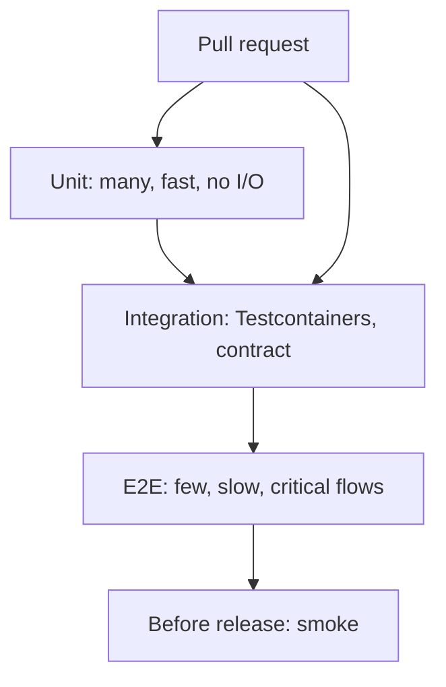

## 1. Core Concept

The **test pyramid** says to have **many fast unit tests, a moderate number of integration tests and few E2E tests**: the higher you go the **slower, costlier and flakier**, but the closer to real behavior. The goal of a test strategy is not "high coverage" but **fast, trustworthy feedback** when code changes, at low maintenance cost.

**Mental model:** like **car quality inspection**: checking each bolt (unit) is very fast and cheap; assembling the engine and test-running it (integration) is slower; driving the whole car on the road (E2E) is the most trustworthy but expensive, slow and easily disturbed by the weather. You want to **catch defects at the cheapest level possible**.

## 2. How It Works

**Three levels**
- **Unit**: one function/class, **no I/O**, milliseconds, thousands per minute. **Integration**: several real components (DB, queue) — often using **Testcontainers** to run a real DB in Docker. **E2E**: the whole system through the UI/API, slow (seconds–minutes), kept only for **critical flows** (sign-in, payment).
- Variants: the **testing trophy** (more integration when logic lives in the "glue"), the **honeycomb** for microservices.

**Test doubles**
- **Stub** (returns fixed data), **Mock** (verifies interactions), **Fake** (a genuine simple implementation such as an in-memory DB), **Spy** (records calls). **Too many** mocks tie tests to the implementation (brittle): a refactor breaks tests even though behavior is unchanged. Prefer **verifying behavior/results** over internal calls.

**Consumer-Driven Contract Testing (Pact)**
- With microservices, whole-system E2E is slow and flaky. A **consumer** describes "I need a response of this shape" as a **contract**; the **provider** runs the contract in its own CI. It detects **incompatible APIs before deployment** without standing up the whole environment.

**Flaky tests**
- Tests that sometimes pass and sometimes fail without a code change: **dependence on time/order/network**, shared data, race conditions, fixed sleeps. Flakiness **destroys trust** in CI → the team ignores red. Remedies: **isolate data**, a **controllable clock**, wait on conditions instead of `sleep`, **quarantine** and then fix quickly, measure the flake rate.

**Mutation and property-based testing**
- **Mutation testing** (PIT, Stryker): deliberately **alters code** (changing `>` to `>=`) and sees whether tests detect it → measuring **assertion quality**, not just coverage. **Property-based** (Hypothesis, fast-check): generates **many random inputs** to check a **property** that always holds (for example `decode(encode(x)) == x`), and **shrinks** to the smallest failing example.

```python
# Property-based: a round-trip property instead of a few fixed examples
from hypothesis import given, strategies as st

@given(st.text())
def test_roundtrip(s):
    assert decode(encode(s)) == s
```

## 3. Visual Diagram



## 4. Rules of Thumb & Trade-offs

| Situation / Need | What to choose |
| --- | --- |
| Pure business logic | Unit tests |
| DB queries, repositories, serialization | Integration (a real DB via Testcontainers) |
| Microservices depending on each other | Consumer-driven contracts |
| Life-critical flows (payment) | A few E2E smoke tests |
| High coverage yet bugs still slip through | Mutation testing |
| A function with many boundary inputs | Property-based |

- **What you gain:** fast feedback, confidence to refactor. **What you lose:** integration/E2E are slow and costly to maintain; excessive mocking makes tests brittle; mutation testing takes run time.

## 5. Must Remember / Production Pitfalls

- **CI is randomly red and the team ignores it → flaky tests → quarantine, isolate data, a fake clock, drop `sleep`**.
- **A small refactor breaks dozens of tests → mocks verify implementation details → verify behavior/results, use fakes**.
- **90% coverage but bugs persist → weak/no assertions → mutation testing, review assertions**.
- **The E2E suite takes 40 minutes → too many E2E tests → push down to integration/contract**.
- **Tests use a mocked DB but a query fails in prod → the mock does not catch real SQL → integration with a real DB**.
- **Tests depend on run order → shared data → each test sets up/cleans up its own data**.
- Interview trap: "why a pyramid?" → **cost and speed rise with each level, catch defects at the cheapest level**; "mock vs fake?" → **a mock verifies interactions, a fake is a genuine simple implementation**; "is high coverage enough?" → **no, you need assertion quality (mutation)**.

## 6. Search Hooks

- `test pyramid unit integration e2e` — the layered test strategy.
- `test doubles mock stub fake spy` — the kinds of test doubles.
- `consumer-driven contract testing Pact` — checking API contracts between services.
- `flaky tests` — unstable tests and how to handle them.
- `mutation testing PIT Stryker` — measuring assertion quality.
- `property-based testing Hypothesis` — checking properties with randomly generated inputs.
