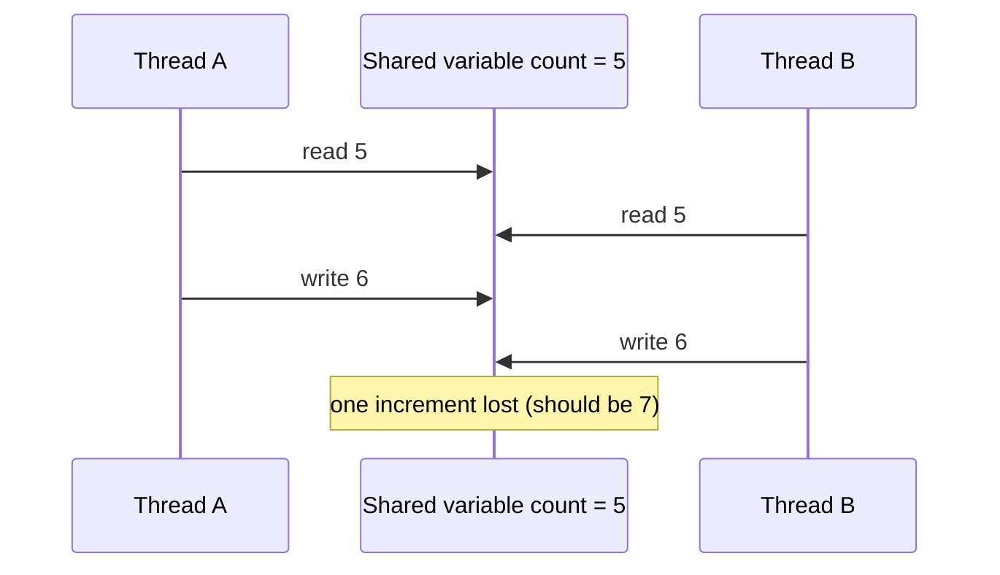

## 1. Core Concept

**Concurrency** is handling many tasks that overlap in time (possibly interleaved on a single core), while **parallelism** is truly running at the same time on multiple cores. When several threads **share mutable data**, the result depends on **a lucky execution order** — causing **race conditions**, **deadlocks** and memory-visibility bugs. These bugs are **hard to reproduce and debug** and often only show up in production under high load.

**Mental model:** several chefs sharing **one recipe book and one storage shelf**: if two of them read the salt count as "1 packet left" and both take it, the stock goes negative (a race condition); if A holds the knife waiting for the board while B holds the board waiting for the knife, they **stand still forever** (a deadlock).

## 2. How It Works

**Race condition → Check-then-act and read-modify-write**
- **Check-then-act**: check a condition and then act, but the state changes between the two steps (`if (balance >= x) balance -= x`). **Read-modify-write**: `counter++` is really read, add, write — two threads read the same value `5` and both write `6` → **one increment is lost**. Fix with a **lock (mutex)**, an **atomic operation** or **immutability/no sharing**.

**Deadlock → The four Coffman conditions**
- All must hold **simultaneously**: **mutual exclusion** (exclusive resources), **hold and wait** (holding one lock while waiting for another), **no preemption** (cannot be taken back), **circular wait** (a cycle of waiting). Breaking **one** condition ends the deadlock: in practice **always acquire locks in the same global order**, use **timeouts/tryLock**, or reduce nested locks. There are also **livelock** (endlessly yielding to each other) and **starvation** (resource starvation).

**Compare-and-Swap (CAS) → Lock-free**
- An atomic CPU instruction: "if the current value is `A` then set it to `B`", returning success/failure; a **retry** loop on failure. The basis of `AtomicInteger` and lock-free queues. Beware the **ABA problem** (the value changes `A→B→A` and CAS does not notice).

**Happens-before and memory visibility**
- Compilers and CPUs **reorder instructions** and each core has its **own cache**, so a thread **is not guaranteed to see** another thread's write. The **memory model** defines **happens-before**: `volatile`/atomics (Java), `synchronized`/unlock–lock, acquire/release guarantee that earlier writes are **visible** to later threads. Without synchronization → a **data race** (undefined behavior).

**Optimistic vs pessimistic locking**
- **Pessimistic**: lock before modifying (`SELECT ... FOR UPDATE`) — safe under **high contention**, but reduces parallelism and risks deadlock. **Optimistic**: no lock, check the **version** on write (`UPDATE ... WHERE version = ?`) and **retry** if it changed — suited to **low contention**, high throughput.

**The actor model and message passing**
- Each **actor** owns its own state, communicates only via **immutable messages** and processes them **sequentially**, so no locks are needed (Erlang/Akka). The philosophy: **"do not communicate by sharing memory; share memory by communicating"**.

**Tools**
- Race detectors (`go test -race`, ThreadSanitizer), thread dumps to see deadlocks, tests with many threads and load.

```java
// Wrong: check-then-act is not atomic
if (stock > 0) { stock--; }          // two threads both see stock = 1 → negative stock

// Right: atomic with CAS
AtomicInteger stock = new AtomicInteger(1);
boolean ok = stock.updateAndGet(s -> s > 0 ? s - 1 : s) >= 0;  // or use compareAndSet
```

## 3. Visual Diagram



## 4. Rules of Thumb & Trade-offs

| Situation / Need | What to choose |
| --- | --- |
| Avoid sharing state | Immutability, thread confinement, actors |
| A simple counter/flag | Atomic / CAS |
| Protect a multi-step critical section | Mutex / lock |
| Low contention, high throughput | Optimistic locking + retry |
| High contention | Pessimistic locking |
| Avoid deadlock | A fixed lock order, tryLock with timeout |
| Detect races | Race detector, stress tests |

- **What you gain:** using many cores, handling work concurrently. **What you lose:** complexity, hard-to-reproduce bugs; locks reduce parallelism and can deadlock; lock-free code is hard to get right.

## 5. Must Remember / Production Pitfalls

- **Occasionally wrong numbers (undercounts, negative stock) → read-modify-write/check-then-act is not atomic → atomics or locks, or a constraint in the DB**.
- **The system hangs under load and a thread dump shows threads waiting on each other → a deadlock from different lock orders → a fixed lock order, timeouts**.
- **One thread does not see another thread's update → missing happens-before (a non-volatile flag) → volatile/atomic/proper synchronization**.
- **Optimistic locking retries forever under high contention → throughput falls → cap retries, switch to pessimistic for hot spots**.
- **Only tested single-threaded so the bug is invisible → the bug shows only when threads overlap → stress tests and a race detector**.
- Interview trap: "the four deadlock conditions?" → **mutual exclusion, hold and wait, no preemption, circular wait**; "is `count++` safe?" → **no, it is read-modify-write**; "optimistic or pessimistic?" → **optimistic for low contention, pessimistic for high**.

## 6. Search Hooks

- `race condition check-then-act` — bugs from a lucky execution order.
- `deadlock Coffman conditions` — the four conditions that cause deadlock.
- `compare-and-swap CAS lock-free` — atomic operations without locks.
- `happens-before memory model` — visibility guarantees between threads.
- `optimistic vs pessimistic locking` — two concurrency-control strategies.
- `actor model message passing` — concurrency without shared state.
