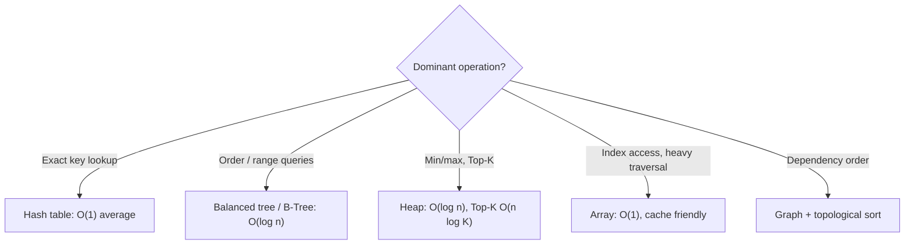

## 1. Core Concept

A **data structure** determines **the cost of each operation** (search, insert, delete, traverse) and **Big-O** describes **how that cost grows with input size `n`**. The right structure takes a query from **hours down to milliseconds**; the wrong one makes a system "work fine at 1,000 records and die at 1 million". This is the foundation for system design, reading DB query plans and interviews.

**Mental model:** Big-O is **a "steepness graph"** of cost: O(1) is a flat line, O(log n) nearly flat, O(n) rises steadily, **O(n²) is a cliff**. When data grows 1,000×, O(n) is 1,000× slower but O(n²) is **1,000,000×** slower.

## 2. How It Works

**Common Big-O → A feel for scale**
- **O(1)** constant, **O(log n)** (halving each step), **O(n)** linear, **O(n log n)** (good sorting), **O(n²)** (two nested loops), **O(2ⁿ)** (explosive). A modern machine does about **10⁸–10⁹ simple operations/second**: with **n = 10⁶**, O(n log n) ≈ 2·10⁷ operations (milliseconds) while **O(n²) = 10¹² operations (tens of minutes to hours)**. Remember to distinguish **average, worst and amortized cases**.

**Arrays and dynamic arrays**
- Access by index **O(1)**, insert/delete in the middle **O(n)** (shifting elements). A **dynamic array** (ArrayList, Python `list`) has **amortized O(1) append**: occasionally it reallocates at **double** size and copies (costing O(n)), but spread out each append is still O(1). **Cache locality**: contiguous data in memory lets the CPU traverse very fast — arrays often **beat linked lists** in practice despite the same complexity.

**Hash table (map/set)**
- Lookup/insert/delete **O(1) on average**, **O(n) worst case** under heavy collisions. **Collision handling**: chaining (a list per slot) or open addressing; when the **load factor** (usually ~0.75) is exceeded it **resizes/rehashes**. **Risks**: **hash flooding** (an attacker deliberately crafts keys with the same hash → O(n²)) → use a hash with a random seed; **mutable keys** (changing the value after insertion → it can no longer be found).

**Balanced trees and B-Trees**
- Lookup/insert **O(log n)** and **keep order** → support **range queries** and ordered traversal that a hash cannot. A **B-Tree** (many keys per node, low height) is optimized for **disk** — the foundation of **DB indexes**.

**Heaps and priority queues**
- Get min/max **O(1)**, insert/delete **O(log n)**. **Top-K**: use a **min-heap of size K**, scanning n elements → **O(n log K)** with only O(K) memory, better than a full sort O(n log n) when K ≪ n. Used for schedulers, merging K sorted lists.

**Graphs and topological sort**
- **BFS/DFS O(V + E)**. **Topological sort** orders the vertices of a **directed acyclic graph (DAG)** by dependency — used for **build order, task scheduling, prerequisite trees**; detecting a **cycle** catches circular dependencies.

**Others**
- A **Trie** (prefix search, autocomplete), a **Bloom filter** (an "maybe present/definitely absent" check, memory-efficient, with false positives but no false negatives).

```python
# Wrong: O(n*m) because `in` on a list is O(n)
common = [x for x in a if x in b_list]
# Right: O(n + m) thanks to a set (hash)
b = set(b_list); common = [x for x in a if x in b]

import heapq
top3 = heapq.nlargest(3, items)          # O(n log 3) instead of sorting everything
```

## 3. Visual Diagram



## 4. Rules of Thumb & Trade-offs

| Situation / Need | What to choose |
| --- | --- |
| Lookup by exact key | Hash map / set |
| Need order, range queries | Balanced tree / B-Tree |
| Top-K elements | A min-heap of size K |
| Index access, heavy traversal | Array / dynamic array |
| Dependency order (build, tasks) | Graph + topological sort |
| A memory-efficient existence check | Bloom filter |
| Small data (small n) | The simple approach, measure before optimizing |

- **What you gain:** the right structure for the right operation. **What you lose:** a hash trades **order** for speed; fast structures often cost **memory**; for small `n`, constants and cache locality matter more than Big-O.

## 5. Must Remember / Production Pitfalls

- **An API slows as data grows → an O(n) call inside a loop (`list.contains`, a DB query per iteration) becomes O(n²) → use a set/map, batch queries**.
- **A hash map under attack pins the CPU at 100% → hash flooding → a randomly seeded hash, limit the size/keys controlled by users**.
- **An inserted element can no longer be found → a mutable key was changed → use immutable keys**.
- **Sorting the whole set to get Top-K → O(n log n) and memory heavy → a min-heap of size K**.
- **A circular dependency hangs the build/scheduler → no cycle detection → topological sort and report cycle errors**.
- Interview trap: "is HashMap O(1) or O(n)?" → **O(1) on average, O(n) worst case under collisions**; "dynamic-array append?" → **amortized O(1)**; "array or linked list?" → **an array is usually faster thanks to cache locality**.

## 6. Search Hooks

- `Big-O notation time and space complexity` — how cost grows with n.
- `hash table collision resolution` — handling collisions in a hash table.
- `B-Tree vs balanced binary tree` — the structures behind indexes.
- `heap priority queue top-K` — getting priority elements and Top-K.
- `topological sort dependency graph` — ordering by dependencies.
- `amortized analysis dynamic array` — the average cost of append.
