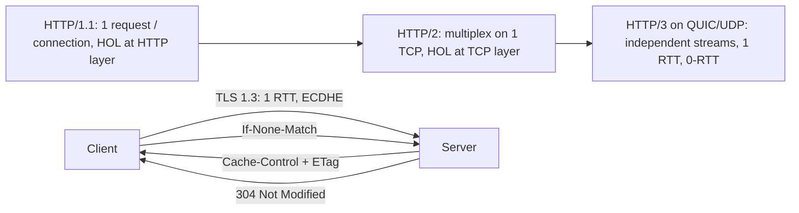

## 1. Core Concept

**HTTP** is the web's request–response protocol; **HTTPS** is HTTP running over **TLS** to provide **encryption, server authentication and integrity**. Understanding the evolution **HTTP/1.1 → HTTP/2 → HTTP/3**, the **TLS handshake**, **caching** and **status codes** helps you optimize performance and security and debug in the right place — especially with proxies, CDNs and load balancers in between.

**Mental model:** HTTP is **a letter written on a postcard** (anyone can read it); TLS is **a sealed envelope with a stamp verifying the sender**. HTTP/1.1 is **one counter serving one customer at a time**, HTTP/2 is **one counter with several windows sharing a single queue**, HTTP/3 is **separate counters so one jam does not jam the others**.

## 2. How It Works

**HTTP/1.1 vs HTTP/2 vs HTTP/3**
- **HTTP/1.1**: one request/response at a time per connection → **head-of-line blocking at the HTTP layer**; browsers open about **6 connections per host** to run in parallel. **HTTP/2**: **multiplexes** many streams over **one TCP connection**, with **header compression (HPACK)**; but a lost TCP packet still **blocks the whole connection (HOL at the TCP layer)**. **HTTP/3**: runs on **QUIC (UDP)**, **each stream recovers from loss independently**, **the TLS handshake is merged in (1 RTT, with 0-RTT)**, and **connection migration** (switching wifi ↔ 4G without dropping).

**TLS 1.3 handshake**
- **1 RTT** (TLS 1.2 needs 2 RTTs): the client sends a hello with a **key share (ECDHE)**, the server replies with the certificate + key share + `Finished`. **Forward secrecy** thanks to **ephemeral** session keys (a later leak of the long-term key cannot decrypt old traffic). **0-RTT resumption** saves another RTT but **can be replayed**, so use it only for safe/idempotent requests. **Certificates** are verified through the **CA chain**; **SNI** lets many domains share one IP; **ALPN** negotiates h2/h3.

**mTLS (mutual TLS)**
- **Both sides** present certificates to authenticate each other; used for **service-to-service** traffic (service mesh, zero trust), not for end users.

**HTTP caching → Reducing load and latency**
- **`Cache-Control: max-age=N`** (fresh for N seconds), **`no-cache`** (may be stored but **must be revalidated** before use), **`no-store`** (do not store), `public/private`, **`immutable`**. **Validators**: **`ETag`**/`If-None-Match` or `Last-Modified`/`If-Modified-Since` → the server returns **304 Not Modified** (without resending the body). **`Vary`** names the headers that affect the cache key. A good approach for static resources: **hashed file names + a long `max-age` + `immutable`**.

**Commonly confused status codes**
- **401** (unauthenticated/bad credentials) vs **403** (authenticated but **not permitted**). **502 Bad Gateway** (the proxy received an **invalid** response from the upstream) vs **503** (overloaded/maintenance) vs **504 Gateway Timeout** (the upstream **did not answer in time**). **301/308** (permanent redirect) vs **302/307** (temporary, 307/308 keep the method). **429** (rate limited), **409** (conflict), **422** (invalid data).

```bash
curl -I https://example.com/app.9f3c.js         # see Cache-Control, ETag
curl -sI --http3 https://example.com | head -1   # try HTTP/3 if curl supports it
openssl s_client -connect example.com:443 -servername example.com </dev/null | openssl x509 -noout -dates
```

## 3. Visual Diagram



## 4. Rules of Thumb & Trade-offs

| Situation / Need | What to choose |
| --- | --- |
| Many small resources on one origin | HTTP/2 (multiplexing) |
| Mobile networks, packet loss, network switching | HTTP/3 (QUIC) |
| Reduce load and latency for static files | A long Cache-Control + hashed files |
| Sensitive data that must not be cached | `no-store` |
| Mutual authentication between services | mTLS |
| The upstream does not answer in time | 504 (and check timeouts) |

- **What you gain:** performance, security, caching. **What you lose:** TLS costs CPU/handshakes (reduced by session resumption, TLS 1.3), HTTP/3 needs UDP support along the path, wrong caching serves stale data.

## 5. Must Remember / Production Pitfalls

- **Users see old JS/CSS after a deploy → a long cache without renaming files → hashed file names, a long `Cache-Control` for hashed files, short/`no-cache` for HTML**.
- **Confusing `no-cache` with `no-store` → sensitive data gets stored → `no-store` for sensitive data**.
- **An expired certificate takes the service down → no monitoring/automatic renewal → automate (ACME/Let's Encrypt, cert-manager), alert before expiry**.
- **Debugging the wrong layer on 502/504 → confusing proxy and upstream errors → 502 = the upstream replied wrongly, 504 = the upstream was too slow; check upstream logs and timeouts**.
- **Using 0-RTT for write operations → replayed → only for idempotent requests**.
- Interview trap: "401 vs 403?" → **401 unauthenticated, 403 authenticated but not permitted**; "502 vs 504?" → **the upstream replied wrongly vs the upstream did not reply in time**; "what problem does HTTP/2 still have that HTTP/3 solves?" → **HOL blocking at the TCP layer**.

## 6. Search Hooks

- `HTTP/1.1 vs HTTP/2 vs HTTP/3` — evolution and differences.
- `TLS 1.3 handshake` — the 1-RTT handshake and forward secrecy.
- `QUIC protocol` — the protocol underlying HTTP/3.
- `HTTP caching ETag Cache-Control` — validators and cache directives.
- `mTLS mutual TLS` — two-way authentication.
- `HTTP status codes 401 403 502 504` — the easily confused codes.
