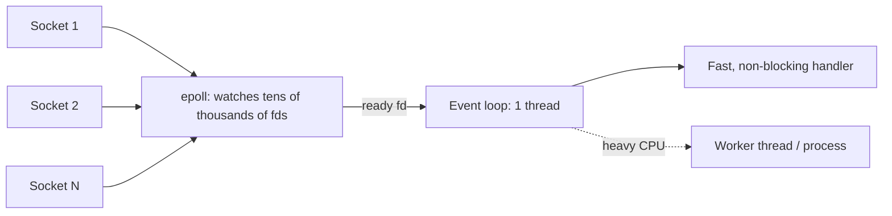

## 1. Core Concept

Servers usually spend **most of their time waiting on I/O** (network, disk). How a program **waits** decides **how many concurrent connections it can serve with how many resources**: the **thread-per-connection** model (one blocking thread per connection) is already heavy at a few thousand connections, while **I/O multiplexing + an event loop** (one thread watching tens of thousands of connections through `epoll`) solves the **C10K** problem. Understanding this model is the key to using async/await, Node.js, Netty, goroutines and virtual threads correctly.

**Mental model:** thread-per-connection is like **each customer having a dedicated waiter standing by until they order** (costly in staff, mostly standing idle). The event loop is like **a single waiter carrying a bell indicator**: when a table rings (a socket becomes ready) they rush over, serve quickly and come back — but **if that waiter gets absorbed in one long job, the whole restaurant waits**.

## 2. How It Works

**I/O models**
- **Blocking**: the thread **waits** until data arrives, doing nothing else. **Non-blocking**: the call **returns immediately** (even with no data yet) → you must ask again. **I/O multiplexing** (`select/poll/epoll/kqueue`): **one thread waits on many sockets**, the kernel reports **which sockets are ready** → the basis of the event loop. **True asynchronous I/O** (`io_uring`, IOCP): submit a request and the kernel **notifies you on completion**.

**epoll → Solving C10K**
- Thread-per-connection costs **~1 MB of stack per thread** (10,000 threads ≈ 10 GB of virtual memory) and heavy context switching. **`epoll`** lets one thread register tens of thousands of fds and only receive the list of **ready fds** (cost scales with the number of events, not the total number of connections) → serving **tens of thousands of connections** with a few threads.

**The event loop (Reactor pattern)**
- The loop: **wait for events** (`epoll_wait`) → **call the matching handler** → go back to waiting. It is the foundation of **Node.js (libuv)**, **Nginx** and Netty. **The golden rule: never block the event loop** — a **CPU-heavy** operation or **synchronous I/O** **freezes every other connection**. CPU-bound work must be pushed to **worker threads/processes**.

**async/await**
- Syntax that lets you write sequential-looking code that actually **yields the thread while waiting** (promises/futures). It **helps I/O-bound load** and does not make CPU-bound tasks faster.

**Virtual threads and goroutines → Blocking code, low cost**
- **Goroutines** (Go: an initial stack of **~2 KB**, growing as needed, an **M:N** scheduler) and **virtual threads** (Java 21) let you write **simple blocking code** that **parks extremely cheaply** while waiting for I/O and yields the real thread. **1 million goroutines ≈ 2 GB**, versus 1 million OS threads being impossible. The catch is to watch for **pinning/native blocking** which loses the advantage.

**Backpressure in reactive streams**
- When the producer is faster than the consumer, queues swell and memory runs out. **Reactive Streams** has **`request(n)`**: the consumer **signals how many items it wants**; combine with **bounded queues**, **drop/buffer/slow the producer**, **latency monitoring**.

```javascript
// Node.js: heavy CPU blocks the event loop → every other request hangs
app.get("/hash", (req, res) => {
  const h = crypto.pbkdf2Sync(pw, salt, 1e7, 64, "sha512"); // WRONG: blocks the loop
  res.send(h.toString("hex"));
});
// Right: pbkdf2 (asynchronous, runs on the thread pool) or worker_threads
```

## 3. Visual Diagram



## 4. Rules of Thumb & Trade-offs

| Situation / Need | What to choose |
| --- | --- |
| Tens of thousands of connections, mostly I/O | Event loop / epoll (Node, Netty, Nginx) |
| Want simple blocking code at large scale | Virtual threads / goroutines |
| CPU-heavy tasks | Worker threads/processes, not on the event loop |
| Few connections, complex logic | Thread-per-connection is still fine |
| The producer is faster than the consumer | Backpressure, bounded queues |
| I/O-bound load | async/await |

- **What you gain:** many concurrent connections with few resources. **What you lose:** a single-threaded event loop is easily blocked; callback/async code is harder to debug (stack traces); CPU-bound work gains nothing.

## 5. Must Remember / Production Pitfalls

- **A Node/Netty server suddenly freezes → a blocking or CPU-heavy operation on the event loop → push it to workers/a thread pool, avoid synchronous APIs**.
- **Using a blocking JDBC/driver inside the (reactive) event loop → blocks the loop → an asynchronous driver or run it on a separate pool**.
- **Memory runs out as load grows → unbounded queues, no backpressure → bounded queues, `request(n)`, monitor lag**.
- **Thread-per-connection collapses at a few thousand connections → each thread ~1 MB plus context switching → an event loop or virtual threads**.
- **Async does not speed up CPU-bound work → the model only helps when waiting → use more cores/processes for heavy CPU**.
- Interview trap: "what does epoll do?" → **one thread watches many sockets and only receives the ready ones**; "why not block the event loop?" → **one blocking job stalls every other connection**; "which load does async/await speed up?" → **I/O-bound**.

## 6. Search Hooks

- `blocking vs non-blocking I/O` — two ways to wait on I/O.
- `epoll kqueue I/O multiplexing` — one thread watching many sockets.
- `event loop reactor pattern` — the event loop of Node/Nginx.
- `C10K problem` — serving tens of thousands of concurrent connections.
- `virtual threads goroutines` — lightweight threads for large-scale blocking code.
- `reactive streams backpressure` — controlling producer and consumer speed.
