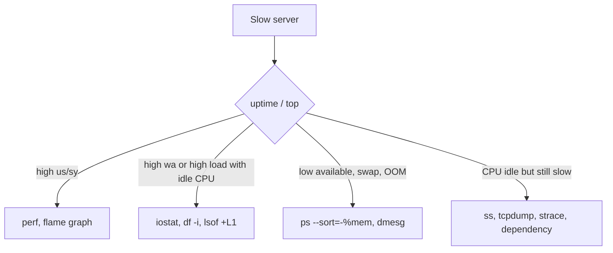

## 1. Core Concept

When production has an incident you usually have only **a shell on the server** and a few minutes to understand what is happening. The **Linux debugging toolbox** helps answer four questions quickly: **which resource is exhausted** (CPU, RAM, disk, network)? **which process is causing it**? **what is it doing** (syscalls, connections, files)? and **is data really crossing the network**? The backbone method is **USE** (Utilization, Saturation, Errors) applied to each resource, then digging into the suspect process.

**Mental model:** like **a doctor's examination**: measure vital signs first (temperature, blood pressure = uptime, top, free, iostat), narrow down the suspect organ (CPU/RAM/disk/network), and only then **look inside** (strace, perf, tcpdump). Do not "prescribe" (restart) before collecting **evidence**.

## 2. How It Works

**The 60-second routine → An overview**
- `uptime` (load average), `dmesg -T | tail` (OOM killer, hardware/driver errors), `vmstat 1` (CPU, memory, swap, I/O), `mpstat -P ALL 1` (per core), `pidstat 1` (per process), `iostat -xz 1` (disks), `free -m`, `sar -n DEV 1` (network), `ss -s`, `top`.

**CPU and load average**
- **Load average** (1/5/15 minutes) counts processes that are **runnable + waiting on uninterruptible I/O (state D)**; compare it with the **number of cores**. **High load but idle CPU** = many processes **waiting on I/O or locks**, not a CPU shortage. In `top`: `us/sy` (user/kernel), **`wa`** (high I/O wait = disk bottleneck), **`st`** (steal: the VM's CPU taken by the host), `id`. Find hot functions with **`perf top`/`perf record -g`** + **flame graphs**.

**Memory**
- Read the **`available`** column (not `free`; page cache is reclaimable memory); **rising swap** or `dmesg | grep -i oom` = out of RAM/the OOM killer. `ps aux --sort=-%mem`, `/proc/<pid>/status`.

**Disk**
- `df -h` (capacity) **and `df -i` (out of inodes)** — running out of inodes prevents creating files even with free space; `iostat -x` shows **`await`** (latency) and **`%util`** (with parallel SSD/NVMe, `%util` is less meaningful); `iotop`; **a deleted file still held open by a process keeps occupying space** (`lsof +L1`).

**Network**
- `ss -tulpn` (listening ports + processes), `ss -s` (counts ESTABLISHED/TIME_WAIT), `ip a`, `ping`, `mtr`, `dig`, `curl -v`, **`tcpdump -i any port 443 -w out.pcap`** to capture packets.

**Inspecting a process**
- `lsof -p <pid>` / `lsof -i :8080` (open files, sockets), **`strace -p <pid> -f -tt -T`** (syscalls + timing; `-c` to summarize) shows **what it is waiting on**, `/proc/<pid>/limits`, `jstack`/`py-spy dump` for specific languages, `journalctl -u <service> -f` for logs.

**eBPF → Low-intrusion observability**
- **bcc/bpftrace** run small programs in the kernel to trace syscalls, disk latency (`biolatency`), TCP connection lifecycle (`tcplife`), `execsnoop`… with **lower overhead** than `strace`.

```bash
# "The server is slow": a quick check in order
uptime; dmesg -T | tail -20; vmstat 1 5
free -m; df -h; df -i; iostat -xz 1 3
top -o %CPU -n 1 | head -15; ss -s
```

## 3. Visual Diagram



## 4. Rules of Thumb & Trade-offs

| Situation / Need | What to choose |
| --- | --- |
| A quick overview | The 60-second routine (uptime, vmstat, iostat, free, ss) |
| Find the hot CPU function | perf + flame graph |
| What a process is waiting on | strace -p (short-term) |
| Files/sockets a process has open | lsof |
| Are packets crossing the network | tcpdump |
| Deep, low-intrusion tracing | eBPF (bcc/bpftrace) |
| Cannot create files despite free space | df -i |

- **What you gain:** finding the bottleneck in minutes with evidence. **What you lose:** deep tools have **overhead** (strace slows a high-load process); collecting lots of metrics takes experience to read.

## 5. Must Remember / Production Pitfalls

- **High load but idle CPU → processes are stuck waiting on I/O (state D) or locks → `iostat`, the `vmstat` `b` column, `strace`; do not add CPU**.
- **Cannot create files although `df -h` shows free space → out of inodes → `df -i`, clean up small files**.
- **The disk is full even after deleting a big file → a process still holds the deleted file → `lsof +L1`, restart that process**.
- **Ephemeral ports run out / many `TIME_WAIT` → too many connection open-closes → a connection pool (`ss -s` to count)**.
- **A service "dies on its own" with no visible error → killed by the OOM killer → `dmesg -T | grep -i oom`, check memory limits**.
- **`strace -f` on a high-load process takes the service down → large overhead → use it briefly, with `-c`, or use perf/eBPF**.
- Interview trap: "the server is slow, what do you do?" → **the USE method: check CPU/RAM/disk/network, then the suspect process, then strace/perf — collect evidence before restarting**; "what does high load with idle CPU mean?" → **waiting on I/O or locks**.

## 6. Search Hooks

- `Linux performance analysis in 60 seconds` — Netflix's quick-check command sequence.
- `USE method utilization saturation errors` — a per-resource checking framework.
- `strace lsof ss tcpdump` — tracing syscalls, files, sockets and packets.
- `iostat await util disk bottleneck` — diagnosing disk I/O bottlenecks.
- `load average vs CPU usage` — why load is high while the CPU is idle.
- `eBPF bcc bpftrace observability` — low-intrusion observation of the Linux kernel.
