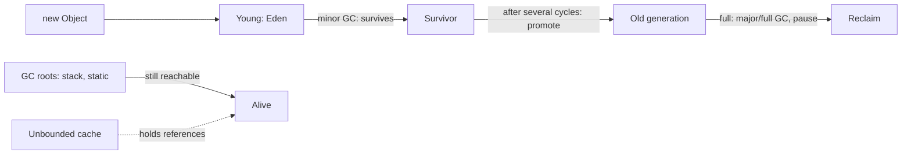

## 1. Core Concept

Every program needs **memory** for local variables and long-lived objects. The **stack** is allocated/freed automatically with function calls (fast, small, per-thread), while the **heap** holds objects with arbitrary lifetimes that someone must **reclaim**: the programmer manually (C/C++), an automatic **garbage collector** (Java, Go, C#, Python…) or **the compiler via ownership** (Rust). Understanding this mechanism helps you diagnose **memory leaks, latency spikes from GC pauses and OOM**.

**Mental model:** the stack is **the tray you are holding** (put down as soon as the job is done), the heap is **a shared storage room**; GC is **a cleaner** who automatically throws away items **nobody references any more** — but when cleaning a large room it has to **pause the work** (a pause), and if you keep notes pointing at old items the cleaner **can never throw them away**.

## 2. How It Works

**Stack vs heap**
- **Stack**: each thread has one (typically **~1 MB**), holding **function frames** (local variables, return addresses); allocation is just moving a pointer → **very fast**; **stack overflow** on deep recursion. **Heap**: shared among threads, allocation/reclamation is costlier, and it can **fragment**; objects live until no reference remains (GC) or are freed (manually).

**Garbage collection → Reachability**
- GC treats an object as **alive if it is reachable from GC roots** (stack variables, static variables, running threads…). Algorithms: **mark-sweep(-compact)** (mark then sweep, optionally compacting against fragmentation), **copying** (copy live objects into a new region).

**The generational hypothesis → Most objects die young**
- The heap is split into a **young generation** (Eden + survivor) and an **old generation**. A **minor GC** collects young **often and cheaply** (few objects survive); objects that survive many cycles are **promoted** to old; a **major/full GC** collects old **rarely but expensively**. This is why total GC work shrinks.

**Stop-the-world and modern GCs**
- Many GC phases must **pause every application thread (STW)** → **latency spikes**. **G1** (region-based, with a pause goal such as `-XX:MaxGCPauseMillis=200`), **ZGC/Shenandoah** (most work is **concurrent**, pauses **under a few milliseconds** regardless of heap size), **Parallel** (maximum throughput), and Go uses a **concurrent tri-color** GC. The trade-off: **throughput vs latency vs memory**.

**Leaks in GC languages → Holding unnecessary references**
- GC does not detect "useless objects", only "unreachable objects". Leak causes: **unbounded caches/maps**, **static collections** that only add and never remove, **listeners/callbacks never unregistered**, **ThreadLocals in thread pools**, resources not closed. Signs: **the heap after a full GC keeps growing**; handle with a **heap dump** (jmap, Eclipse MAT) to find the reference path holding the objects, and **GC logs**.

**GC thrashing and off-heap memory**
- With the heap nearly full, GC runs constantly and **the CPU concentrates on GC** (possibly reporting `GC overhead limit exceeded`). A **container is OOMKilled** even though `-Xmx` is below the limit because the process also uses **metaspace, thread stacks, direct buffers and native memory** outside the heap — set `-Xmx` to ≈ **50–75%** of the limit.

**Management without GC**
- **C/C++**: manual (**use-after-free, double free, leaks**). **Rust**: **ownership** — each value has **one owner**, ownership moves, and the **borrow checker** (many read references **or** one write reference) checks at compile time → memory safety **without GC**, deterministic release at scope end. **Reference counting** (Python/Swift) has the **reference cycle** problem.

```bash
java -Xmx2g -XX:+UseZGC -Xlog:gc*:file=gc.log MyApp      # GC log, ZGC
jmap -dump:live,format=b,file=heap.hprof <pid>            # heap dump for leak analysis
jcmd <pid> GC.heap_info
```

## 3. Visual Diagram



## 4. Rules of Thumb & Trade-offs

| Situation / Need | What to choose |
| --- | --- |
| Maximum throughput, tolerates pauses | Parallel GC |
| Low pauses, large heap | ZGC / Shenandoah |
| Balanced, the modern default | G1 |
| Running in a container | `-Xmx` ≈ 50–75% of the limit |
| Suspected leak | Heap dump + MAT, GC log |
| Memory safety without GC | Rust (ownership) |
| Reduce GC pressure | Cut short-lived object allocation on hot paths |

- **What you gain:** GC eliminates a whole class of manual memory bugs. **What you lose:** pauses and CPU/memory overhead, less control; low-pause GCs trade throughput for latency.

## 5. Must Remember / Production Pitfalls

- **The heap grows forever despite GC → a logical leak (unbounded cache/map, listeners) → cap size/TTL, unregister, find the holding path with a heap dump**.
- **p99 latency spikes periodically → GC pauses (old gen full/fragmented) → choose a low-pause GC, size the heap sensibly, reduce the allocation rate**.
- **A pod is OOMKilled although `-Xmx` is below the limit → off-heap memory (metaspace, thread stacks, direct buffers) → set `-Xmx` lower than the limit, monitor native memory**.
- **High CPU and the application nearly freezes → GC thrashing from a nearly full heap → enlarge the heap/fix the leak, do not just raise `-Xmx`**.
- **Loading a whole file/large table into RAM at once → OOM → process in streams/batches**.
- Interview trap: "with GC, are memory leaks gone?" → **no, GC only reclaims unreachable objects; holding extra references still leaks**; "why is generational GC effective?" → **most objects die young so minor GCs are cheap and frequent**; "container OOM although Xmx is small?" → **off-heap memory**.

## 6. Search Hooks

- `stack vs heap memory` — the two memory regions and their lifetimes.
- `garbage collection generational mark-sweep` — the principles of automatic reclamation.
- `stop-the-world pauses ZGC G1` — GC pauses and modern GCs.
- `memory leak in garbage collected languages` — leaks from extra references.
- `Rust ownership borrow checker` — memory safety without GC.
- `heap dump analysis` — analyzing a heap snapshot to find leaks.
