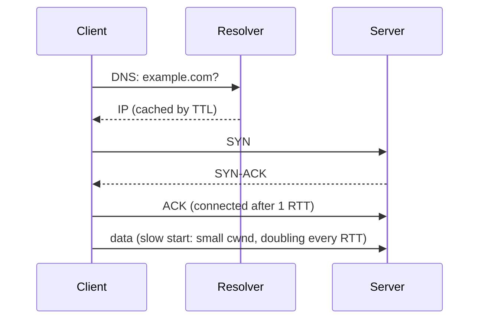

## 1. Core Concept

Every distributed system runs on a **network**, and a network has physical limits that code cannot optimize away: **latency**, **bandwidth** and **packet loss**. Understanding **TCP** (guaranteed delivery, with a handshake and congestion control), **UDP** (lightweight, no guarantees) and **DNS** (translating names to IPs, cached by TTL) helps you **diagnose latency and connection errors and design the right protocol**.

**Mental model:** TCP is **a phone call that confirms every sentence** (it opens with "hello, can you hear me?" and repeats whatever was lost), UDP is **sending a postcard** (fast, no guarantee it arrives). DNS is **a phone book annotated "this number is good for N minutes"** (the TTL).

## 2. How It Works

**TCP three-way handshake → A 1-RTT cost before sending data**
- **SYN → SYN-ACK → ACK**, taking **1 RTT**. For example a client in Vietnam calling a US server (RTT ~200 ms): just opening the connection costs ~200 ms; adding TLS 1.3 costs one more RTT (HTTP/1.1 over TLS can take ~3 RTTs before the first data byte). That is why **reusing connections (keep-alive, connection pools)** matters.

**TCP congestion control → Slow start and AIMD**
- **Slow start**: `cwnd` (the congestion window) starts small (typically 10 MSS) and **doubles every RTT** until a threshold. **Congestion avoidance (AIMD)**: **additive increase** each RTT, **multiplicative decrease** — halving on packet loss. Consequence: a **new** connection starts slowly; transferring a small file on a new connection **never reaches full bandwidth**. **Flow control** (the receive window `rwnd`) is a separate mechanism that keeps the receiver from being overwhelmed.

**TCP vs UDP → Choose by requirement**
- **TCP**: reliable, ordered, congestion-controlled; in exchange for **head-of-line blocking** (one lost packet stalls the whole stream) and the handshake. **UDP**: connectionless, no guarantees, low latency — used for **DNS, VoIP, games, streaming, QUIC/HTTP3** (the application handles reliability if needed).

**DNS resolution → A lookup chain and caches**
- The client asks a **recursive resolver**; if nothing is cached it asks **root → TLD (.com) → authoritative server** and returns the result, **cached by TTL**. Records: **A/AAAA** (IPv4/IPv6), **CNAME** (an alias, **not allowed at the zone apex**), **MX**, **TXT**, **NS**. The **TTL** trade-off: **a low TTL** → fast IP change/failover but higher DNS load and latency; **a high TTL** the opposite. There is also **negative caching** (caching "does not exist" results).

**TIME_WAIT and ephemeral port exhaustion**
- The side that **closes the connection first** enters **TIME_WAIT** for about **60 seconds** (Linux). Each outbound connection uses an **ephemeral port** (by default about **28,000** ports: 32768–60999). Example: **1,000 new connections/second** to the same destination → ports run out in ~**28–60 seconds** → the error `Cannot assign requested address`. Remedies: **connection pool/keep-alive**, widen the port range, `tcp_tw_reuse` (for outbound connections), avoid creating a new connection per request.

**Latency numbers → An intuition scale**
- Main memory access ~**100 ns**; SSD random read ~**100 µs**; **RTT within the same datacenter ~0.5 ms**; spinning-disk seek ~**10 ms**; **intercontinental RTT ~150 ms**. A network call is **thousands to millions of times** slower than memory.

```bash
dig +trace example.com            # see the root → TLD → authoritative chain
curl -w "dns:%{time_namelookup} tcp:%{time_connect} tls:%{time_appconnect} ttfb:%{time_starttransfer}\n" -so /dev/null https://example.com
ss -s                              # count connections, TIME_WAIT
```

## 3. Visual Diagram



## 4. Rules of Thumb & Trade-offs

| Situation / Need | What to choose |
| --- | --- |
| Need reliability and ordering | TCP |
| Low latency, tolerates loss (games, VoIP, DNS) | UDP |
| Many requests to the same destination | Keep-alive, connection pool |
| Fast failover via DNS | Low TTL (trading load and latency) |
| Ephemeral port exhaustion | Connection pool, widen the port range |
| Reduce RTT for distant users | CDN, edge, place servers near users |

- **What you gain:** the right protocol for the right problem. **What you lose:** TCP pays for the handshake and has HOL blocking; a low TTL raises DNS load/latency; UDP forces the application to handle reliability.

## 5. Must Remember / Production Pitfalls

- **"Cannot assign requested address" under high load → a new connection per request, TIME_WAIT consumes all ports → connection pooling/keep-alive, widen the port range**.
- **The first request is very slow for distant users → TCP + TLS handshakes cost several RTTs → keep-alive, TLS 1.3/0-RTT, a CDN near users**.
- **The IP is changed/failed over but users still reach the old IP → DNS caching by TTL → lower the TTL before switching, accept the propagation delay**.
- **Small file transfers are slow despite large bandwidth → slow start on a new connection → reuse connections**.
- **No CNAME at the zone apex → a DNS constraint → use the provider's ALIAS/ANAME**.
- Interview trap: "the cost of opening a TCP connection?" → **a 1-RTT handshake (plus TLS)**; "TCP vs UDP?" → **reliable + ordered vs fast + no guarantees**; "why do ports run out?" → **TIME_WAIT 60 seconds × the rate of new connections**.

## 6. Search Hooks

- `TCP three-way handshake` — the 1-RTT cost of opening a connection.
- `TCP congestion control slow start AIMD` — why new connections are slow.
- `TCP vs UDP` — the reliability versus latency trade-off.
- `DNS resolution TTL` — the lookup chain and caching.
- `TIME_WAIT ephemeral port exhaustion` — running out of ports with too many connections.
- `latency numbers every programmer should know` — the latency scale.
