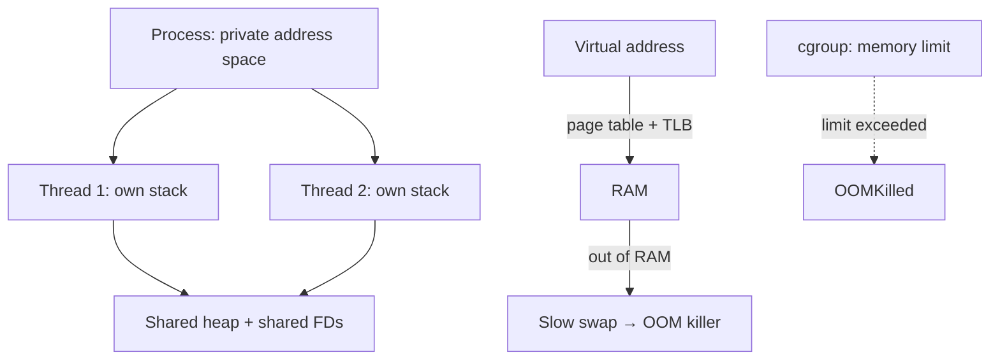

## 1. Core Concept

The operating system gives every program the illusion of **having its own CPU and memory**, through **processes** (a private address space), **threads** (execution streams sharing memory), **virtual memory** (virtual addresses mapped to RAM/disk) and isolation mechanisms (**namespaces, cgroups**) that underlie containers. Understanding them helps you **diagnose OOM, latency from context switching, file descriptor exhaustion** and choose a sensible **thread pool size**.

**Mental model:** a process is **a private apartment** (its own walls, kitchen and storage; to talk you must use the phone/IPC); threads are **people living together in one apartment** (sharing the storage, fast but easy to step on each other). Virtual memory is **a numbering plan of virtual storage rooms**; the OS secretly swaps real goods between fast storage (RAM) and slow storage (disk).

## 2. How It Works

**Process vs thread**
- **Process**: a **private** address space, with its own PID and resources (file descriptors); costly to create (`fork`/`exec`, copy-on-write), well isolated (one process crashing does not take others down). **Thread**: shares the process's **heap and resources**, with its **own stack and registers**; cheaper to create, communicates quickly through shared memory but **needs synchronization**, and a faulty thread can bring down the whole process.

**Context switch → A hidden cost**
- When the scheduler moves the CPU between threads/processes it must **save/restore state**: the direct cost is on the order of **a few microseconds**, and the **indirect** cost is larger (losing CPU cache and TLB). Too many concurrently running threads → **many context switches, lower throughput**.

**Virtual memory, paging and the OOM killer**
- Each process sees its own virtual address space, divided into **4 KB pages** mapped through a **page table** (cached in the **TLB**). A **page fault** happens when a page is not in RAM (loaded from disk/swap), and **mmap** maps a file into memory. **Out of RAM**: the system swaps (very slow), then the **OOM killer** picks a process to **kill** (by `oom_score`). In a **container**, memory is limited by a **cgroup**: exceeding it gets you **OOMKilled** even if the machine still has RAM.

**Namespaces and cgroups → The container foundation**
- **Namespaces** isolate **what a process can see** (PID, network, mount, hostname, user…). **cgroups** limit **the resources a process uses** (CPU, memory, I/O). A container = an ordinary Linux process + namespaces + cgroups (not a virtual machine).

**Thread pool sizing → CPU-bound vs I/O-bound**
- **CPU-bound**: threads ≈ **number of cores** (+1). **I/O-bound**: threads mostly **wait**, so you need more: `cores × (1 + wait time / compute time)`. For example **8 cores**, each request waits 90 ms on I/O and computes 10 ms → `8 × (1 + 9) = 80` threads. With an **async/event loop** model or **virtual threads** you can serve more without that many OS threads.

**File descriptors and `ulimit`**
- Every file, **socket** and pipe is a **file descriptor (FD)**; each process has a limit (`ulimit -n`, often a **1024** soft default). A server with many connections hits **"Too many open files"** unless you raise the limit or it **leaks FDs** (forgetting to close).

```bash
ulimit -n                                # the soft FD limit
ls /proc/$(pgrep -n myapp)/fd | wc -l    # the number of open FDs
cat /sys/fs/cgroup/memory.max            # the cgroup memory limit
dmesg -T | grep -i "killed process"      # traces of the OOM killer
```

## 3. Visual Diagram



## 4. Rules of Thumb & Trade-offs

| Situation / Need | What to choose |
| --- | --- |
| Strong fault isolation | Multiple processes |
| Fast data sharing within one process | Threads (with synchronization) |
| CPU-bound load | A pool ≈ the number of cores |
| I/O-bound load | A larger pool, or async/virtual threads |
| Many concurrent connections | Raise `ulimit -n`, close FDs properly |
| Isolated, lightweight execution | Containers (namespace + cgroup) |

- **What you gain:** the right model for each workload. **What you lose:** many threads → context switching and contention; many processes → memory cost and IPC; containers share the kernel so isolation is weaker than a VM.

## 5. Must Remember / Production Pitfalls

- **A pod is OOMKilled even though the node has RAM → it exceeded the cgroup limit (heap + non-heap + page cache) → set a sensible limit, count non-heap memory too**.
- **Throughput falls when threads are added → context switching and lock contention → shrink the pool, measure the CPU run-queue**.
- **"Too many open files" under high load → a low `ulimit -n` or an FD leak → raise the limit, close connections, monitor the FD count**.
- **The server is unusually slow when memory is nearly full → swap thrashing → reduce memory use, add RAM, disable/reduce swap for latency-sensitive services**.
- **Treating a container as a VM → expecting absolute isolation → remember containers share the kernel, add seccomp/user namespaces when needed**.
- Interview trap: "how do a process and a thread differ?" → **a process has its own address space, threads share the heap**; "what is a container?" → **a Linux process + namespaces + cgroups**; "thread pool size?" → **CPU-bound ≈ cores, I/O-bound ≈ cores × (1 + wait/compute)**.

## 6. Search Hooks

- `process vs thread` — the two execution units and their trade-offs.
- `context switch cost` — the cost of switching context.
- `virtual memory paging OOM killer` — virtual memory and what happens when RAM runs out.
- `Linux namespaces cgroups containers` — the foundation of containers.
- `thread pool sizing CPU-bound I/O-bound` — the pool sizing formula.
- `ulimit file descriptors` — file descriptor limits.
