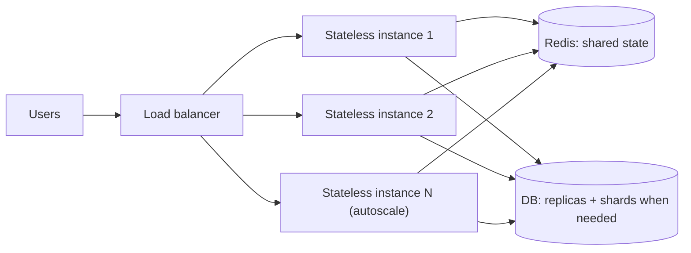

## 1. Core Concept

**Scalability** is a system's ability to **handle increased load** (more users, more data, more requests) by **adding resources** while keeping acceptable performance. It is not "adding machines": you must know **where the bottleneck is**, **be able to estimate the scale**, design **stateless** services so they can be replicated, and understand **tail latency** and the **availability level** expressed as an SLO.

**Mental model:** the system is like **a restaurant**: hiring a better head chef (vertical) has limits; adding many parallel kitchens (horizontal) needs **recipes that do not depend on who cooks (stateless)** and **a pass that does not jam**. Customers care about **the slowest dish at the table** (tail latency), not the average time.

## 2. How It Works

**Vertical vs horizontal**
- **Vertical (scale up)**: a more powerful machine — simple, no architecture change, but **it has a ceiling**, is expensive and remains a single point of failure. **Horizontal (scale out)**: add more machines — practically no ceiling, good fault tolerance, but you need **a load balancer, distributed data and consistency handling**.

**Stateless service → The condition for scaling out**
- Hold no **session state in an instance's memory**; state goes to a **shared DB/cache** (Redis), so any request can land on any instance. Then adding/removing/replacing instances is safe (autoscaling).

**Back-of-the-envelope → Quick estimation**
- Common anchors: **1 day = 86,400 seconds (~10⁵)**. Example: **1 million daily active users × 10 requests = 10⁷ requests/day ≈ 115 requests/second on average**; **peak is usually 3–5× higher** → ~350–600 rps. Storage: 1 million records × 1 KB ≈ **1 GB**; 100 bytes × 10⁹ = **100 GB**. Use these to pick an architecture of the right size (one machine or many shards?).

**Little's Law → The relation of load, latency and concurrency**
- **`L = λ × W`**: the number of requests **in flight concurrently** `L` = the **arrival rate** `λ` × the **average processing time** `W`. Example: **100 rps × 0.2 s = 20 concurrent requests** → you need at least ~20 workers/connections; if `W` rises to 2 s you need ~200 → the thread pool is exhausted.

**Tail latency (p99) → More important than the average**
- **p99 = the slowest 1% of requests**. With **fan-out**: if one request calls **100** services and each has a **1%** chance of being slow, the probability that all 100 are fast is `0.99¹⁰⁰ ≈ 37%` ⇒ **~63%** of requests hit at least one slow call. Mitigations: **timeouts**, **hedged requests**, caching, reducing fan-out.

**Availability nines → SLA, SLO, SLI**
- **99.9%** ≈ **8.76 hours of downtime/year** (≈ 43.8 minutes/month); **99.99%** ≈ **52.6 minutes/year**; **99.999%** ≈ **5.26 minutes/year**. **SLI** (the measured indicator), **SLO** (an internal target), **SLA** (a customer commitment, with penalties); **error budget** = 1 − SLO. Services **in series** multiply SLAs: `99.9% × 99.9% ≈ 99.8%`.

**Bottlenecks and levers**
- Find the **bottleneck** (CPU, I/O, DB, network) by measuring; levers: **cache, CDN, async/queues, read replicas, sharding, query/index optimization**. **Amdahl's law**: the sequential portion caps the speedup no matter how many machines you add.

```python
dau, req_per_user = 1_000_000, 10
avg_rps = dau * req_per_user / 86_400          # ≈ 115 rps
peak_rps = avg_rps * 4                         # ≈ 460 rps
concurrent = peak_rps * 0.2                    # Little: 0.2 s per request ≈ 92 concurrent
```

## 3. Visual Diagram



## 4. Rules of Thumb & Trade-offs

| Situation / Need | What to choose |
| --- | --- |
| Need a quick, simple increase, load still moderate | Scale up (vertical) |
| Need fault tolerance and near-unlimited growth | Scale out (horizontal) + stateless |
| Sizing the architecture | Back-of-the-envelope estimation |
| Sizing pools/concurrency | Little's Law |
| Fan-out across many services | Watch p99, timeouts, hedging |
| Committing to availability | SLO + error budget |

- **What you gain:** handles large load, tolerates failure. **What you lose:** distributed complexity (consistency, operations), infrastructure cost; **optimizing early without measuring** is a common mistake.

## 5. Must Remember / Production Pitfalls

- **Instances are added but logins/carts are lost → state is kept in instance memory → move state to Redis/DB, design stateless**.
- **The average is fine but users complain of slowness → a high p99 from fan-out/GC/contention → track p95/p99, timeouts, hedged requests**.
- **Threads/connections run out when backend latency rises → Little's Law (L = λW) → timeouts, concurrency limits, backpressure**.
- **Adding machines does not make it faster → the bottleneck is the DB or the sequential portion (Amdahl) → measure the bottleneck, cache, split reads/writes**.
- **A 99.99% commitment but a chain of serial dependencies → the total SLA is lower than each component → compute the serial SLA, add redundancy**.
- Interview trap: "scale up vs scale out?" → **scale up has a ceiling and is a single point of failure, scale out needs statelessness**; "how long is 99.9% downtime?" → **~8.76 hours/year (43.8 minutes/month)**; "Little's Law?" → **L = λ × W**.

## 6. Search Hooks

- `vertical vs horizontal scaling` — the two directions of growth.
- `stateless service design` — designing for easy replication.
- `back-of-the-envelope estimation` — quick scale estimation.
- `Little's Law` — the relation of load, latency and concurrency.
- `tail latency p99` — tail latency and fan-out.
- `availability nines SLA SLO` — availability levels and error budget.
