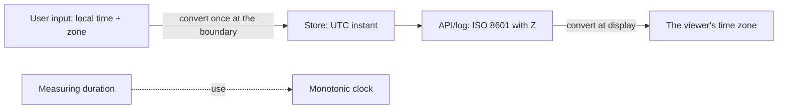

## 1. Core Concept

**Time** is a major source of silent bugs: time zones, daylight saving time (DST), leap seconds, skewed machine clocks, and above all **confusing an "instant" with a "wall-clock time"**. The base rule: **store and transmit instants in UTC**, **convert to the user's time zone only for display**, measure durations with a **monotonic clock** and **do not trust another machine's clock**.

**Mental model:** there are **two different concepts**: an **instant** (a single point on the global timeline, like "the moment the team scored") and **wall time** (the number on a wall clock somewhere, like "9 AM" — ambiguous without knowing where). Every time bug is **mixing the two**.

## 2. How It Works

**Instant, local time and zoned time**
- **Instant**: a point on the timeline (UTC/epoch). A **local date-time** (`2026-03-08 02:30`) is **undetermined** until you know the **time zone**. A **zoned date-time** = local + zone (`Asia/Ho_Chi_Minh`). Store in the DB as `timestamptz` (PostgreSQL normalizes to UTC) or **epoch**, never local time without a zone.

**UTC + an IANA time zone**
- Use **IANA time zone names** (`America/New_York`, `Asia/Ho_Chi_Minh`) rather than **fixed offsets** (`-05:00`): offsets **change with DST and with each country's rules** (for example Vietnam has no DST, UTC+7 all year; New York switches between UTC−5 and UTC−4). The tz database is updated when rules change.

**DST → Nonexistent and repeated times**
- A **"spring forward"** change (02:00 → 03:00) makes **02:30 nonexistent**; a **"fall back"** change (02:00 → 01:00) makes **01:30 occur twice**. A DST day is **23 or 25 hours** long, so "add 86,400 seconds" **differs** from "add 1 calendar day".

**Physical clocks → Wall clock and monotonic**
- The **wall clock** can **jump** (NTP adjustments, an admin changing the time, leap seconds) — `System.currentTimeMillis`, `time.time()`. The **monotonic clock** **only moves forward** and is for **measuring durations/timeouts** — `System.nanoTime`, `time.monotonic()`, `performance.now()`. Using the wall clock to measure duration can give **negative results**.

**Distributed clocks → Do not trust cross-machine timestamps**
- Machines' clocks **drift apart** (milliseconds to seconds even with NTP). Using timestamps from two machines to decide "who wrote last" (**last-write-wins**) can **lose data**. Use **logical clocks** (**Lamport**, **vector clocks**), a **hybrid logical clock**, or system-determined ordering (Spanner uses **TrueTime** with an uncertainty interval).

**Formats and representation**
- **ISO 8601 / RFC 3339** for APIs and logs: `2026-11-21T09:30:00Z` or `2026-11-21T16:30:00+07:00`; avoid `03/04/2026` (March 4 or April 3?). **Epoch**: watch **seconds vs milliseconds**, and **Year 2038** with 32-bit numbers.

**Future events in local time**
- "A 9:00 AM daily meeting in Berlin" should store **local time + zone** (DST rules can change), not a fixed UTC; conversely, **events that already happened** are stored in UTC.

```python
from datetime import datetime, timezone
from zoneinfo import ZoneInfo
now = datetime.now(timezone.utc)                       # an instant, store this
vn = now.astimezone(ZoneInfo("Asia/Ho_Chi_Minh"))      # for display only
import time; t0 = time.monotonic(); work(); elapsed = time.monotonic() - t0  # measure duration
```

## 3. Visual Diagram



## 4. Rules of Thumb & Trade-offs

| Situation / Need | What to choose |
| --- | --- |
| Store an event's instant | UTC (`timestamptz`/epoch) |
| Display to users | Convert to their IANA zone |
| Measure duration/timeout | Monotonic clock |
| Recurring appointments in local time | Local time + IANA zone |
| Passing through APIs/logs | ISO 8601 / RFC 3339 |
| Cron | Run in UTC |
| Ordering across machines | Logical clocks, do not compare physical timestamps |

- **What you gain:** UTC is simple and comparable. **What you lose:** the local-time semantics needed for calendars/reminders (you must store the zone as well); logical clocks are more complex than timestamps.

## 5. Must Remember / Production Pitfalls

- **The time is off by an hour after a DST day → adding 86,400 seconds instead of 1 calendar day → use the standard library's calendar arithmetic**.
- **The real instant cannot be recovered → local time was stored without a zone → store UTC or include an IANA zone**.
- **Negative latency/wrong timeouts when NTP adjusts the clock → measured with the wall clock → monotonic clock**.
- **Cron runs 0 or 2 times on a DST day → cron in local time → run in UTC**.
- **Data is lost with last-write-wins across nodes → comparing timestamps from skewed clocks → logical clocks/versions, system-determined ordering**.
- **Parsing an ambiguous date (`03/04/2026`) or mixing seconds/milliseconds → always use ISO 8601 and explicit units**.
- Interview trap: "why not store the +07:00 offset instead of the zone name?" → **an offset does not encode DST rules or future changes in the region**; "which clock for measuring duration?" → **monotonic**; "compare two machines' timestamps to know who is first?" → **not trustworthy, use logical clocks**.

## 6. Search Hooks

- `UTC vs local time storing timestamps` — storing absolute instants and displaying by time zone.
- `IANA time zone database DST pitfalls` — why to use zone names and the DST traps.
- `monotonic clock vs wall clock` — the duration clock and the wall clock.
- `ISO 8601 RFC 3339 timestamps` — standard time formats for APIs.
- `Falsehoods programmers believe about time` — a list of wrong assumptions about time.
- `Lamport clocks vector clocks` — logical clocks instead of physical clocks.
