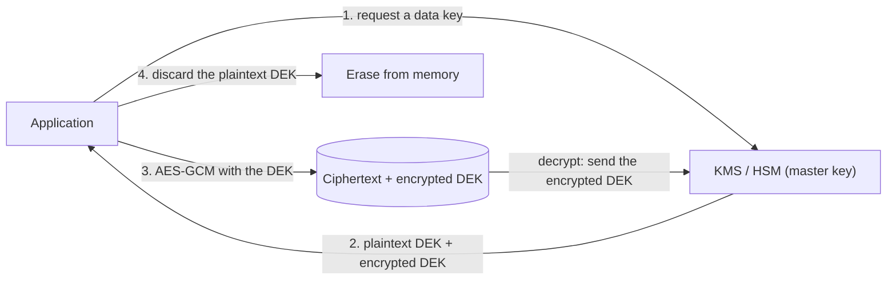

## 1. Core Concept

Practical cryptography for engineers revolves around four goals: **confidentiality**, **integrity**, **authenticity** (verifying origin) and **non-repudiation**. Rule number one: **do not invent algorithms, use standard libraries** and pick **the right primitive for the purpose** — the wrong primitive (hashing to encrypt, MD5 to hash passwords) is the most common mistake.

**Mental model:** each primitive is **a different tool**: a **hash** is a one-way fingerprint; **symmetric encryption** is a shared key that locks and unlocks; **asymmetric** is a mailbox (anyone can drop a letter in with the public key, only the owner opens it with the private key); a **signature** is a notarizing seal.

## 2. How It Works

**Hashes and password hashing**
- A **hash** (SHA-256) is one-way and fast — **do not use it directly for passwords**: GPUs try billions of hashes per second. Passwords need **a slow, salted, memory-hard function**: **argon2id** (recommended), **bcrypt**, **scrypt/PBKDF2**. A random **salt** per user defeats rainbow tables; a **pepper** is an extra secret stored outside the DB.

**Symmetric encryption: AES-GCM**
- **AES-GCM** is **authenticated encryption (AEAD)**: both **confidential** and **tamper-detecting** (auth tag). **A nonce/IV must never repeat with the same key** (repeating a nonce in GCM catastrophically exposes the key/plaintext). Avoid **ECB** (leaks patterns) and **unauthenticated CBC** (padding oracle). 128/256-bit keys.

**Symmetric vs asymmetric**
- **Symmetric**: fast, encrypts large data, but the **key must be shared**. **Asymmetric** (RSA ≥ 2048, ECDSA/Ed25519): slow, used for **key exchange, signatures and the TLS handshake**; in practice they are **combined**: asymmetric negotiates the key, symmetric encrypts the data.

**HMAC vs digital signature**
- **HMAC**: authenticates with a **shared secret key**; anyone holding the key can create it → **no non-repudiation**; used between two systems that trust each other (webhook signatures). **Digital signature**: signed with a **private key**, verified with a **public key** → authenticates origin and provides **non-repudiation**.

**Envelope encryption (KMS data key)**
- Encrypt large data with a local **data key (DEK)**, then **encrypt the DEK with a master key (KEK)** in **KMS/HSM**. Store `{ciphertext, encrypted DEK}`. Benefits: the master key **never leaves KMS**, encryption is fast locally, **key rotation** only needs to re-wrap the DEK, and control is via IAM with auditing.

**Quick comparison by purpose**
- Hash passwords → **argon2id**; encrypt data → **AES-GCM/ChaCha20-Poly1305**; sign/verify → **Ed25519/ECDSA**; authenticate webhooks → **HMAC-SHA256**; secure random numbers → **CSPRNG** (not `Math.random`).

```python
import os
from cryptography.hazmat.primitives.ciphers.aead import AESGCM
key = AESGCM.generate_key(bit_length=256)
nonce = os.urandom(12)                       # a UNIQUE nonce for every encryption with the same key
ct = AESGCM(key).encrypt(nonce, b"secret", b"aad")   # ct includes the auth tag
pt = AESGCM(key).decrypt(nonce, ct, b"aad")          # wrong/modified -> raises InvalidTag
```

## 3. Visual Diagram



## 4. Rules of Thumb & Trade-offs

| Need | Use |
| --- | --- |
| Storing passwords | argon2id (or bcrypt) + salt |
| Encrypting data | AES-256-GCM / ChaCha20-Poly1305 |
| Encrypting large data in the cloud | Envelope encryption with KMS |
| Authenticating webhooks between two trusting parties | HMAC-SHA256 |
| Non-repudiation, public verification | A digital signature (Ed25519/ECDSA) |
| Generating tokens/keys | CSPRNG |

- **What you gain:** mathematically grounded data protection. **What you lose:** slow password-hash functions cost CPU/RAM (deliberately), key management and rotation are complex, a misconfiguration voids all guarantees.

## 5. Must Remember / Production Pitfalls

- **Passwords are cracked quickly after a DB leak → unsalted SHA-256/MD5 → argon2id/bcrypt**.
- **Plaintext is exposed when a nonce repeats → GCM reused a nonce with the same key → random/counter-unique nonces, rotate keys**.
- **Tampered data goes undetected → unauthenticated CBC/ECB was used → AEAD (AES-GCM)**.
- **Loss of key control → the master key sits in code/environment variables → KMS/HSM, envelope encryption, IAM**.
- **Tokens are guessable → `Math.random`/time was used → CSPRNG**.
- **Comparing HMAC/tokens with `==` → a timing attack → constant-time comparison**.
- Interview trap: "hash vs encryption?" → **a hash is one-way, encryption is two-way with a key**; "HMAC vs digital signature?" → **HMAC uses a shared key and has no non-repudiation, a signature uses an asymmetric key**; "why envelope encryption?" → **the master key never leaves KMS and rotation is cheap**.

## 6. Search Hooks

- `password hashing argon2id bcrypt` — hashing passwords correctly.
- `AES-GCM authenticated encryption` — encryption with authentication.
- `symmetric vs asymmetric encryption` — the difference and how to combine them.
- `envelope encryption KMS data key` — envelope encryption with KMS.
- `HMAC vs digital signature` — authentication with a shared key versus an asymmetric key.
- `CSPRNG secure random` — generating secure randomness.
