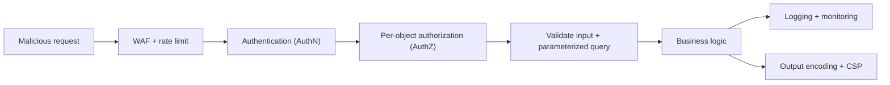

## 1. Core Concept

The **OWASP Top 10** is a list of the **most common and serious web security risks** (Broken Access Control, Injection, Cryptographic Failures, SSRF…). Most incidents trace back to a few root causes: **trusting user input**, **missing authorization checks**, **default configuration** and **a lack of layered defenses**. The goal: grasp **the attack mechanism and how to block it at the root**, not memorize names.

**Mental model:** an application is **a building with many layers of doors**: the attacker tries each lock. **Defense in depth** means that if one layer fails another remains; **least privilege** means everyone/everything holds only the key for the room it needs.

## 2. How It Works

**Broken Access Control and IDOR (#1)**
- **IDOR**: `GET /orders/1234` returns someone else's order because the server **only checks that you are logged in, not ownership**. Defense: **always check permission on the server per object** (`order.userId == currentUser`), deny by default; hard-to-guess IDs **do not** replace authorization checks.

**SQL Injection**
- Input is **concatenated** into a query: `' OR '1'='1`. Defense: **parameterized queries/prepared statements** (data and command kept separate), an ORM used correctly, **no** string concatenation; enforce **least privilege** on the DB account. Manual escaping and blacklists are **not enough**.

**XSS, Output Encoding and CSP**
- An attacker injects a script that runs in the victim's browser (stealing the session, acting as the user). Defense: **context-aware output encoding** (HTML/attribute/JS/URL), framework auto-escaping (do not use `innerHTML`/`dangerouslySetInnerHTML` with raw data), a **CSP** restricting script sources, cookies **HttpOnly + Secure + SameSite**.

**CSRF**
- A malicious page makes the browser send a request carrying your cookies. Defense: **SameSite cookies**, **CSRF tokens**, checking `Origin`.

**SSRF and cloud metadata**
- The server is tricked into **calling an attacker-chosen URL**, reaching the internal network or the **metadata service** `169.254.169.254` to obtain **IAM credentials**. Defense: **allowlist** destination hosts/URLs, block internal/link-local IP ranges, resolve DNS and then check the IP (against rebinding), use **IMDSv2** (token required, blocks simple SSRF), and do not follow redirects.

**Defense in Depth and Least Privilege**
- Several independent layers of control: input validation, a WAF, authorization checks, encryption, monitoring. Each service/account gets **minimum privileges**; limit the **blast radius** when one layer is breached.

**Other core points**
- **Cryptographic failures** (weak encryption, data exposure), **security misconfiguration** (defaults, debug enabled), **vulnerable components** (outdated libraries), **authentication failures** (brute force, no MFA), missing **logging & monitoring**.

```python
# WRONG: string concatenation -> SQL injection
cur.execute(f"SELECT * FROM users WHERE email = '{email}'")
# RIGHT: a parameterized query
cur.execute("SELECT * FROM users WHERE email = %s", (email,))
# IDOR: check ownership on the server
order = repo.get(order_id)
if order.user_id != current_user.id:
    raise Forbidden()
```

## 3. Visual Diagram



## 4. Rules of Thumb & Trade-offs

| Risk | Primary defense |
| --- | --- |
| Injection (SQL, command) | Parameterized queries, avoid string concatenation |
| XSS | Context-aware output encoding, CSP, HttpOnly cookies |
| IDOR / Broken Access Control | Server-side per-object authorization, deny by default |
| CSRF | SameSite cookies, CSRF tokens |
| SSRF | Allowlist destinations, block internal IPs, IMDSv2 |
| Outdated libraries | Dependency scanning, updates |

- **What you gain:** a smaller attack surface, limited damage. **What you lose:** extra development/testing effort; overly strict checks can cause false positives and hurt the experience.

## 5. Must Remember / Production Pitfalls

- **Users can see other people's data → only login was checked → check ownership per object (IDOR)**.
- **Data is stolen through queries → SQL string concatenation → parameterized queries**.
- **IAM credentials are taken from the server → SSRF to metadata → IMDSv2, allowlist, block internal IPs**.
- **A foreign script runs on the page → raw input is rendered → output encoding, CSP**.
- **Only validating on the client → easily bypassed → always validate/authorize on the server**.
- **A single defensive layer → breach it and everything is lost → defense in depth, least privilege**.
- Interview trap: "defending against SQL injection?" → **parameterized queries, not manual escaping**; "do UUIDs prevent IDOR?" → **no, you must check permissions**; "how dangerous is SSRF on cloud?" → **it steals credentials from the metadata service**.

## 6. Search Hooks

- `OWASP Top 10` — the list of top web risks.
- `SQL injection parameterized queries` — blocking injection with parameterized queries.
- `XSS output encoding CSP` — defending against script injection.
- `SSRF IMDSv2 cloud metadata` — blocking metadata access through SSRF.
- `IDOR broken access control` — missing per-object authorization checks.
- `defense in depth least privilege` — layered defenses, minimum privileges.
