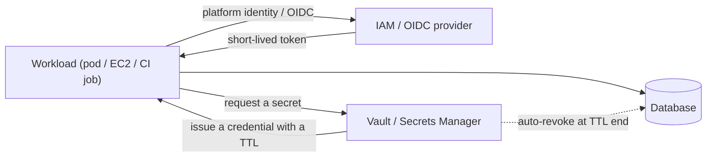

## 1. Core Concept

**Secrets management** is how you **store, issue, rotate and revoke** sensitive information (DB passwords, API keys, tokens, certificates) **without exposing it in code, Git, logs or images**. The best direction today: **as few long-lived secrets as possible** — use **workload identity and short-lived credentials** instead of static keys.

**Mental model:** a secret is like **a server-room key**. The worst way is **taping the key to the door (committing to Git)**. The good way is **not handing out permanent keys**: each time one is needed, **a gatekeeper (Vault/IAM) issues a temporary pass** that opens exactly the right room for a few minutes and then **expires on its own**.

## 2. How It Works

**General principles**
- **Never hard-code**, never put it in an image/committed env file. Store in a **secrets manager** (AWS Secrets Manager, Azure Key Vault, HashiCorp Vault). Apply **least privilege**, **encryption at rest**, an **audit log** of every access, **rotation** periodically and when a leak is suspected. Separate secrets by environment.

**Dynamic secrets (Vault)**
- Instead of one shared DB password forever, Vault **creates a temporary DB user on request** (a TTL of minutes to hours, minimum privileges) and **revokes it automatically when it expires**. Benefit: **no long-lived secret to leak**, each workload has its own credential → each can be traced and revoked.

**Secret zero and Workload Identity**
- **Secret zero** is the chicken-and-egg problem: to fetch secrets you need an initial credential — so where do you store that? The solution: **workload identity**, where the platform issues an identity to the workload (an IAM role attached to EC2/ECS/EKS, **IRSA**, Azure **Managed Identity**, GCP Workload Identity); the workload **proves its identity through the platform**, carrying no secret.

**OIDC federation for CI/CD**
- A pipeline (GitHub Actions) gets a **short-lived OIDC token** issued by GitHub and **exchanges it for a temporary cloud role** (`AssumeRoleWithWebIdentity`) through a **trust policy** limited to the repo/branch → **no long-lived AWS key** stored in CI secrets.

**Secret scanning and pre-commit**
- **Pre-commit hooks** (gitleaks, detect-secrets) block commits containing secrets; **secret scanning** on the repo/CI (and GitHub push protection) catches what slips through. **When leaked: assume it is permanently exposed → revoke/rotate immediately**; removing it from history is only a secondary step (crawlers have already harvested it).

```yaml
# GitHub Actions: no AWS key stored, use OIDC -> a temporary role
permissions: { id-token: write, contents: read }
steps:
  - uses: aws-actions/configure-aws-credentials@v4
    with:
      role-to-assume: arn:aws:iam::123456789012:role/gha-deploy
      aws-region: ap-southeast-1
```

## 3. Visual Diagram



## 4. Rules of Thumb & Trade-offs

| Situation / Need | What to choose |
| --- | --- |
| Accessing AWS/Azure from a workload | Workload identity (IAM role/Managed Identity), no keys |
| CI/CD deploying to the cloud | OIDC federation |
| A DB password for many services | Dynamic secrets (Vault) or automatic rotation |
| Keep secrets out of Git | Pre-commit + secret scanning + push protection |
| A secret has leaked | Revoke/rotate immediately |

- **What you gain:** few long-lived secrets, fast revocation, clear auditing. **What you lose:** extra infrastructure (Vault) and complexity, dependence on the secrets manager's availability, a need to design caching/fallback.

## 5. Must Remember / Production Pitfalls

- **An AWS key is harvested from GitHub → a secret was committed → revoke immediately, rotate, enable push protection**.
- **A secret leaks through logs/an environment dump → printed on error → mask secrets in logs, do not print env**.
- **One DB password shared everywhere → a large blast radius, hard to rotate → dynamic secrets/a separate credential per service**.
- **An application crashes because a secret expired → uncoordinated rotation → two-phase rotation, the application reloads secrets**.
- **The secrets manager dies and takes the whole system down → a hard dependency → a cache with TTL, retries, an HA design**.
- **Storing an AWS key in CI secrets → a long-lived key → OIDC federation, a trust policy by repo/branch**.
- Interview trap: "what is secret zero?" → **the initial credential needed to fetch secrets; solved with workload identity**; "a secret was committed, what first?" → **revoke/rotate, then clean the history**; "what do dynamic secrets give?" → **temporary credentials, per workload, expiring on their own**.

## 6. Search Hooks

- `secrets management best practices` — secret management practices.
- `HashiCorp Vault dynamic secrets` — temporary credentials on demand.
- `OIDC federation GitHub Actions AWS` — CI without long-lived keys.
- `secret scanning pre-commit gitleaks` — keeping secrets out of Git.
- `workload identity IRSA Managed Identity` — workload identity instead of static secrets.
- `secret zero problem` — the bootstrap credential problem.
