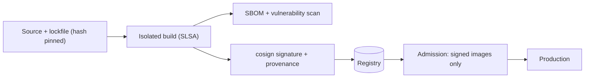

## 1. Core Concept

**Software supply chain security** protects **the whole path from source code and dependencies through the build to the artifact running in production** from tampering. Most of the code you run is **someone else's** (libraries, base images, build tools), so attackers target **the weakest link**: a malicious package, a compromised build server, a swapped artifact. The goal: **know what you run, where it came from, and prove it was not altered**.

**Mental model:** like **a food supply chain**: you need **an ingredient label (SBOM)**, **a tamper-evident seal (a signature)**, **a factory record (provenance)** and **to buy only from vetted suppliers**. A dirty batch of raw material at the start of the chain ruins everything at the end.

## 2. How It Works

**Forms of attack**
- **Dependency confusion**: an attacker publishes a public package **with the same name as an internal package** at a higher version → the build pulls the malicious one by mistake. **Typosquatting**: near-identical names (`reqeusts`). **A compromised maintainer/package** (event-stream), **malicious install scripts**, **build system compromise** (SolarWinds).

**Lockfiles and reproducible builds**
- A **lockfile** (`package-lock.json`, `poetry.lock`, `go.sum`) **pins versions + hashes** → the same input gives the same dependencies; use **strict** install commands (`npm ci`, `pip install --require-hashes`). A **reproducible build**: the same source produces a **bit-for-bit identical artifact** → a third party can **verify** the binary matches the source. Pin base images by **digest** (`@sha256:…`), not just the `latest` tag.

**SBOM**
- A **Software Bill of Materials** lists components and versions (**SPDX**, **CycloneDX** formats), generated with **Syft**. Value: when a new CVE appears (Log4Shell) you **immediately know which systems are affected**; combine with vulnerability scanning (Grype, Trivy, Dependabot).

**Artifact signing and provenance**
- **Sigstore/cosign**: sign images/artifacts with a **short-lived identity (keyless, OIDC)** and record it in a **transparency log (Rekor)**; an admission controller on Kubernetes **only lets correctly signed images run**. **Provenance** (an attestation) records **who built it, from which commit, where**.

**SLSA**
- A **maturity framework** for builds: L1 (provenance exists) → L2 (hosted build, signed provenance) → L3 (**isolated, tamper-resistant build**). Protect the **build pipeline** like production: least privilege, ephemeral runners, branch protection, mandatory review.

**Defending against dependency confusion**
- **Scoped/namespaced packages** (`@company/x`), configure registries to **prefer the internal source**, **reserve internal names** on the public registry, block internal names from external sources, a **registry allowlist**.

```bash
# A strict build: install exactly the lockfile, generate an SBOM, scan for vulnerabilities, sign the image by digest
npm ci --ignore-scripts
syft packages dir:. -o cyclonedx-json > sbom.json
grype sbom:sbom.json --fail-on high
cosign sign --yes registry.example.com/app@sha256:abc123...
```

## 3. Visual Diagram



## 4. Rules of Thumb & Trade-offs

| Risk | Measure |
| --- | --- |
| Dependency confusion | Scoped packages, prefer the internal registry, reserve names |
| A library has a CVE | SBOM + continuous scanning + automated updates |
| An artifact is swapped | cosign signing + verification at admission |
| Builds differ each time | Lockfile + base image by digest + reproducible build |
| The pipeline is hijacked | Ephemeral runners, least privilege, SLSA L3 |
| Malicious install scripts | `--ignore-scripts`, review new dependencies |

- **What you gain:** traceability, detecting/blocking unauthorized changes. **What you lose:** extra CI steps/tools, friction in updating dependencies, a need to manage signing keys/identity.

## 5. Must Remember / Production Pitfalls

- **The build pulls a public package with an internal name by mistake → dependency confusion → scoped packages, internal registry preferred**.
- **Not knowing which CVEs affect you → no SBOM → generate and store an SBOM on every build, scan continuously**.
- **The same tag but different content → the `latest` tag can be overwritten → pin by digest**.
- **A foreign image can run in the cluster → signatures are not checked → an admission controller requiring cosign**.
- **The CI pipeline is hijacked → overly broad permissions, long-lived tokens → OIDC, ephemeral runners, branch protection**.
- **Automated updates pull a malicious version → blind trust → review, a cooldown, scan before merge**.
- Interview trap: "what is dependency confusion?" → **a public package with an internal name at a higher version**; "what is an SBOM for?" → **knowing components so you can react quickly to a CVE**; "is a lockfile enough?" → **no, you need hash/digest pinning and a protected build**.

## 6. Search Hooks

- `software supply chain security SLSA` — a framework for protecting the software supply chain.
- `SBOM SPDX CycloneDX` — the software bill of materials.
- `dependency confusion typosquatting` — attacks through package names.
- `Sigstore cosign artifact signing` — signing and verifying artifacts.
- `lockfiles reproducible builds` — pinning dependencies and reproducible builds.
- `in-toto provenance attestation` — evidence of build origin.
