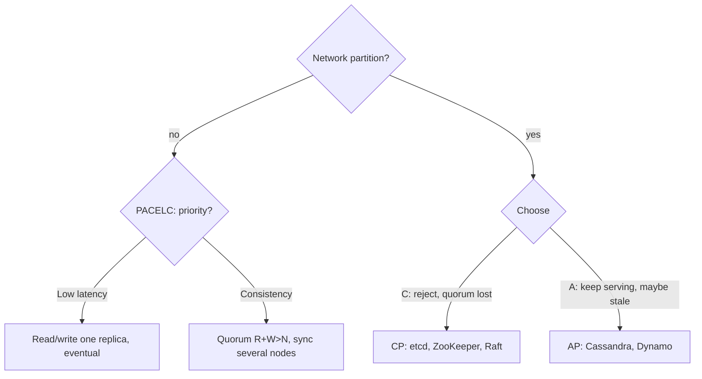

## 1. Core Concept

**CAP** says that when a distributed system hits a **network partition**, it **cannot simultaneously** guarantee both **Consistency** (every read sees the latest write, in the sense of **linearizability**) and **Availability** (every request to a live node receives a response): it must **pick one**. Because network partitions **cannot be eliminated**, the practical choice is **CP** (refuse/block during the partition to stay consistent) or **AP** (keep serving but possibly return stale data). **Consistency models** describe the "levels of correctness" in the space between the two extremes.

**Mental model:** two bank branches lose contact. **CP**: both stop withdrawals until the link is restored (safe, but customers are annoyed). **AP**: both keep allowing withdrawals and reconcile later (convenient, but you can overdraw). There is no "both perfectly safe and always serving" option when the line is cut.

## 2. How It Works

**Understanding CAP correctly**
- It is not "pick 2 of 3 all the time": **without a partition** a system can be both C and A; CAP only constrains behavior **during a partition**. The "C" of CAP (linearizability) is **not the "C" of ACID** (integrity constraints).
- **CP**: ZooKeeper, etcd, DBs built on consensus (Raft/Paxos); when quorum is lost they reject writes/reads. **AP**: Cassandra, DynamoDB (default mode) — keep serving and **converge later**.

**PACELC → Even without a partition**
- **If Partition then choose A or C; Else (normal operation) choose Latency or Consistency.** Even when the network is healthy, strong consistency **costs latency** (waiting to sync several nodes/Regions). This is why DynamoDB/Cassandra offer **tunable** reads/writes.

**The consistency spectrum (strong to weak)**
- **Linearizability**: behaves as a single copy, in real-time order. **Sequential/causal**: preserves causal order. **Read-your-writes**: you always see your own writes. **Monotonic reads**: you never "go back in time". **Eventual consistency**: if writes stop, all replicas **eventually** converge, but meanwhile you may read stale data.

**Quorum → Tuning with R and W**
- With **N** replicas, a write waits for **W** acknowledgements and a read asks **R** nodes: if **R + W > N**, the read set and the write set **overlap**, so a read sees the latest write. **Example N = 3, W = 2, R = 2**: tolerates losing 1 node; **W = 1, R = 1** is fast but may read stale data. **Sloppy quorum + hinted handoff** keep availability when nodes fail.

**Conflict handling (AP)**
- **Last-write-wins** (simple, may lose updates), **vector clocks** (detect conflicts so the application can reconcile), **CRDTs** (self-merging structures such as counters and sets).

**Verification**
- **Jepsen** tests real DBs to see whether they keep their consistency promises under network failures/crashes; do not trust the marketing.

## 3. Visual Diagram

## 4. Rules of Thumb & Trade-offs

| Situation / Need | What to choose |
| --- | --- |
| Account balances, distributed locks, coordination | CP / linearizability |
| Shopping carts, feeds, view counters, staleness tolerated | AP / eventual consistency |
| Users must see the post they just made | Read-your-writes |
| Reads see the latest write with N=3 | R + W > N (for example W=2, R=2) |
| Two conflicting records under AP | LWW, vector clocks or CRDTs |
| Low multi-Region latency | Relax consistency (eventual) |

- **What you gain:** you understand how to choose correctly for each piece of data. **What you lose:** strong consistency trades latency and availability; weak consistency trades complexity in the application layer (handling stale data and conflicts).

## 5. Must Remember / Production Pitfalls

- **Understanding CAP as "always pick 2 of 3" → a wrong design → CAP only constrains during a partition; outside it, think PACELC**.
- **A user posts and does not see their own post → reading from a lagging replica → read-your-writes (read from the leader/a sticky replica after writing)**.
- **Updates lost when two sides write concurrently under AP with LWW → clock skew and overwrites → CRDTs or reconciliation in the application**.
- **Confusing the "C" of CAP with the "C" of ACID → a wrong explanation → CAP-C is linearizability, ACID-C is integrity constraints**.
- **Trusting a DB's "strong consistency" claim without verifying → surprises under network faults → read Jepsen analyses, test network failures**.
- Interview trap: "Pick 2 of 3 in CAP?" → **P is always there; the question is C or A during a partition**; "What is R + W > N for?" → **the read set intersects the write set, so you see the latest write**; "What does PACELC add?" → **a latency vs consistency trade-off even without a partition**.

## 6. Search Hooks

- `CAP theorem` — the consistency vs availability trade-off during a partition.
- `PACELC theorem` — extends CAP to normal operation.
- `linearizability vs eventual consistency` — the two ends of the consistency spectrum.
- `quorum reads writes R+W>N` — guarantee reads see the latest write.
- `read-your-writes consistency` — users always see their own writes.
- `Jepsen consistency analysis` — verifying a DB's consistency promises.
