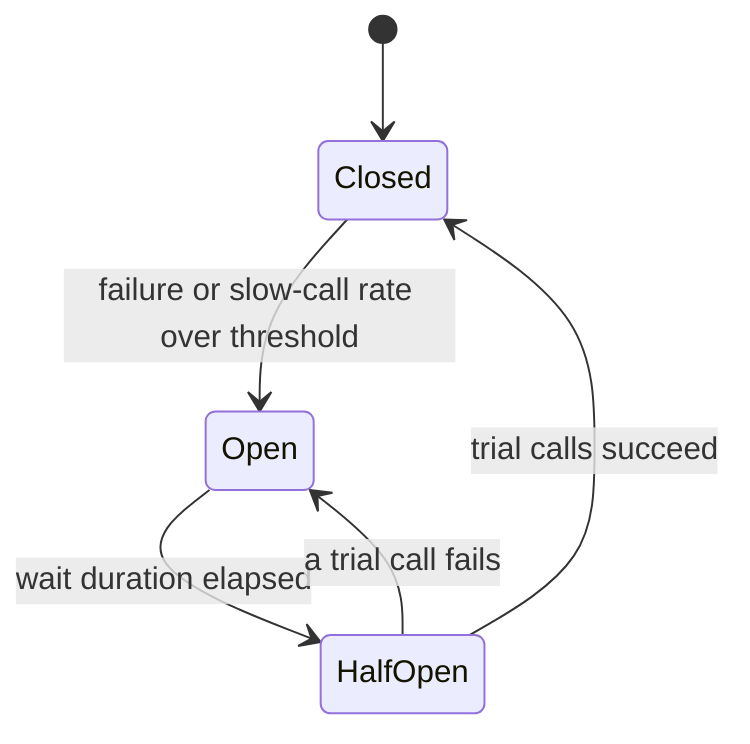

## 1. Core Concept

**Circuit Breaker** protects an application when a dependency (another service, a DB, an external API) starts failing or slowing down: instead of continuing to call it and **piling threads up in a wait**, it **opens the circuit** and **fails fast** for a period of time, giving the dependency room to recover. It solves **cascading failure** — one slow service taking down the whole chain of services that depend on it.

**Mental model:** like the **circuit breaker in your house**: on overload it **trips by itself** to protect all the wiring; after a while you **try closing it again** (half-open) and if everything is fine the current flows again, and if there is still a short it trips again. Without a breaker, one shorted appliance can burn the whole house.

## 2. How It Works

**Three states → Closed, Open, Half-Open**
- **Closed**: calls go through normally and **failures are counted** in a sliding window (for example the last 20 calls or 60 seconds).
- **Open**: when a threshold is exceeded (for example **failure rate ≥ 50%** or a **high slow-call rate**), the circuit **opens**: every call **fails immediately** (or returns a **fallback**) without touching the dependency for a **wait duration** (for example 30 seconds).
- **Half-Open**: after the wait duration it allows **a few trial calls** (for example 3); if they **succeed** it returns to **Closed**, if they **fail** it goes back to **Open**.

**Why you need it → Thread exhaustion**
- Example: service A has 200 threads and dependency B starts answering after **30 seconds**; at only **7 requests per second**, all 200 threads hang within tens of seconds and A can no longer serve even requests unrelated to B. Short timeouts + a circuit breaker + a bulkhead prevent this.

**Companion mechanisms → Layered fault tolerance**
- **Timeout**: mandatory, because the breaker only learns about a failure when the call **ends** (including by timing out).
- **Bulkhead**: **resource isolation** (a separate thread pool/semaphore per dependency) so one failing dependency cannot eat the shared resources.
- **Retry with backoff + jitter**: only retry **transient, idempotent** failures; uncontrolled retries **amplify load** while a dependency is weak (a **retry storm**).
- **Fallback**: return cached data, a default value or a degraded feature (**graceful degradation**).

**Practical configuration → One breaker per dependency**
- A breaker **per dependency** (never one global breaker), thresholds based on **failure rate and slow calls** rather than absolute error counts, and a **minimum number of calls** before evaluating (to avoid opening the circuit because 1 of 2 calls failed). Libraries: **Resilience4j**, **Polly**, or a **service mesh** (outlier detection in Istio/Envoy).

```java
CircuitBreakerConfig cfg = CircuitBreakerConfig.custom()
    .failureRateThreshold(50)                  // % of failures that opens the circuit
    .slowCallDurationThreshold(Duration.ofSeconds(2))
    .slidingWindowSize(20).minimumNumberOfCalls(10)
    .waitDurationInOpenState(Duration.ofSeconds(30))
    .permittedNumberOfCallsInHalfOpenState(3).build();
```

## 3. Visual Diagram



## 4. Rules of Thumb & Trade-offs

| Situation / Need | What to choose |
| --- | --- |
| A slow/failing dependency exhausts threads | Timeout + Circuit Breaker |
| One failing dependency must not affect others | Bulkhead (separate pools) |
| Transient errors, idempotent operations | Retry with backoff + jitter |
| You must answer even when a dependency fails | Fallback (cache/default) |
| You need to fail fast at the network layer | Mesh outlier detection |

- **What you gain:** stops failures from propagating, keeps the system responsive, gives the dependency time to recover. **What you lose:** it may **reject wrongly** after the dependency is healthy again, adds parameters to tune and requires designing fallbacks.

## 5. Must Remember / Production Pitfalls

- **Service A hangs because B is slow → long or missing timeouts → set short timeouts on every outbound call**.
- **The circuit keeps opening and closing (flapping) → thresholds too sensitive or no minimum number of calls → widen the window, `minimumNumberOfCalls`, wait duration**.
- **The dependency recovers slowly even though it is healthy → a retry storm from many clients → backoff with jitter, a retry budget, a breaker in every client**.
- **One breaker shared by several dependencies → a failure in one blocks the others → a breaker per dependency**.
- **A fallback with the wrong side effect (stale data for a payment) → not distinguishing operations → only safe fallbacks, fail clearly on critical operations**.
- Interview trap: "What is Half-Open for?" → **let a few trial calls check whether the service has recovered**; "How does a circuit breaker differ from retry?" → **retry tries again, the breaker stops calling when the dependency is failing**; "Why do you need a bulkhead?" → **resource isolation, so one failing dependency cannot eat the shared pool**.

## 6. Search Hooks

- `circuit breaker pattern Resilience4j` — cut the circuit when a dependency fails.
- `half-open state circuit breaker` — the recovery probing state.
- `bulkhead pattern` — isolate resources per dependency.
- `cascading failure` — failures propagating along a service chain.
- `retry storm backoff jitter` — retries amplifying load on a weak system.
