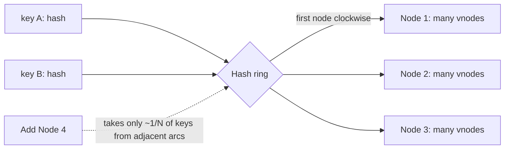

## 1. Core Concept

When distributing data/requests across **N nodes** (cache, shards, LB), the simple approach `node = hash(key) mod N` has a fatal flaw: **when N changes (a node is added or removed), almost every key changes node** — wiping the cache and forcing massive data movement. **Consistent hashing** redesigns this so that **only about 1/N of the keys must move** when a node is added or removed.

**Mental model:** picture **a clock face** with nodes placed at a few positions; each key lands on a point on the ring and **belongs to the first node met going clockwise**. Adding a new node only **"steals" one arc** from the next node, and all other arcs stay unchanged.

## 2. How It Works

**The problem with `hash mod N`**
- Example: 4 nodes → add a 5th: keys with `h mod 4` become `h mod 5` — about **80%** of keys change node. For a cache that is a **mass cache miss** and a DB overload; for shards it means moving nearly all the data.

**The hash ring**
- Hash both **nodes** and **keys** into the same space (for example 0 … 2³²−1) arranged as a ring. A key belongs to the **first node met clockwise**. **Adding/removing a node only affects keys in the adjacent arc** (≈ 1/N of all keys). To store **R replicas**, pick the **next R distinct nodes** on the ring.

**Virtual nodes (vnodes) → Load balancing**
- Each physical node is placed at **many points (about 100–200 vnodes)** on the ring instead of one. Benefits: **more even distribution** (no physical node gets an unusually large arc), **stronger machines get more vnodes**, and when a node dies its load **spreads evenly** over many nodes instead of piling onto the next one.

**Variants**
- **Rendezvous (HRW) hashing**: for each key, compute `hash(key, node)` for every node and pick the node with the **highest score**; simple, no ring, O(N), and also moves only ≈ 1/N of the keys. **Jump consistent hash**: no memory, very fast and even, but nodes are numbered **consecutively from 0** and you cannot remove an arbitrary node (good for growing shard counts).
- **Redis Cluster** does not use a ring but **16,384 hash slots**: `slot = CRC16(key) mod 16384`; slots are assigned to nodes and **moved per slot** when resharding.

**Applications**
- Cache distribution (Memcached clients), **Dynamo/Cassandra** (partitioning and replicas), **CDNs and LBs** (Maglev), sharding. Note: consistent hashing **does not solve hot keys** — an extremely hot key still lands on one node.

```python
import bisect, hashlib
def h(x): return int(hashlib.md5(x.encode()).hexdigest(), 16)
ring = sorted((h(f"{n}#{v}"), n) for n in nodes for v in range(150))   # 150 vnodes per node
def owner(key):
    i = bisect.bisect(ring, (h(key), ""))        # the first node clockwise
    return ring[i % len(ring)][1]
```

## 3. Visual Diagram



## 4. Rules of Thumb & Trade-offs

| Situation / Need | What to choose |
| --- | --- |
| A fixed number of nodes that never changes | `hash mod N` is enough |
| The node count changes (cache, shards) | Consistent hashing + vnodes |
| You want simplicity, small N | Rendezvous hashing |
| Shards numbered incrementally, low memory | Jump consistent hash |
| Redis cluster | Hash slots (16,384) |
| Stronger nodes should take more load | Raise the vnode count by weight |

- **What you gain:** adding/removing a node moves only ≈ 1/N of the data, so scaling is less disruptive. **What you lose:** more complex than plain hashing, vnodes are needed for balance, it does not solve hot keys and ring metadata must be managed.

## 5. Must Remember / Production Pitfalls

- **Adding a cache node overloads the DB with mass misses → using `hash mod N` → consistent hashing so only ~1/N of keys are affected**.
- **One node takes much more load → few vnodes so the distribution is skewed → raise vnodes (100–200) or weight by capacity**.
- **A dead node takes its neighbor down too → load piles onto one neighbor → vnodes spread the load, add replicas**.
- **One extremely hot key still overloads a node → hashing does not fix key skew → local caches, replicate hot keys, split the key**.
- **Redis cluster resharding is slow → movement is per slot → plan slot moves gradually and monitor**.
- Interview trap: "Why not `hash mod N`?" → **changing N moves almost every key (about (N−1)/N)**; "What are vnodes for?" → **balancing load and spreading it evenly when a node fails**; "Does Redis Cluster use a hash ring?" → **no, it uses 16,384 hash slots**.

## 6. Search Hooks

- `consistent hashing ring virtual nodes` — the hash ring and vnodes.
- `rendezvous hashing HRW` — pick the node with the highest score.
- `jump consistent hash` — consistent hashing with no memory.
- `Redis Cluster hash slots` — 16,384 slots instead of a ring.
- `hash mod N rehashing problem` — why changing N moves nearly all keys.
