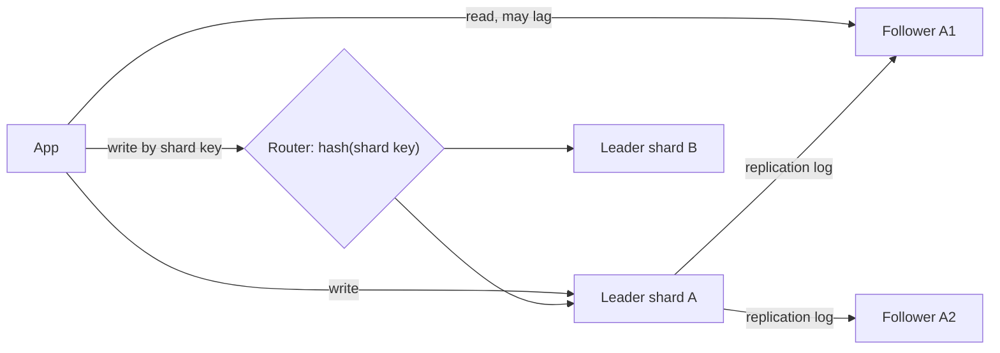

## 1. Core Concept

A single database has two limits: it is **not fault-tolerant** (if it dies the service is lost) and it **does not scale without bound** (reads, writes, capacity). **Replication** (copying data across several nodes) solves **availability and read scaling**; **Sharding** (splitting data horizontally across several nodes) solves **write scaling and capacity**. The two techniques are **orthogonal** and often combined: each shard has its own leader and followers.

**Mental model:** replication is **photocopying the ledger for many branches** (many people read the same content, one master ledger takes the writes); sharding is **splitting the ledger into several volumes by customer surname** (each volume is smaller, each clerk writes to their own volume).

## 2. How It Works

**Replication → The leader–follower model**
- The **leader** takes writes and records them in a log (WAL/binlog); **followers** apply the log. **Synchronous** (wait for the follower's ack: safe, slow, one dead follower can block writes), **asynchronous** (the leader does not wait: fast, but **the most recent data is lost if the leader dies before a follower receives it**), **semi-synchronous** (wait for at least one follower). There are also **multi-leader** and **leaderless** setups (Dynamo/Cassandra, using quorums).

**Replication lag → The anomalies**
- Asynchronous followers **lag by a few ms to a few seconds**. Consequences: **read-your-writes violations** (you write and the replica does not show it), **monotonic reads** (a later read shows older data than the previous one because you switched replica), **consistent prefix** (seeing the effect before the cause). Mitigate by reading the **leader** for freshly written data, **pinning a user to one replica**, and tracking the written log position (LSN/GTID).

**Failover → Split brain and fencing**
- When the leader dies, **elect or promote** a follower. The risk is **split brain**: two nodes both believe they are the leader and both take writes → data diverges. Prevent with **quorum/consensus (Raft)**, **fencing tokens/epochs** (the old node's writes are rejected) and **STONITH** (power off the suspect node).

**Sharding → How to split**
- **Range** (by key interval: efficient range queries, prone to **hot spots** with increasing keys), **hash** (even distribution, loses ordering), **directory/lookup** (a flexible mapping table), **geographic**. The **shard key** is the most important decision: high cardinality, even distribution, **present in most queries**.
- **Hot shard/hot partition**: load piles onto one shard although total capacity remains (skewed keys, an especially busy user). **Resharding** (changing the shard count) is expensive: use **consistent hashing or many virtual shards** to move less data.

**The price of sharding**
- **Cross-shard queries/joins/transactions** are complex (scatter–gather, **2PC or sagas**), **secondary indexes** are distributed, global ID generation and harder operations.

```sql
-- Safe read-after-write: after writing, read from the leader (or a replica that reached the written LSN)
SELECT pg_current_wal_lsn();                      -- on the leader after the write
-- replica: serve only when pg_last_wal_replay_lsn() >= that LSN
```

## 3. Visual Diagram



## 4. Rules of Thumb & Trade-offs

| Situation / Need | What to choose |
| --- | --- |
| Fault tolerance, read scaling | Replication (leader–follower) |
| Committed data must not be lost | Synchronous/semi-synchronous (at the cost of latency) |
| Scale writes and capacity | Sharding |
| Range queries | Range sharding |
| Even distribution, queries by key | Hash sharding |
| Reading right after a write | Read the leader/a sticky replica |
| Avoid split brain | Consensus + fencing tokens |

- **What you gain:** HA, read scaling, write scaling. **What you lose:** replication lag (eventual), losing the latest data on asynchronous failover, the complexity of cross-shard queries and operations; **shard only when a single node (even with read replicas, caching and index tuning) is no longer enough**.

## 5. Must Remember / Production Pitfalls

- **A user writes and does not see their own data → reading a lagging replica → read the leader after writing, a sticky replica, check the LSN**.
- **The latest transactions are lost after a failover → asynchronous replication → semi-synchronous for important data, accepting the latency**.
- **Two leaders take writes (split brain) → failover without fencing → quorum, epoch/fencing token, STONITH**.
- **One shard is overloaded while the cluster has spare capacity → a hot shard from a skewed shard key → choose an evenly distributed key, add a suffix/split the hot key**.
- **Joins across shards are slow/infeasible → data is not co-located → design the shard key around queries, denormalize or co-locate**.
- Interview trap: "Replication vs sharding?" → **replication copies for HA and read scaling, sharding splits data to scale writes and capacity**; "What does replication lag cause?" → **read-your-writes/monotonic-reads violations**; "How do you prevent split brain?" → **quorum and fencing tokens**.

## 6. Search Hooks

- `database replication leader follower` — leader–follower replication.
- `replication lag read your writes monotonic reads` — anomalies caused by lag.
- `database sharding strategies range hash` — ways to split shards.
- `hot shard hot partition` — one overloaded shard.
- `split brain fencing token` — avoid two leaders writing.
