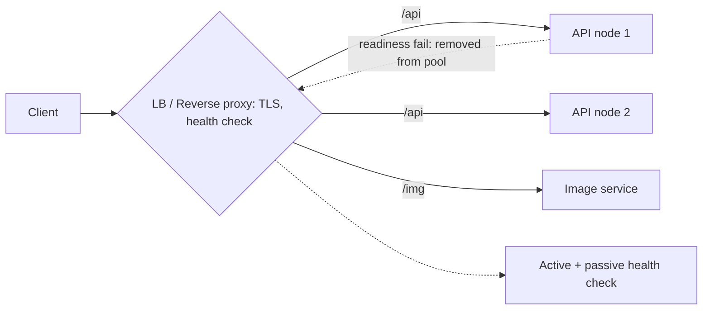

## 1. Core Concept

A **load balancer** distributes requests across multiple backend servers to **raise throughput, remove single points of failure and enable horizontal scaling**; a **reverse proxy** sits in front of backends to do extra work such as **TLS termination, caching, compression, rate limiting and content-based routing**. Many products (Nginx, HAProxy, Envoy, ALB) play both roles.

**Mental model:** a load balancer is the **airport gate coordinator**: it looks at each counter's queue (health + load) and sends passengers to a suitable counter; **L4** only looks at "which flight number" (address/port), **L7** reads the whole "ticket" (URL, headers, cookies) to direct people to a specialized counter.

## 2. How It Works

**L4 vs L7 → Decide at which layer**
- **L4 (TCP/UDP)**: decides by IP/port, **very fast and cheap**, does not understand HTTP, works for any protocol. **L7 (HTTP)**: reads **path, host, headers, cookies**, supports **content routing** (`/api` → service A, `/img` → service B), **TLS termination**, WAF, retries, rewrites; the price is more CPU.

**Distribution algorithms**
- **Round robin** (in turn), **weighted round robin** (by machine weight), **least connections** (pick the node with the fewest connections, good for uneven request lengths), **least response time**, **IP hash/consistent hash** (the same client/key goes to the same node, good for local caches), **power of two choices** (pick two nodes at random and take the less loaded one — good and cheap).

**Health checks → Liveness vs readiness**
- **Liveness**: is the process alive (if not, **restart**). **Readiness**: is it ready to **receive traffic** (finished starting up, connected to the DB; if not, **remove from the pool without restarting**). **Active** (the LB pings proactively) and **passive** (when it sees real errors it ejects temporarily, like outlier detection). Set thresholds (for example 3 consecutive failures, a 5-second interval) to avoid flapping.

**Reverse proxy → Extra jobs**
- **TLS termination** (decrypt at the proxy, internal traffic can be HTTP or mTLS), **connection pooling/keep-alive** to backends, **compression**, **caching**, **rate limiting**, adding `X-Forwarded-For`/`X-Request-Id`.

**Sticky sessions (session affinity)**
- Pin a client to one backend (via cookie/IP hash) to keep local session state. **Downsides**: uneven load, session loss when a node dies, hard to scale; better to **move state out** (Redis/DB) so backends are **stateless**.

**Global distribution → GeoDNS and Anycast**
- **GeoDNS** returns different IPs by client location (subject to DNS TTL). **Anycast**: many places advertise the same IP and the network routes to the nearest (CDN, DNS).

**The LB itself must be HA**
- A single LB is itself a single point of failure: use an **active–passive/VIP pair (keepalived)**, several LBs behind DNS/anycast, or a cloud **managed LB**.

```nginx
upstream api {
    least_conn;
    server 10.0.0.11:8080 max_fails=3 fail_timeout=10s;
    server 10.0.0.12:8080 max_fails=3 fail_timeout=10s;
}
server { listen 443 ssl; location /api/ { proxy_pass http://api; } }
```

## 3. Visual Diagram



## 4. Rules of Thumb & Trade-offs

| Situation / Need | What to choose |
| --- | --- |
| Any TCP/UDP, high performance | L4 |
| Routing by URL/host, WAF, TLS termination | L7 |
| Uneven request durations | Least connections / P2C |
| Machines with different capacity | Weighted round robin |
| Local cache needs the same key on the same node | Consistent hash |
| Login sessions | External session store (Redis), avoid sticky |
| Global users | GeoDNS / Anycast / CDN |

- **What you gain:** horizontal scaling, fault tolerance, zero-downtime deployments. **What you lose:** an extra hop and a component that needs HA; L7 uses more resources; sticky breaks balance.

## 5. Must Remember / Production Pitfalls

- **Requests pour into a freshly started node that is not ready → only liveness, no readiness → add a readiness probe and slow start**.
- **One slow node slows the whole system → round robin is load-blind → least connections/P2C, passive health checks**.
- **Login sessions lost when a node dies → sticky sessions and local state → move state to Redis/DB, make backends stateless**.
- **The LB is a single point of failure → only one LB → HA/VIP, several LBs behind anycast, or a managed LB**.
- **Slow DNS failover → clients/resolvers cache by TTL → a low TTL for critical records or anycast/global LB**.
- Interview trap: "L4 vs L7?" → **L7 understands HTTP (path/headers) so it routes by content, L4 only by IP/port**; "Liveness vs readiness?" → **liveness decides restarts, readiness decides whether to receive traffic**; "Are sticky sessions good?" → **avoid them if possible, move state out**.

## 6. Search Hooks

- `L4 vs L7 load balancing` — load balancing at different network layers.
- `load balancing algorithms least connections` — distribution algorithms.
- `liveness vs readiness probe` — the two kinds of health checks.
- `reverse proxy TLS termination` — a proxy in front of the backends.
- `sticky sessions session affinity` — pin a client to one node.
- `GeoDNS anycast` — global routing by location.
