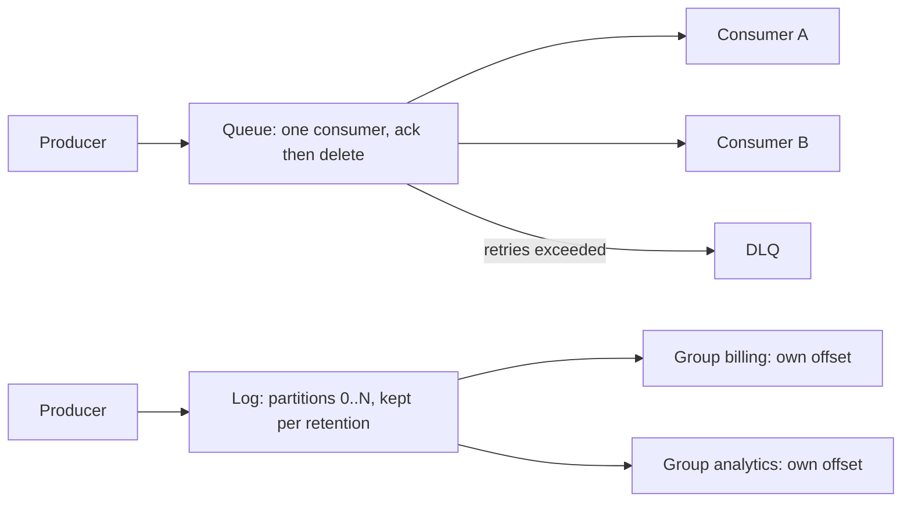

## 1. Core Concept

A **message queue** and an **event log (streaming)** both **decouple** the sender and the receiver, absorb load spikes and enable asynchronous processing — but they are **two different models**: a queue is a **to-do list** (finished items are removed), while a log is an **append-only journal** that many readers can read again and again at their own pace. Choosing the wrong model is the root of many design bugs (lost events, no replay, wrong ordering).

**Mental model:** a queue is like the **ticket rail in a kitchen**: each ticket is taken by **one cook** and torn off when done. A log is like the **shared notebook in the meeting room**: anyone can read from any page and the notebook is still there after reading (until its retention expires).

## 2. How It Works

**Queue vs Log → The core difference**
- **Message queue** (RabbitMQ, SQS, ActiveMQ): a message is **delivered to one consumer** (competing consumers), each message is **acknowledged (ack)** and then **deleted**; fits **task queues**, load leveling, retries. **No replay** once deleted.
- **Event log** (Kafka, Kinesis, Pulsar): an **append-only log split into partitions**, **kept per retention** (hours to days); consumers manage their own **offsets**; **many consumer groups** read independently and can **replay**; fits **event streaming**, event sourcing and data pipelines.

**Partitions, consumer groups and ordering**
- Ordering is only guaranteed **within one partition**; use a **partition key** (for example `order_id`) so the events of one entity go to the same partition. Within a **consumer group**, each partition is read by **at most one consumer** ⇒ **parallelism is capped by the partition count** (10 partitions → at most 10 active consumers).

**Delivery semantics**
- **At-most-once** (may lose), **at-least-once** (no loss, **may duplicate**), **exactly-once** (in practice achieved with an **idempotent producer + transactions** inside Kafka, or **at-least-once + an idempotent consumer** at the system boundary). A sensible default: **at-least-once + idempotent processing**.

**Dead-letter queue (DLQ)**
- A message that exceeds its retry count (a **poison message**) is moved to a DLQ for investigation, so it does not block the main queue.

**Backpressure → When consumers are slower than producers**
- The queue swells, memory fills, latency grows. Remedies: a **bounded queue**, **pull at the consumer's pace**, **rate limiting producers**, **adding consumers**, **monitoring consumer lag**; never let an unbounded queue grow in memory.

**Competing consumers**
- Several consumers read one queue to **scale processing horizontally**; ordering between messages is not guaranteed without grouping.

```python
# Kafka consumer: at-least-once, idempotent, commit the offset after processing
for msg in consumer:                         # group.id = "billing"
    if already_processed(msg.key, msg.offset):
        continue                             # deduplicate
    handle(msg)                              # side effects
    consumer.commit()                        # commit only after it finishes
```

## 3. Visual Diagram



## 4. Rules of Thumb & Trade-offs

| Situation / Need | What to choose |
| --- | --- |
| Load leveling, one worker per task, retries | Message queue |
| Several systems read one event stream, replay needed | Event log (Kafka) |
| Ordering per entity | Partition key = entity id |
| Repeatedly failing messages | DLQ |
| Consumers slower than producers | Backpressure, bounded queue, add consumers |
| Messages must not be lost | At-least-once + idempotent consumer |

- **What you gain:** decoupling, spike tolerance, asynchronous processing. **What you lose:** eventual consistency, the need to handle duplicates/ordering, extra infrastructure; a log trades **operational complexity** for replay and multiple consumers.

## 5. Must Remember / Production Pitfalls

- **Duplicate processing repeats side effects (double charge) → at-least-once → an idempotent consumer by id/business key**.
- **Adding consumers does not speed things up → you exceeded the partition count → add partitions (careful with ordering) or parallelize inside the consumer**.
- **Events of one order get interleaved → no partition key → key by entity id**.
- **One bad message blocks the whole queue → a poison message → DLQ, a retry limit, DLQ alerts**.
- **The queue/lag grows until the system collapses → no backpressure → monitor consumer lag, throttle producers, scale consumers**.
- Interview trap: "How does a queue differ from a log?" → **a queue deletes after ack and cannot replay; a log is kept per retention, has many consumer groups and can replay**; "Is exactly-once real?" → **in practice it is at-least-once + idempotent (or transactions in Kafka)**; "Where is ordering guaranteed?" → **within one partition**.

## 6. Search Hooks

- `message queue vs event log Kafka` — two messaging models.
- `at-least-once vs exactly-once delivery` — delivery semantics.
- `dead-letter queue` — where unprocessable messages go.
- `Kafka consumer groups partitions ordering` — parallelism and ordering.
- `backpressure` — handling consumers slower than producers.
- `competing consumers pattern` — many workers processing one queue.
