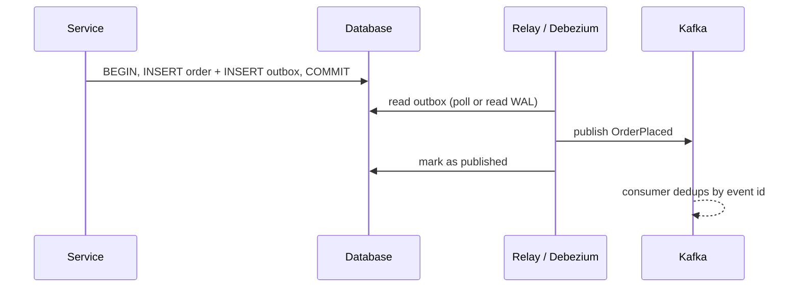

## 1. Core Concept

When a service both **writes to the database** and **publishes an event** (for example saving an order and then sending `OrderPlaced` to Kafka), the two operations live in **two systems that share no transaction** — the **dual-write problem**: if the DB write succeeds but the publish fails the event is lost, and if the publish succeeds but the DB rolls back a "ghost" event exists. **Transactional Outbox** solves it by **writing the event into an `outbox` table in the same transaction as the business data**, and then a **relay** reads that table and publishes to the message broker.

**Mental model:** like **posting a letter through an internal mailbox with a ledger slip**: you drop the letter into the company mailbox **at the same moment** you sign the transaction ledger (one atomic action); the postal worker (the relay) later collects the letters from the box and forwards them, possibly collecting the same letter more than once but **never losing a letter**.

## 2. How It Works

**Atomic write → Data and event in one transaction**
- Inside one DB transaction: `INSERT` the order **and** `INSERT` a row into the `outbox` table (`id`, `aggregate_id`, `type`, `payload`, `created_at`, `published_at`). They commit or roll back together, so **there is never data without its event, nor an event without its data**.

```sql
BEGIN;
INSERT INTO orders (id, customer_id, total) VALUES ('o-1001', 'c-42', 250000);
INSERT INTO outbox (id, aggregate_id, type, payload)
VALUES (gen_random_uuid(), 'o-1001', 'OrderPlaced', '{"orderId":"o-1001","total":250000}');
COMMIT;
```

**Relay → Two ways to move events to the broker**
- **Polling publisher**: a process periodically runs `SELECT ... WHERE published_at IS NULL ORDER BY created_at LIMIT 100 FOR UPDATE SKIP LOCKED`, publishes, then sets `published_at`. Simple, but it has **latency bounded by the poll interval** and adds load on the DB.
- **CDC (Change Data Capture)**: a tool such as **Debezium** reads the DB **transaction log** (WAL/binlog) and pushes changes of the `outbox` table to Kafka (with the **Outbox Event Router**). Low latency, no polling, but extra infrastructure to operate.

**At-least-once delivery → Consumers must be idempotent**
- The relay can **publish and then crash before marking the row** → it resends → **the event is delivered twice**. So the system is **at-least-once** and **consumers must be idempotent**: deduplicate by `event id` (a `processed_events`/inbox table) or upsert by business key.

**Ordering → Per aggregate key**
- Use `aggregate_id` as the **partition key** so all events of one order land in the same partition and keep their order. **Global ordering is not guaranteed**.

**Cleanup and observation**
- Delete or archive published rows (or partition the table by time) so the table does not bloat; watch the **outbox lag** (number of unpublished rows, age of the oldest one).

## 3. Visual Diagram



## 4. Rules of Thumb & Trade-offs

| Situation / Need | What to choose |
| --- | --- |
| Reliably write to the DB and emit an event | Transactional Outbox |
| Small system, a few seconds of latency is fine | Polling publisher |
| Low latency, high volume | CDC (Debezium) |
| Consumers receive repeated events | Idempotent consumer |
| Ordering per entity | Partition key = aggregate id |
| Distributed transaction across services | Saga (with Outbox for each step) |

- **What you gain:** no lost events and no ghost events **without 2PC**. **What you lose:** an extra table and relay, small (eventual) latency, at-least-once delivery forcing idempotent consumers, and the operational burden of CDC.

## 5. Must Remember / Production Pitfalls

- **Lost or ghost events → publishing to Kafka inside `@Transactional` (dual-write) → write the event to the outbox table in the same transaction and let the relay publish**.
- **A consumer processes duplicates and repeats side effects (double charge) → at-least-once → deduplicate by event id or make the operation idempotent**.
- **Events for one order arrive out of order → the partition key is not the aggregate → use `aggregate_id` as the key**.
- **The outbox table bloats and queries slow down → no cleanup → delete/archive on a schedule or partition by time**.
- **Events get stuck and nobody notices → no relay monitoring → alert on outbox lag and the age of the oldest event**.
- Interview trap: "Why not publish to Kafka inside the DB transaction?" → **the DB and Kafka share no transaction, so it is a dual-write**; "Does outbox give exactly-once?" → **no, it is at-least-once and needs an idempotent consumer**; "Polling or CDC?" → **polling is simple but laggy, CDC has low latency but adds infrastructure**.

## 6. Search Hooks

- `transactional outbox pattern` — write the event in the same transaction as the data.
- `dual write problem` — why writing to the DB and the broker separately drifts out of sync.
- `change data capture Debezium` — read the DB log to emit changes.
- `idempotent consumer` — process repeated events safely.
