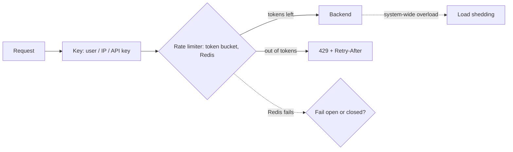

## 1. Core Concept

**Rate limiting** caps the number of requests a client (user, IP, API key, tenant) may send in a period, to **protect the system from overload and abuse**, ensure **fairness** between clients and **control cost**. What matters is choosing the right **algorithm** (allow bursts or smooth, exact or approximate) and implementing it **correctly when distributed** (atomic, not a single point of failure).

**Mental model:** a **token bucket** is like a **wallet of entry tickets**: a few new tickets arrive every second but the wallet holds only a maximum number; every request spends a ticket. You can **spend them all at once** when the wallet is full (a controlled burst) but over time you cannot exceed the refill rate.

## 2. How It Works

**The algorithms**
- **Fixed window counter**: counts per fixed window (for example 100/minute). Simple but has a **boundary flaw**: 100 requests in the last second of one minute + 100 in the first second of the next = **200 in ~2 seconds**.
- **Sliding window log**: stores each request's timestamp, **exact** but memory-hungry (O(number of requests)).
- **Sliding window counter**: combines two adjacent windows with **position-based weights** (approximate, cheap, pragmatic).
- **Token bucket**: refills at `r` tokens/second with a **maximum capacity `b`**; each request takes 1 token; **allows bursts of up to `b`**. Example `r = 10/s, b = 20`: you can send 20 requests back to back and then are limited to 10/s.
- **Leaky bucket**: requests enter a queue and **drain at a fixed rate** (smoothing); when the queue is full they are rejected. Good for protecting backends that need steady load.

**Distributed implementation with Redis → It must be atomic**
- The "read then write" pattern `GET` → compare → `SET` is **not atomic**: many concurrent requests all read `99` and all write `100`, **exceeding the limit**. Use **`INCR` (atomic) + `EXPIRE` when the key is new**, or a **Lua script** so the token bucket/sliding window runs entirely inside Redis. Note that `SET ... EX` on every call also **refreshes the TTL** and extends the window forever.

```python
def allow(user_id, limit=100, window=60):
    key = f"rl:{user_id}:{int(time.time()) // window}"
    pipe = redis.pipeline()
    pipe.incr(key); pipe.expire(key, window + 1)     # atomic INCR, TTL when needed
    count, _ = pipe.execute()
    return count <= limit
```

**The HTTP protocol and placement**
- Return **`429 Too Many Requests`** with **`Retry-After`** (and `RateLimit-*` headers) so clients back off sensibly. Place it at the **edge/API gateway** (reject early, cheap) and/or in the application (using business context); tier it by **customer plan**.

**Load shedding vs rate limiting**
- **Rate limiting**: enforces **fairness per client**. **Load shedding**: when **the whole system is overloaded**, deliberately **drop some requests** (prioritizing important ones) whichever client they come from. You need both.

**Fail open vs fail closed**
- When the counter store (Redis) **dies**: **fail open** (let traffic through, favoring availability, risking overload) or **fail closed** (block, favoring safety, risking self-inflicted downtime). Usually choose **fail open with a local limit** for regular APIs and **fail closed** for sensitive operations.

## 3. Visual Diagram



## 4. Rules of Thumb & Trade-offs

| Situation / Need | What to choose |
| --- | --- |
| Allow short bursts, keep the average rate | Token bucket |
| Smooth the load towards the backend | Leaky bucket |
| A simple limit, boundary flaw acceptable | Fixed window |
| High accuracy, memory is no concern | Sliding window log |
| Balance accuracy and cost | Sliding window counter |
| Many instances sharing one quota | Redis (INCR/Lua) |
| General system overload | Load shedding |

- **What you gain:** protects the system, fairness, cost control. **What you lose:** the extra latency of one counter-store call (you can cache tokens locally), distributed complexity, the risk of wrongly blocking legitimate customers.

## 5. Must Remember / Production Pitfalls

- **The limit is exceeded with many instances → read-then-write is not atomic → `INCR` + `EXPIRE` or a Lua script**.
- **Double the quota around the window boundary → fixed window → sliding window counter or token bucket**.
- **The window never resets → the TTL is reset on every request → set the TTL once when the key is created**.
- **Redis dies and takes the API down (or leaves it wide open) → fail open/closed was not chosen → decide deliberately, keep a local limit as a fallback**.
- **Clients retry in a rush after a 429 → no `Retry-After`/backoff → return `Retry-After`, clients use backoff + jitter**.
- Interview trap: "Token bucket vs leaky bucket?" → **token bucket allows bursts up to capacity, leaky bucket smooths the output**; "Why is `GET` then `SET` wrong?" → **it is not atomic, so many requests pass together**; "Rate limiting vs load shedding?" → **fairness per client vs protection under system-wide overload**.

## 6. Search Hooks

- `token bucket vs leaky bucket` — two algorithms that allow bursts or smooth them.
- `sliding window counter rate limiting` — a cheap, accurate sliding window approximation.
- `distributed rate limiter Redis Lua` — atomic limiting across many instances.
- `HTTP 429 Retry-After` — the standard for signaling a quota breach.
- `load shedding vs rate limiting` — two different protection mechanisms.
- `fail open vs fail closed` — behavior when the counter store fails.
