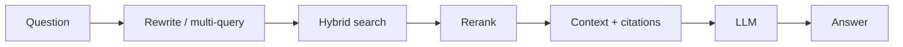

## 1. Core Concept

RAG cơ bản (cắt nhỏ → embed → top-K → LLM) thường đạt ~70%; phần còn lại cần các mẫu nâng cao: **cải thiện truy vấn, truy xuất, ngữ cảnh và đánh giá**. Mental model: *chất lượng RAG = chất lượng truy xuất; LLM chỉ có thể dùng thứ bạn đưa vào.*

## 2. How It Works

- **Query transformation**: **rewrite** câu hỏi (rõ nghĩa, thêm ngữ cảnh hội thoại), **multi-query**, **HyDE** (sinh tài liệu giả để embed), tách câu hỏi con.
- **Truy xuất**: **hybrid search** (BM25 + vector), **metadata filter**, lấy nhiều rồi **rerank** (cross-encoder) lấy top-N.
- **Chunking nâng cao**: theo cấu trúc (tiêu đề), **parent-document/small-to-big** (tìm đoạn nhỏ, đưa đoạn cha), thêm **contextual header** cho mỗi chunk.
- **Graph RAG**: dựng đồ thị thực thể/quan hệ để trả lời câu hỏi nhiều bước.
- **Agentic RAG**: agent quyết định có truy xuất không, truy xuất nguồn nào, lặp lại khi chưa đủ.
- **Giảm nhiễu**: nén/tóm tắt ngữ cảnh, loại trùng, đặt đoạn quan trọng ở đầu/cuối.
- **Trích dẫn**: buộc trả lời kèm nguồn và "không biết" khi không có căn cứ.
- **Đánh giá**: tách **context recall/precision** (truy xuất) và **faithfulness/answer relevance** (sinh); bộ câu hỏi vàng.

## 3. Visual Diagram

## 4. Rules of Thumb & Trade-offs

- Đo trước, thêm kỹ thuật theo lỗi quan sát được (recall thấp → hybrid/rerank/chunking).
- Mỗi tầng thêm làm tăng độ trễ và chi phí.
- Trade-off: **độ chính xác** vs **độ trễ/chi phí/phức tạp**.

## 5. Must Remember / Production Pitfalls

- Thêm nhiều tầng khi chưa đo → phức tạp mà không cải thiện.
- Chunk mất ngữ cảnh (đại từ, bảng) → truy xuất sai.
- LLM bịa khi truy xuất rỗng; cần chính sách "không đủ thông tin".
- Quyền truy cập tài liệu: lọc theo người dùng ở bước truy xuất, không ở bước trả lời.
- Dữ liệu lỗi thời không được reindex.
- Interview trap: "RAG sai thì đổi LLM?" → trước hết kiểm tra **truy xuất**.

## 6. Search Hooks

- `HyDE hypothetical document embeddings` — sinh tài liệu giả để tìm tốt hơn.
- `parent document retriever small to big` — tìm đoạn nhỏ, đưa đoạn lớn.
- `Graph RAG` — truy xuất dựa trên đồ thị tri thức.
- `agentic RAG` — agent điều khiển việc truy xuất.
- `RAG evaluation faithfulness context recall` — chỉ số đánh giá RAG.
