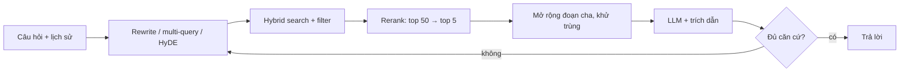

## 1. Core Concept

RAG cơ bản (cắt nhỏ → embed → lấy top-K → đưa cho LLM) thường chỉ giải quyết được phần lớn câu hỏi dễ; phần còn lại cần các mẫu nâng cao cải thiện **truy vấn, truy xuất, ngữ cảnh và đánh giá**. Nguyên tắc xuyên suốt: **chất lượng RAG chủ yếu là chất lượng truy xuất**, vì LLM chỉ dùng được thứ bạn đưa vào context.

**Mental model:** RAG là **thủ thư giúp bạn viết báo cáo**: nếu thủ thư tìm sai sách (retrieval miss) hoặc đưa sách đúng nhưng ở trang sai (ranking miss), người viết giỏi mấy cũng viết sai. Các kỹ thuật nâng cao là **huấn luyện thủ thư**: hiểu câu hỏi tốt hơn, tìm bằng nhiều cách, đọc kỹ hơn trước khi trao sách.

## 2. How It Works

**Query transformation → Hiểu đúng câu hỏi**
- **Rewrite/condense**: biến câu hỏi nối tiếp ("còn cái thứ hai thì sao?") thành câu độc lập dựa trên lịch sử. **Multi-query**: sinh vài biến thể rồi gộp kết quả bằng **RRF**. **HyDE**: sinh một **câu trả lời giả** rồi embed nó để tìm (gần ý nghĩa tài liệu hơn câu hỏi). **Decomposition**: tách câu hỏi phức tạp thành câu con.

**Truy xuất → Nhiều đường, rồi chấm lại**
- **Hybrid search** (BM25 + vector), **metadata filter**, lấy nhiều (top 20–50) rồi **rerank bằng cross-encoder** lấy top 5; **MMR** để đa dạng, tránh các đoạn trùng ý.

**Chunking nâng cao → Cân bằng chính xác và ngữ cảnh**
- **Theo cấu trúc** (tiêu đề, mục); **parent-document / small-to-big**: **tìm bằng đoạn nhỏ** (chính xác) rồi **đưa đoạn cha lớn** (đủ ngữ cảnh) vào LLM; **contextual chunk**: thêm một câu mô tả vị trí/chủ đề của chunk trong tài liệu trước khi embed để chunk không mất ngữ cảnh.

**Graph RAG → Câu hỏi nhiều thực thể/toàn cục**
- Trích **thực thể và quan hệ** thành đồ thị (kèm tóm tắt theo cụm) để trả lời câu hỏi cần **liên kết nhiều tài liệu** hoặc **tổng quan toàn bộ kho**; đổi lại **chi phí lập chỉ mục cao**.

**Agentic RAG → Agent điều khiển truy xuất**
- Agent **quyết định có cần truy xuất không, truy xuất nguồn nào, đánh giá kết quả và viết lại truy vấn rồi lặp** (vòng `retrieve → grade → rewrite → retrieve`). Linh hoạt hơn nhưng chậm, tốn token và khó dự đoán.

**Lắp ngữ cảnh và trả lời**
- **Khử trùng, sắp xếp, giữ ngân sách token**, đánh số nguồn để **trích dẫn**; chính sách **"không đủ thông tin"** khi truy xuất rỗng; **lọc quyền truy cập ở bước truy xuất**.

**Đánh giá → Tách hai tầng**
- **Retrieval**: **context recall/precision**, recall@K, MRR/nDCG trên **bộ câu hỏi vàng**. **Generation**: **faithfulness/groundedness**, answer relevance. Phân loại lỗi: **retrieval miss**, **ranking miss**, **context quá tải**, **LLM bỏ qua context**.

## 3. Visual Diagram

## 4. Rules of Thumb & Trade-offs

| Tình huống / Nhu cầu | Chọn gì |
| --- | --- |
| Câu hỏi nối tiếp trong hội thoại | Query rewrite/condense |
| Từ khoá chính xác + ngữ nghĩa | Hybrid search |
| Top-K không đủ chính xác | Reranker |
| Đoạn tìm được thiếu ngữ cảnh | Parent-document / contextual chunk |
| Câu hỏi liên kết nhiều thực thể, tổng quan | Graph RAG |
| Câu hỏi phức tạp, nhiều bước | Agentic RAG |

- **Được gì:** độ chính xác và độ phủ cao hơn. **Mất gì:** mỗi tầng thêm **độ trễ, chi phí và độ phức tạp**; chỉ thêm khi **đã đo** thấy lỗi ở đó.

## 5. Must Remember / Production Pitfalls

- **Thêm nhiều tầng khi chưa đo → phức tạp mà không cải thiện → đo recall/precision, sửa đúng điểm yếu quan sát được**.
- **Chunk mất ngữ cảnh (đại từ, bảng, tiêu đề) → truy xuất sai → chunk theo cấu trúc, contextual chunk, parent-document**.
- **LLM bịa khi truy xuất rỗng → không có chính sách từ chối → trả lời "không đủ thông tin" kèm trích dẫn và kiểm tra faithfulness**.
- **Lộ tài liệu người dùng không có quyền → lọc quyền ở bước trả lời → lọc ở bước truy xuất**.
- **Dữ liệu lỗi thời → không reindex/xoá vector cũ → quy trình cập nhật theo id nguồn**.
- Interview trap: "RAG sai thì đổi LLM?" → **kiểm tra truy xuất trước**; "parent-document retriever làm gì?" → **tìm nhỏ, đưa lớn**; "khi nào Graph/Agentic RAG?" → **câu hỏi nhiều thực thể/bước, sau khi đo cho thấy RAG thường không đủ**.

## 6. Search Hooks

- `HyDE hypothetical document embeddings` — sinh tài liệu giả để tìm tốt hơn.
- `parent document retriever small to big` — tìm đoạn nhỏ, đưa đoạn lớn.
- `Graph RAG` — truy xuất dựa trên đồ thị tri thức.
- `agentic RAG` — agent điều khiển việc truy xuất.
- `RAG evaluation faithfulness context recall` — chỉ số đánh giá RAG.
