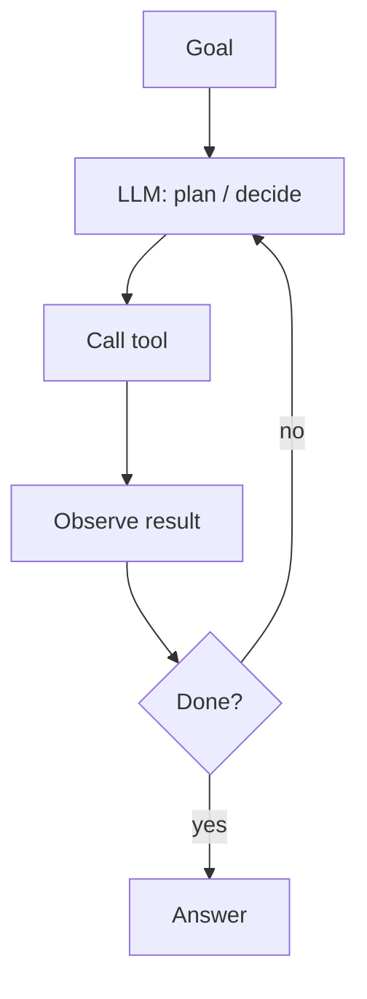

## 1. Core Concept

**Workflow** là chuỗi bước do code định sẵn có gọi LLM; **agent** là hệ thống trong đó LLM **tự quyết định bước tiếp theo và tool** trong vòng lặp cho đến khi hoàn thành. **Agentic AI** là thuật ngữ rộng cho hệ thống có tính tự chủ này. Mental model: *agent = LLM + tools + vòng lặp + bộ nhớ + điều kiện dừng.*

## 2. How It Works

- **Vòng lặp agent**: quan sát → suy nghĩ/lập kế hoạch → gọi tool → nhận kết quả → lặp (mẫu **ReAct**).
- **Thành phần**: model, **system prompt**, **tools**, **memory/context**, **guardrails**, **điều kiện dừng** (giới hạn bước/tiền/thời gian).
- **Các mẫu workflow** (đơn giản hơn agent): prompt chaining, **routing** (phân loại rồi chuyển nhánh), **parallelization**, **orchestrator-workers**, **evaluator-optimizer** (sinh + chấm lặp).
- **Planning**: tách mục tiêu thành bước, ghi kế hoạch ra file/todo và cập nhật.
- **Reflection**: tự kiểm tra kết quả bằng test hoặc critic trước khi kết thúc.
- **Human-in-the-loop**: dừng chờ duyệt ở bước rủi ro.
- **Quan sát**: trace từng bước (prompt, tool call, token, lỗi).

## 3. Visual Diagram

## 4. Rules of Thumb & Trade-offs

- **Bắt đầu đơn giản**: một lời gọi LLM tốt → workflow → agent chỉ khi bước đi không dự đoán được.
- Agent hợp với tác vụ **mở, nhiều bước, có thể tự kiểm tra** (coding, nghiên cứu); workflow hợp với quy trình ổn định.
- Trade-off: **tự chủ/linh hoạt** vs **độ tin cậy, chi phí, độ trễ và khó debug**.

## 5. Must Remember / Production Pitfalls

- **Lỗi cộng dồn**: xác suất đúng mỗi bước 95% còn ~60% sau 10 bước.
- **Vòng lặp vô hạn / đốt token**: luôn có giới hạn bước và ngân sách.
- Agent có quyền ghi/xoá/chi tiền cần **sandbox, least privilege, xác nhận**.
- Thiếu **tiêu chí hoàn thành kiểm chứng được** → agent tự tuyên bố xong sai.
- Debug không có trace gần như bất khả thi.
- Interview trap: "Agent khác workflow ở đâu?" → ai quyết định luồng điều khiển: code hay LLM.

## 6. Search Hooks

- `ReAct reasoning and acting agents` — mẫu vòng lặp suy luận và hành động.
- `agentic workflows patterns routing parallelization` — các mẫu workflow dùng LLM.
- `evaluator optimizer pattern` — vòng sinh và chấm điểm lặp.
- `LLM agent planning reflection` — lập kế hoạch và tự kiểm tra.
- `human in the loop agents` — chèn bước duyệt của con người.
