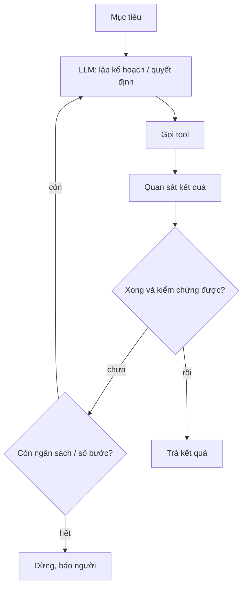

## 1. Core Concept

**Workflow** là chuỗi bước do **code** quyết định, trong đó có gọi LLM ở vài chỗ; **agent** là hệ thống mà **chính LLM quyết định bước tiếp theo và tool cần dùng** trong một vòng lặp cho tới khi xong. **Agentic AI** là thuật ngữ rộng chỉ các hệ thống có tính tự chủ kiểu đó. Câu hỏi thiết kế quan trọng không phải "dùng agent được không" mà là **"có thật sự cần LLM tự quyết luồng điều khiển không"**.

**Mental model:** workflow là **dây chuyền lắp ráp có công thức cố định**; agent là **nhân viên giải quyết vấn đề được giao mục tiêu và bộ công cụ**, tự quyết làm gì trước. Nhân viên linh hoạt hơn nhưng khó đoán, đắt hơn và cần bạn giám sát, đặt giới hạn.

## 2. How It Works

**Vòng lặp agent → Quan sát, quyết định, hành động**
- Mẫu **ReAct**: model **suy nghĩ** → **gọi tool** → **quan sát kết quả** → lặp, cho tới khi coi là xong hoặc chạm giới hạn. Mỗi vòng **gửi lại toàn bộ context**, nên chi phí tăng theo số bước.

**Thành phần của agent**
- **Model**, **chỉ dẫn (system prompt)**, **tool**, **bộ nhớ/context**, **guardrail** và **điều kiện dừng** (tối đa số bước, thời gian, ngân sách token). Thiếu điều kiện dừng là lỗi nghiêm trọng nhất.

**Các mẫu workflow (đơn giản hơn agent)**
- **Prompt chaining** (chuỗi bước, kiểm tra giữa các bước), **routing** (phân loại rồi chuyển nhánh), **parallelization** (chia nhỏ hoặc bỏ phiếu song song), **orchestrator-workers** (LLM chia việc động), **evaluator-optimizer** (một LLM sinh, một LLM chấm và lặp).

**Planning và tự kiểm tra**
- Ghi **kế hoạch/danh sách việc** ra file hoặc state và cập nhật dần; **kiểm chứng kết quả bằng cách khách quan** (chạy test, validator) thay vì tin lời model "đã xong".

**Con người trong vòng lặp**
- **Human-in-the-loop** ở bước rủi ro (xoá dữ liệu, chi tiền, gửi ra ngoài): dừng chờ duyệt. Mức tự chủ nên tăng dần theo độ tin cậy đo được.

**Quan sát và đo lường**
- **Trace** từng bước (prompt, tool, token, độ trễ, lỗi) và **eval** theo tỷ lệ hoàn thành, số bước, chi phí. Không có trace thì gần như không debug được.

**Lỗi cộng dồn**
- Xác suất đúng toàn chuỗi ≈ tích xác suất từng bước: mỗi bước **95%** thì sau **10 bước** còn khoảng **60%** (0,95¹⁰ ≈ 0,6).

```python
for step in range(MAX_STEPS):               # điều kiện dừng cứng
    reply = llm(messages, tools=TOOLS)
    if not reply.tool_calls:
        return reply.text
    for call in reply.tool_calls:
        messages.append(run_tool_safely(call))   # validate, sandbox, cắt kết quả
raise BudgetExceeded("hết số bước")
```

## 3. Visual Diagram



## 4. Rules of Thumb & Trade-offs

| Tình huống / Nhu cầu | Chọn gì |
| --- | --- |
| Một việc đơn giản | Một lời gọi LLM tốt |
| Quy trình ổn định, bước biết trước | Workflow do code điều khiển |
| Bước đi không đoán trước, có thể tự kiểm chứng (coding, nghiên cứu) | Agent |
| Việc rủi ro cao | Agent + human-in-the-loop + quyền tối thiểu |
| Quy trình hoàn tiền có bước cố định | Workflow, LLM chỉ ở bước hiểu ngôn ngữ |

- **Được gì:** linh hoạt với bài mở, nhiều bước. **Mất gì:** độ tin cậy thấp hơn, chi phí và độ trễ cao hơn, khó debug; **bắt đầu đơn giản nhất có thể** rồi mới tăng tự chủ.

## 5. Must Remember / Production Pitfalls

- **Agent chạy mãi đốt token → thiếu điều kiện dừng → giới hạn bước, thời gian và ngân sách, cảnh báo khi vượt**.
- **Agent kẹt gọi lại cùng một tool → không phát hiện lặp → phát hiện lặp, phản hồi lỗi rõ hơn, thay chiến lược hoặc chuyển người**.
- **Agent tuyên bố xong nhưng sai → không có tiêu chí hoàn thành kiểm chứng được → bắt buộc kiểm chứng bằng test/validator**.
- **Agent có quyền ghi/xoá/chi tiền chạy tự do → hậu quả lớn khi sai → sandbox, least privilege, xác nhận hành động nhạy cảm**.
- **Không debug được lỗi khó tái hiện → thiếu trace → trace đầy đủ từng bước và lưu dấu vết**.
- Interview trap: "Agent khác workflow ở đâu?" → **ai quyết định luồng điều khiển: LLM hay code**; "mỗi bước 95% đúng, 10 bước?" → **~60%**; "khi nào chọn workflow?" → **quy trình ổn định, cần tin cậy và dễ debug**.

## 6. Search Hooks

- `ReAct reasoning and acting agents` — mẫu vòng lặp suy luận và hành động.
- `agentic workflows patterns routing parallelization` — các mẫu workflow dùng LLM.
- `evaluator optimizer pattern` — vòng sinh và chấm điểm lặp.
- `LLM agent planning reflection` — lập kế hoạch và tự kiểm tra.
- `human in the loop agents` — chèn bước duyệt của con người.
