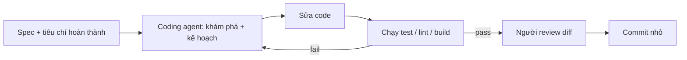

## 1. Core Concept

Trợ lý lập trình AI có ba hình thái: **gợi ý/chat trong IDE** (Copilot, Cursor), **agent chạy trong terminal** (Claude Code, Codex CLI, Gemini CLI, Aider) và **agent chạy nền trên cloud** nhận task rồi mở pull request. Giá trị không nằm ở "viết code nhanh" mà ở **quy trình**: bạn giao mục tiêu rõ ràng, agent làm, bạn **kiểm chứng**. Người chịu trách nhiệm về code vẫn là bạn.

**Mental model:** AI là **dev junior cực nhanh, không biết mệt, rất tự tin, đôi khi bịa**. Bạn không "tin" mà **đặt ranh giới**: spec rõ, test làm trọng tài, review diff, quyền hạn giới hạn. Càng có cách kiểm chứng tự động, bạn càng giao được nhiều.

## 2. How It Works

**Vòng lặp của coding agent**
- **Khám phá** (đọc file, grep) → **lập kế hoạch** → **sửa** → **chạy test/lint/build** → **sửa tiếp** tới khi qua. Điểm mấu chốt là agent **tự chạy được kiểm chứng** (test, type check, build); không có điều này nó chỉ đoán.

**Hướng dẫn dự án → Hợp đồng với agent**
- File như **`CLAUDE.md`** hoặc **`AGENTS.md`** ở gốc repo chứa **lệnh build/test/lint, quy ước code, cấu trúc thư mục, ranh giới** (không sửa thư mục nào, không commit khi chưa được hỏi). Ngắn, cụ thể, không chứa secret.

**Cơ chế mở rộng (ví dụ Claude Code)**
- **Skills** (thư mục chỉ dẫn + script nạp khi cần), **slash commands**, **hooks** (script **xác định** chạy ở sự kiện như trước/sau khi dùng tool hay khi dừng, đảm bảo việc luôn xảy ra, khác với lời nhắc trong prompt), **subagents** (context cô lập), **MCP servers**, **plugins** (gói gộp các thứ trên).

**Quyền và an toàn**
- Chế độ **hỏi từng lệnh**, **plan mode** (lập kế hoạch và duyệt trước khi sửa), **allowlist** lệnh an toàn, **sandbox**. Không để agent chạy lệnh tuỳ ý trên máy có secret.

**Quy trình làm việc tốt**
- Viết **spec ngắn có tiêu chí hoàn thành** → để agent làm → **tự chạy test** → bạn **review diff** → **commit nhỏ**. Với tính năng mới: yêu cầu **viết test thất bại trước** (kiểu TDD) rồi mới cài đặt.
- Dùng **git** và **worktree** để cô lập và quay lại; chạy **nhiều agent song song** trên worktree riêng cho các việc độc lập. Giữ **phiên ngắn**, dùng compaction/phiên mới khi context phình.

**Review code do AI sinh ra**
- Đọc diff như code của đồng nghiệp lạ: kiểm tra **logic, edge case, bảo mật, hiệu năng**; coi chừng **API/thư viện không tồn tại** (kể cả tên package bịa, có thể bị kẻ xấu đăng ký), **test giả** (mock hết, không khẳng định gì), **trùng lặp, abstraction thừa**.

```markdown
# AGENTS.md (ví dụ)
## Lệnh
- Build: `npm run build` · Test: `npm test` · Lint: `npm run lint`
## Quy ước
- TypeScript strict, không dùng `any`. Mọi hàm public có test.
## Ranh giới
- Không sửa `legacy/`. Không commit khi chưa được yêu cầu.
```

## 3. Visual Diagram



## 4. Rules of Thumb & Trade-offs

| Tình huống / Nhu cầu | Chọn gì |
| --- | --- |
| Gợi ý nhanh khi đang gõ | Trợ lý trong IDE |
| Việc nhiều bước, sửa nhiều file, chạy test | Agent terminal |
| Việc độc lập, chạy nền, kết quả là PR | Agent cloud |
| Nhiều việc độc lập song song | Worktree riêng cho mỗi agent |
| Đảm bảo một việc luôn xảy ra (format, chặn lệnh nguy hiểm) | Hooks, không chỉ lời nhắc |
| Thay đổi kiến trúc lớn | Bạn tự thiết kế, giao phần thực thi |

- **Được gì:** tốc độ, giảm việc lặp. **Mất gì:** nguy cơ **nợ kỹ thuật** nếu không review, và giảm hiểu code của chính bạn khi giao quá nhiều; code hợp lý nhưng sai.

## 5. Must Remember / Production Pitfalls

- **Code gọi hàm/package không tồn tại → hallucination → chạy build/test, kiểm tra thư viện thật, xác minh trước khi cài**.
- **Test "xanh" nhưng không bảo vệ gì → test do AI viết mock toàn bộ → review chất lượng test, ưu tiên test hành vi thật**.
- **Agent xoá dữ liệu hoặc lộ secret → quyền quá rộng → sandbox, allowlist lệnh, secret ngoài tầm với của agent**.
- **Agent lệch hướng sau phiên dài → context phình → phiên ngắn, compaction, ghi chú ngoài, `AGENTS.md` rõ ràng**.
- **Slop tích tụ (code trùng, thừa) → chỉ nhìn "chạy được" → review diff, yêu cầu tái cấu trúc, giữ commit nhỏ**.
- Interview trap: "Làm sao tin code AI viết?" → **không tin vì sự tự tin của nó: test, build, review diff, commit nhỏ**; "cách nâng chất lượng nhiều nhất?" → **cho agent cách tự kiểm chứng (test/build)**; "đảm bảo việc luôn chạy" → **hooks**.

## 6. Search Hooks

- `AGENTS.md CLAUDE.md project instructions` — file hướng dẫn cho coding agent.
- `Claude Code skills hooks subagents` — các cơ chế mở rộng agent.
- `AI pair programming workflow` — quy trình làm việc với trợ lý code.
- `git worktree parallel agents` — chạy nhiều agent song song không đụng nhau.
- `reviewing AI generated code` — cách review code do AI viết.
