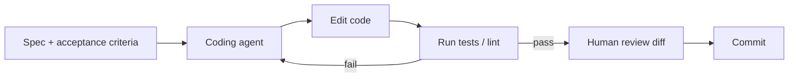

## 1. Core Concept

**AI coding assistant** có ba hình thái: **autocomplete/chat trong IDE** (Copilot, Cursor), **agent CLI/terminal** (Claude Code, Codex CLI, Gemini CLI) và **agent chạy nền/cloud** nhận task rồi mở PR. Giá trị nằm ở **quy trình**: bạn giao mục tiêu rõ, agent làm, bạn **kiểm chứng**. Mental model: *AI là dev junior cực nhanh, không mệt, nhưng cần spec rõ, review chặt và test làm ranh giới.*

## 2. How It Works

- **Agent coding loop**: đọc code (grep, đọc file) → lập kế hoạch → sửa → **chạy test/lint/build** → sửa tiếp.
- **Điều chỉnh hành vi**: file hướng dẫn dự án (`CLAUDE.md`, `AGENTS.md`) chứa lệnh build/test, quy ước, ranh giới.
- **Mở rộng (kiểu Claude Code)**: **skills** (gói chỉ dẫn + script nạp khi cần), **slash commands**, **hooks** (chạy lệnh tự động ở sự kiện như trước/sau tool), **subagents**, **MCP servers**, **plugins** (gói gộp các thứ trên).
- **Plan mode**: lập kế hoạch và duyệt trước khi sửa file.
- **Quyền**: allowlist lệnh, sandbox, chế độ yêu cầu xác nhận.
- **Workflow tốt**: spec ngắn có tiêu chí hoàn thành → để agent **tự chạy test** → review diff → commit nhỏ; dùng git/worktree để cô lập và quay lại.
- **Song song**: nhiều agent/worktree cho tác vụ độc lập.

## 3. Visual Diagram

## 4. Rules of Thumb & Trade-offs

- Cho agent **cách tự kiểm chứng** (test, lệnh build): chất lượng tăng mạnh nhất.
- Tác vụ nhỏ, rõ, tách được → tin cậy cao; thay đổi kiến trúc lớn → tự thiết kế, giao phần thực thi.
- Trade-off: **tốc độ** vs **hiểu code của chính bạn** và rủi ro nợ kỹ thuật.

## 5. Must Remember / Production Pitfalls

- Code AI sinh ra **trông hợp lý nhưng sai** (API không tồn tại, bỏ qua edge case, thiếu bảo mật); luôn review và test.
- **Slop tích tụ**: duplicate, abstraction thừa, test giả (mock hết).
- Để agent chạy lệnh tuỳ ý với quyền cao có thể xoá dữ liệu hoặc lộ secret; dùng sandbox.
- Dán secret/code nhạy cảm vào dịch vụ ngoài cần chính sách.
- Context phình làm agent lệch hướng; làm việc theo phiên ngắn, tóm tắt.
- Interview trap: "Làm sao tin code AI viết?" → **test, review, chạy được, kiểm tra tự động**, không tin vì nghe tự tin.

## 6. Search Hooks

- `AGENTS.md CLAUDE.md project instructions` — file hướng dẫn cho coding agent.
- `Claude Code skills hooks subagents` — các cơ chế mở rộng agent.
- `AI pair programming workflow` — quy trình làm việc với trợ lý code.
- `git worktree parallel agents` — chạy nhiều agent song song không đụng nhau.
- `reviewing AI generated code` — cách review code do AI viết.
