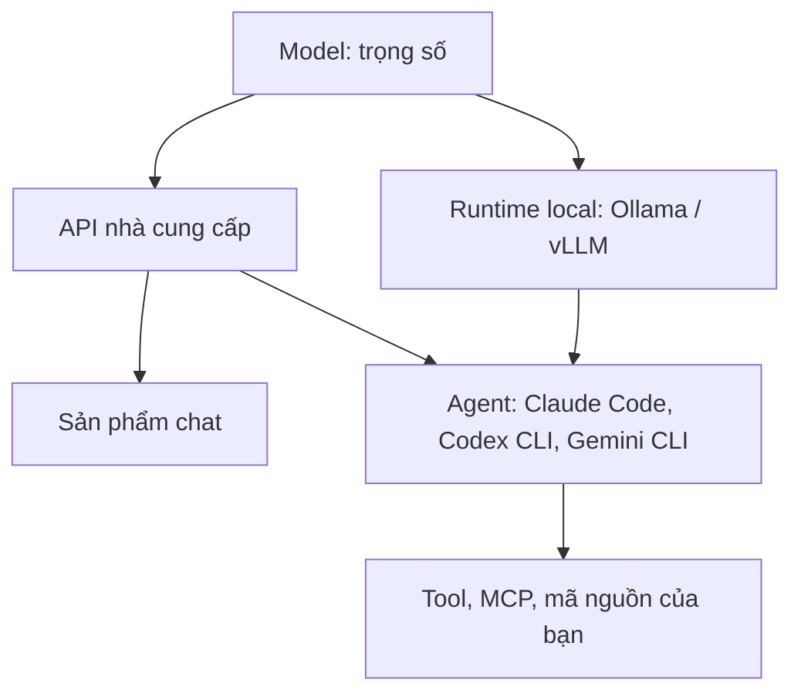

## 1. Core Concept

Khi người ta nói "AI" trong công việc kỹ sư, họ đang gộp **bốn lớp khác nhau**: **model** (bộ trọng số như GPT, Claude, Gemini, Llama), **runtime** (phần mềm nạp và chạy model như Ollama, vLLM), **agent/công cụ** (chương trình dùng model để làm việc như Claude Code, Codex CLI, Gemini CLI) và **sản phẩm** (giao diện chat bọc bên ngoài). Nhầm lớp là nguồn gốc của hầu hết tranh luận "model nào tốt nhất" vô nghĩa, và của quyết định kiến trúc sai.

**Mental model:** model là **bộ não**, runtime là **cơ thể cấp điện và máu nuôi bộ não** (nơi nó chạy), agent là **đôi tay có công cụ**, sản phẩm là **khuôn mặt giao tiếp**. Đổi bộ não không bắt buộc đổi tay; chạy cùng bộ não trên cloud hay laptop là chuyện của runtime.

## 2. How It Works

**Frontier model (closed-weight, gọi qua API)**
- Các họ **GPT** (OpenAI), **Claude** (Anthropic), **Gemini** (Google) chạy trên hạ tầng nhà cung cấp; bạn không có trọng số, **trả tiền theo token** (giá input và output khác nhau, thường tính theo triệu token) và chịu **rate limit**. Cũng truy cập qua nền tảng đám mây: Amazon Bedrock, Azure OpenAI/Foundry, Google Vertex AI.
- Mỗi hãng thường có nhiều **cỡ model**: nhỏ-nhanh-rẻ cho tác vụ đơn giản, lớn-mạnh-đắt cho tác vụ khó.

**Open-weight model (tải trọng số)**
- **Llama** (Meta), **Mistral**, **Qwen**, **DeepSeek**, **Gemma**… cho phép tải về tự chạy, tinh chỉnh, giữ dữ liệu trong hạ tầng của bạn. **"Open-weight" không đồng nghĩa "open source"**: giấy phép khác nhau (có loại giới hạn mục đích hoặc quy mô sử dụng), nên đọc kỹ trước khi dùng thương mại.

**Phân loại theo loại model**
- **Instruct/chat** (đã huấn luyện làm theo chỉ dẫn), **reasoning model** (dành thêm token "suy nghĩ" trước khi trả lời, mạnh hơn ở bài nhiều bước nhưng chậm và tốn token hơn), **multimodal** (văn bản + ảnh + âm thanh), **embedding model** (vector cho tìm kiếm/RAG), **image/video generation** (diffusion), **speech** (STT/TTS).

**Phân loại theo cách dùng**
- **Chat** (hỏi đáp), **coding assistant** (IDE/CLI), **agent** (tự lập kế hoạch và gọi tool), **workflow tự động** (chuỗi bước cố định có gọi LLM). Cùng một model có thể phục vụ cả bốn kiểu.

**Runtime cho model local**
- **Ollama** đóng gói llama.cpp, tải model bằng một lệnh và phục vụ **API tương thích OpenAI** trên máy bạn; **vLLM** dành cho phục vụ nhiều người dùng với throughput cao. Ollama **không phải model**, nó chỉ là runtime.

**Chọn model: đo, không đoán**
- Benchmark công khai không phản ánh tác vụ của bạn. Cách đúng: dựng một **bộ eval** 20–100 ca từ dữ liệu thật, chạy nhiều model, so **chất lượng, độ trễ và chi phí**.

```python
# Cùng một code, đổi model chỉ bằng cấu hình (API tương thích OpenAI)
from openai import OpenAI
client = OpenAI(base_url="http://localhost:11434/v1", api_key="ollama")  # Ollama local
reply = client.chat.completions.create(model="llama3",
    messages=[{"role": "user", "content": "Giải thích idempotent trong 2 câu"}])
```

## 3. Visual Diagram



## 4. Rules of Thumb & Trade-offs

| Tình huống / Nhu cầu | Chọn gì |
| --- | --- |
| Chất lượng cao nhất, ít vận hành | Frontier model qua API |
| Dữ liệu nhạy cảm, offline, chi phí cố định | Open-weight tự host (Ollama/vLLM) |
| Tác vụ đơn giản, khối lượng lớn | Model nhỏ |
| Bài nhiều bước, suy luận khó | Reasoning model |
| Tìm kiếm ngữ nghĩa, RAG | Embedding model |
| Giữ khả năng đổi nhà cung cấp | Bọc sau lớp abstraction/gateway |

- **Được gì:** frontier cho chất lượng; open-weight cho quyền kiểm soát dữ liệu và chi phí dự đoán được. **Mất gì:** frontier tốn tiền theo token và phụ thuộc nhà cung cấp; model local nhỏ thường kém xa ở coding và suy luận dài, lại tự gánh vận hành.

## 5. Must Remember / Production Pitfalls

- **Chọn model theo tin đồn/benchmark chung → kết quả kém ở tác vụ thật → dựng bộ eval riêng và so sánh trực tiếp**.
- **Gắn chặt một nhà cung cấp trong code → khó đổi khi giá/chất lượng/độ khả dụng thay đổi → abstraction mỏng hoặc gateway, giữ prompt/eval độc lập vendor**.
- **Gửi dữ liệu công ty lên API mà chưa đọc chính sách → rủi ro lộ/ huấn luyện bằng dữ liệu → kiểm tra điều khoản lưu trữ, dùng tầng enterprise hoặc tự host**.
- **Coi model local nhỏ như frontier → chất lượng thấp bất ngờ → thử trước bằng eval, giới hạn tác vụ**.
- **Dùng reasoning model cho mọi việc → chậm và tốn token → chỉ dùng cho bài khó, model nhỏ cho bài dễ (routing)**.
- Interview trap: "Ollama có phải model không?" → **không, là runtime**; "open-weight có phải open source không?" → **không nhất thiết, tuỳ giấy phép**; "model nào tốt nhất?" → **không có, đo trên tác vụ của bạn**.

## 6. Search Hooks

- `open-weight vs closed-weight models` — khác biệt về quyền truy cập trọng số.
- `Ollama llama.cpp local LLM` — chạy model trên máy cá nhân.
- `reasoning models vs standard LLM` — model suy luận nhiều bước.
- `multimodal LLM` — model xử lý nhiều loại dữ liệu.
- `LLM model routing` — chọn model theo độ khó tác vụ.
