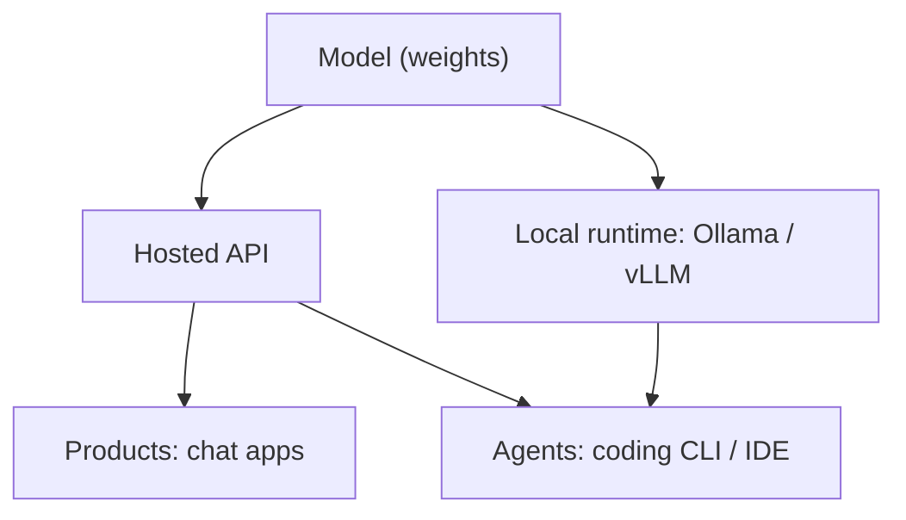

## 1. Core Concept

"AI" trong thực tế là nhiều lớp khác nhau: **model** (bộ trọng số như GPT, Claude, Gemini, Llama), **sản phẩm/API** bọc model (ChatGPT, claude.ai), **công cụ agent** chạy trên model (Claude Code, Codex CLI, Gemini CLI) và **runtime** để chạy model (Ollama, vLLM). Mental model: *model = bộ não, runtime = nơi nó chạy, agent/tool = tay chân, sản phẩm = giao diện.*

## 2. How It Works

- **Frontier (closed-weight, gọi qua API)**: họ **GPT** (OpenAI), **Claude** (Anthropic), **Gemini** (Google). Trả tiền theo token, không tải được trọng số.
- **Open-weight**: **Llama** (Meta), **Mistral**, **Qwen**, **DeepSeek**, **Gemma**: tải trọng số, tự chạy local hoặc tự host; giấy phép khác nhau (không phải lúc nào cũng "open source" đúng nghĩa).
- **Ollama** không phải model: là **runtime** chạy model open-weight trên máy (đóng gói llama.cpp, API tương thích OpenAI).
- **Phân loại theo năng lực**: text/chat (LLM), **multimodal** (ảnh, âm thanh), **reasoning model** (suy luận nhiều bước, tốn token hơn), **embedding model** (vector cho search), **image/video generation** (diffusion), **speech** (STT/TTS).
- **Phân loại theo cách dùng**: chat, **coding assistant** (IDE/CLI), **agent** (tự làm nhiều bước), **workflow tự động** (chuỗi cố định).
- Cùng một hãng có nhiều cỡ model (nhỏ-nhanh-rẻ vs lớn-mạnh-đắt).

## 3. Visual Diagram

## 4. Rules of Thumb & Trade-offs

| Cần | Hướng |
| --- | --- |
| Chất lượng cao nhất, ít vận hành | Frontier API |
| Dữ liệu nhạy cảm, offline, chi phí cố định | Open-weight tự host/Ollama |
| Tác vụ đơn giản, khối lượng lớn | Model nhỏ |
| Suy luận khó | Reasoning model |

- Trade-off: **chất lượng** vs **chi phí/độ trễ** vs **quyền kiểm soát dữ liệu**.
- Đừng gắn chặt vào một vendor: bọc sau một lớp abstraction để đổi model.

## 5. Must Remember / Production Pitfalls

- So sánh model bằng **bộ eval của chính bạn**, không bằng benchmark công khai.
- Tên và năng lực model đổi liên tục; kiến thức "model X mạnh nhất" hết hạn nhanh.
- Model local nhỏ thường kém xa frontier ở coding và suy luận dài.
- Gửi dữ liệu công ty lên API cần kiểm tra chính sách lưu trữ và training.
- Interview trap: "Ollama có phải model không?" → không, là runtime.

## 6. Search Hooks

- `open-weight vs closed-weight models` — khác biệt về quyền truy cập trọng số.
- `Ollama llama.cpp local LLM` — chạy model trên máy cá nhân.
- `reasoning models vs standard LLM` — model suy luận nhiều bước.
- `multimodal LLM` — model xử lý nhiều loại dữ liệu.
- `LLM model routing` — chọn model theo độ khó tác vụ.
