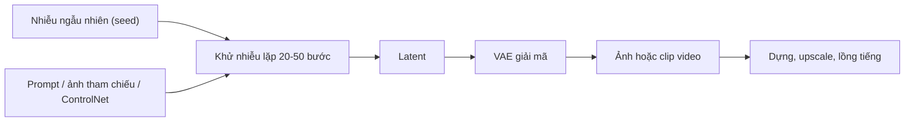

## 1. Core Concept

AI tạo ảnh và video chủ yếu dựa trên **diffusion model**: học cách **khử nhiễu** dần từ nhiễu ngẫu nhiên thành ảnh khớp với mô tả. Video thêm chiều **thời gian** nên phải giữ **nhất quán giữa các khung hình** — đó là điểm khó nhất. Khác với LLM sinh từng token nối tiếp, diffusion **tinh chỉnh lặp lại cả mẫu** qua nhiều bước.

**Mental model:** như một **nhà điêu khắc bắt đầu từ khối đá nhiễu**, mỗi lượt gọt bớt một chút nhiễu theo chỉ dẫn (prompt, ảnh tham chiếu) cho tới khi hiện hình. Video là **gọt cả một cuộn phim** sao cho các khung liền mạch, không "nhảy" nhân vật.

## 2. How It Works

**Diffusion → Thêm nhiễu rồi học đảo ngược**
- Huấn luyện: thêm nhiễu vào ảnh nhiều bước, dạy model **dự đoán nhiễu** để khử. Sinh ảnh: bắt đầu từ **nhiễu thuần**, lặp **20–50 bước** khử nhiễu theo điều kiện. **Seed** quyết định nhiễu ban đầu (cùng seed + tham số → cùng kết quả); **guidance scale (CFG)** cân bằng bám prompt và đa dạng.
- **Latent diffusion**: làm việc trong **không gian nén** (qua **VAE**) thay vì pixel để rẻ hơn nhiều rồi giải mã ra ảnh. Kiến trúc hiện đại hay dùng **Diffusion Transformer (DiT)** thay cho U-Net.

**Điều kiện hoá → Điều khiển kết quả**
- Văn bản qua **text encoder**; ngoài ra **ảnh tham chiếu** (giữ nhân vật/phong cách), **pose/depth/cạnh** (**ControlNet**), **LoRA** (học phong cách/nhân vật riêng).

**Video → Thêm thời gian**
- Sinh chuỗi **latent không-thời gian** (attention theo cả không gian lẫn thời gian). Thách thức: **temporal consistency**, chuyển động vật lý hợp lý, danh tính nhân vật, độ dài (thường **vài giây đến vài chục giây** mỗi clip) và **chi phí GPU rất lớn**.
- Chế độ: **text-to-image, image-to-video, text-to-video, video-to-video**, inpainting/edit, upscale, nội suy khung hình.

**Hệ sinh thái (ví dụ, thay đổi rất nhanh)**
- Dịch vụ: **Sora, Veo, Runway, Kling, Midjourney**… Mã nguồn mở: **Stable Diffusion/FLUX**, các model video mở chạy qua **ComfyUI** (pipeline dạng node), cần GPU nhiều VRAM.

**Quy trình làm video thực tế**
- **Kịch bản → storyboard → ảnh khung chính (giữ nhân vật bằng tham chiếu/LoRA) → image-to-video từng cảnh ngắn → dựng, upscale → lồng tiếng/nhạc (TTS, tách riêng) → ghép**. Chia cảnh ngắn, mỗi cảnh **một ý** (chủ thể, hành động, bối cảnh, chuyển động camera, ánh sáng, phong cách).

```text
Prompt cảnh: "Cận cảnh một kỹ sư trẻ gõ phím trong văn phòng đêm, ánh đèn xanh,
camera dolly-in chậm, phong cách điện ảnh, 6 giây." + ảnh tham chiếu nhân vật.
```

## 3. Visual Diagram



## 4. Rules of Thumb & Trade-offs

| Tình huống / Nhu cầu | Chọn gì |
| --- | --- |
| Giữ nhân vật nhất quán giữa cảnh | Ảnh tham chiếu, seed, LoRA |
| Điều khiển bố cục/chuyển động | ControlNet, image-to-video với khung đầu/cuối |
| Prototype nhanh, không có GPU | Dịch vụ cloud |
| Quy trình tuỳ biến, riêng tư | Open model + ComfyUI trên GPU riêng |
| Nội dung thương mại | Kiểm tra giấy phép và điều khoản dịch vụ |

- **Được gì:** tạo nội dung hình ảnh nhanh, rẻ so với sản xuất thủ công. **Mất gì:** kiểm soát không chính xác bằng dựng tay, phải **sinh nhiều lần rồi chọn**, chi phí GPU/đăng ký cao với video dài.

## 5. Must Remember / Production Pitfalls

- **Nhân vật/chi tiết thay đổi giữa các cảnh → mỗi cảnh sinh độc lập → dùng ảnh tham chiếu, seed, LoRA, giữ prompt mô tả nhất quán**.
- **Chữ, bàn tay, vật lý sai → điểm yếu hiện tại của model → chọn lại nhiều lần, chỉnh sửa hậu kỳ, tránh cảnh phụ thuộc chi tiết đó**.
- **Rủi ro pháp lý (bản quyền, dữ liệu huấn luyện, hình ảnh người thật, deepfake) → dùng sai mục đích → đọc điều khoản thương mại, xin phép hình ảnh người thật, gắn nhãn nội dung AI/watermark theo quy định nền tảng**.
- **Hoá đơn GPU tăng nhanh → thử nhiều lần ở độ phân giải cao → thử ở độ phân giải thấp/ngắn trước, chọn rồi mới nâng cấp**.
- **Kỳ vọng "một prompt ra cả phim" → không đạt → chia cảnh ngắn, mỗi cảnh một ý, dựng ghép**.
- Interview trap: "Diffusion khác autoregressive thế nào?" → **khử nhiễu lặp toàn cục từ nhiễu so với sinh token tuần tự**; "thách thức chính của video?" → **temporal consistency**; "giữ nhân vật nhất quán?" → **ảnh tham chiếu/seed/LoRA**.

## 6. Search Hooks

- `latent diffusion models` — diffusion trong không gian nén.
- `diffusion transformer DiT video generation` — kiến trúc nền của nhiều model video.
- `ControlNet image conditioning` — điều khiển sinh ảnh bằng pose, depth.
- `ComfyUI workflow` — dựng pipeline sinh ảnh/video dạng node.
- `temporal consistency video generation` — giữ nhất quán giữa các khung hình.
