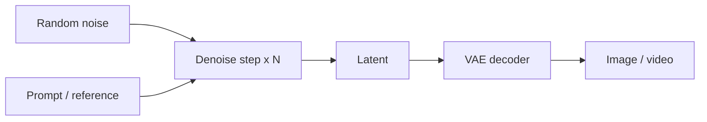

## 1. Core Concept

AI tạo ảnh/video chủ yếu dùng **diffusion model**: học cách **khử nhiễu** từng bước từ nhiễu ngẫu nhiên thành ảnh theo mô tả văn bản. Video thêm chiều **thời gian** và đòi hỏi nhất quán giữa các khung hình. Mental model: *LLM sinh token tuần tự; diffusion sinh cả ảnh bằng cách tinh chỉnh lặp từ nhiễu.*

## 2. How It Works

- **Diffusion**: quá trình thuận thêm nhiễu, mô hình học quá trình ngược; **latent diffusion** làm việc trong không gian nén (VAE) để rẻ hơn; kiến trúc hiện đại hay dùng **Diffusion Transformer (DiT)**.
- **Điều kiện hoá**: văn bản qua text encoder, ngoài ra **ảnh tham chiếu**, pose, depth (ControlNet), âm thanh.
- **Video**: sinh chuỗi latent theo không-thời gian; thách thức: **temporal consistency**, chuyển động vật lý, độ dài ngắn (vài giây đến vài chục giây).
- **Chế độ**: text-to-image, image-to-video, text-to-video, video-to-video, **inpainting**/edit, upscale.
- **Hệ sinh thái** (ví dụ, thay đổi nhanh): Sora, Veo, Runway, Kling, Midjourney; **open**: Stable Diffusion/FLUX, ComfyUI để dựng pipeline node.
- **Quy trình thực tế**: viết script → storyboard/ảnh khung đầu → image-to-video từng cảnh → ghép, lồng tiếng/nhạc bằng công cụ khác.
- **Tham số**: seed, số bước, guidance scale, độ phân giải.

## 3. Visual Diagram

## 4. Rules of Thumb & Trade-offs

- Prompt video: **chủ thể, hành động, bối cảnh, ống kính, ánh sáng, phong cách**; mỗi cảnh một ý.
- Dùng **ảnh tham chiếu** và **seed** để giữ nhân vật nhất quán giữa cảnh.
- Trade-off: **chất lượng/độ dài** vs **chi phí GPU và thời gian**; cloud tiện nhưng đắt, local rẻ về lâu dài nhưng cần GPU mạnh.

## 5. Must Remember / Production Pitfalls

- Nhân vật và chi tiết **trôi** giữa các cảnh; chữ và bàn tay vẫn hay lỗi.
- **Bản quyền, giấy phép dữ liệu huấn luyện, deepfake và quyền hình ảnh** là rủi ro pháp lý; kiểm tra điều khoản sử dụng thương mại.
- Không kiểm soát được chính xác như dựng thủ công; cần sinh nhiều lần và chọn.
- Gắn nhãn/watermark nội dung AI theo quy định nền tảng.
- Interview trap: "Diffusion khác autoregressive thế nào?" → khử nhiễu lặp toàn cục so với sinh token tuần tự.

## 6. Search Hooks

- `latent diffusion models` — diffusion trong không gian nén.
- `diffusion transformer DiT video generation` — kiến trúc nền của nhiều model video.
- `ControlNet image conditioning` — điều khiển sinh ảnh bằng pose, depth.
- `ComfyUI workflow` — dựng pipeline sinh ảnh/video dạng node.
- `temporal consistency video generation` — giữ nhất quán giữa các khung hình.
