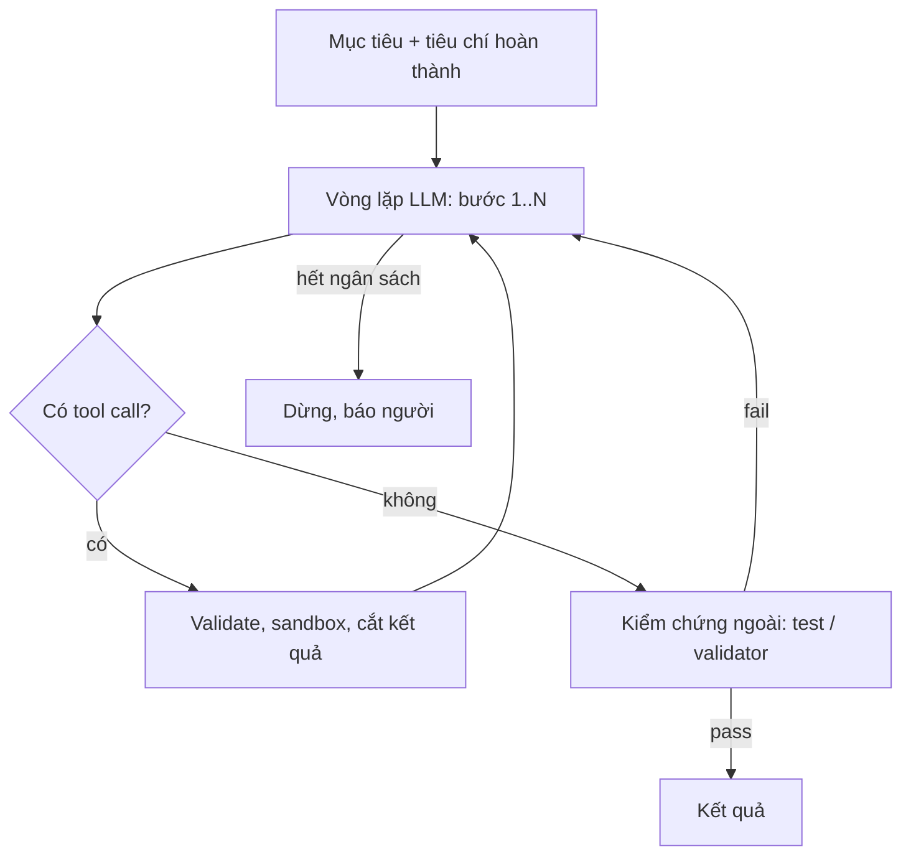

## 1. Core Concept

Xây một agent thực tế phần lớn là **kỹ thuật phần mềm bình thường** quanh một vòng lặp LLM: **định nghĩa tool, vòng lặp có giới hạn, quản lý context, kiểm chứng kết quả, quan sát và đo lường**. Phần "AI" nhỏ hơn bạn nghĩ; phần quyết định thành bại là **ranh giới an toàn, điều kiện dừng và eval**.

**Mental model:** agent là **một vòng `while`** gọi model, thực thi tool, nạp kết quả lại. Bạn là **người thiết kế sàn đấu**: bộ tool, luật chơi (giới hạn bước/ngân sách/quyền), và trọng tài (kiểm chứng, test) — chứ không phải người viết ra từng nước đi.

## 2. How It Works

**Bước 0: Thiết kế trước khi code**
- Xác định **mục tiêu**, **tiêu chí hoàn thành kiểm chứng được**, **tool tối thiểu**, **ngân sách** (bước, token, thời gian), **quyền** và điểm **cần người duyệt**. Bắt đầu với **một agent, ít tool**.

**Vòng lặp tối giản**

```python
def run(goal, max_steps=20):
    msgs = [system(), user(goal)]
    seen = set()
    for step in range(max_steps):                    # điều kiện dừng cứng
        reply = llm(msgs, tools=TOOLS)
        if not reply.tool_calls:
            return reply.text                        # kết thúc có kiểm chứng ngoài vòng
        for call in reply.tool_calls:
            key = (call.name, json.dumps(call.args, sort_keys=True))
            if key in seen:                          # phát hiện lặp
                msgs.append(tool_error(call, "Bạn đã gọi lặp. Hãy đổi cách tiếp cận."))
                continue
            seen.add(key)
            msgs.append(run_tool(call))              # validate → sandbox → cắt kết quả
    raise BudgetExceeded("hết số bước")
```

**Tool → Kỹ thuật chi tiết**
- **Registry** (tên, schema, hàm). **Validate tham số** bằng schema trước khi chạy; **lỗi trả về dạng văn bản rõ ràng** để model tự sửa; **cắt/phân trang kết quả lớn**; **timeout** từng tool; thao tác ghi **idempotent**, có **dry-run** và **xác nhận** cho hành động nguy hiểm; chạy mã trong **sandbox** (container, không mạng, giới hạn tài nguyên).

**Context và kế hoạch**
- Tóm tắt khi dài, dọn kết quả tool cũ; thêm tool **ghi/đọc kế hoạch (todo)** để agent theo dõi tiến độ; lưu **checkpoint** để chạy tiếp được khi lỗi.

**Kiểm chứng và đánh giá**
- **Không tin lời model "xong rồi"**: chạy test/validator/so sánh với kỳ vọng. Dựng **bộ nhiệm vụ mẫu** đo **tỷ lệ hoàn thành, số bước, token, chi phí, độ trễ**; chạy lại khi đổi prompt/model/tool. Test logic bằng phản hồi **ghi sẵn (record/replay)** để ổn định.

**Quan sát**
- **Trace từng bước** (prompt, tool call, kết quả, token, độ trễ, lỗi) — chuẩn hoá (ví dụ OpenTelemetry) — để debug và tính chi phí.

**Framework hay tự viết**
- Framework (LangGraph, OpenAI Agents SDK…) giúp trace, checkpoint, handoff; tự viết giúp hiểu và kiểm soát. Dù chọn gì, giữ **lớp tool và eval độc lập framework**.

## 3. Visual Diagram



## 4. Rules of Thumb & Trade-offs

| Tình huống / Nhu cầu | Chọn gì |
| --- | --- |
| Bắt đầu | Một agent, ít tool, eval nhỏ |
| Tool có tác dụng phụ | Dry-run, xác nhận, idempotent |
| Chạy mã do model sinh | Sandbox, không mạng, timeout |
| Phiên dài | Checkpoint + compaction |
| Cần debug/đo chi phí | Trace từng bước |
| Cần handoff/multi-agent | Framework hoặc orchestrator tự xây |

- **Được gì:** tự động hoá việc nhiều bước, linh hoạt. **Mất gì:** độ tin cậy thấp hơn workflow, chi phí/độ trễ cao hơn; cần đầu tư eval và an toàn.

## 5. Must Remember / Production Pitfalls

- **Vòng lặp không dừng → đốt tiền → `max_steps`, ngân sách token/thời gian, cảnh báo khi vượt**.
- **Tool trả dữ liệu khổng lồ làm tràn context → không cắt → phân trang/tóm tắt, giới hạn kích thước**.
- **Agent tuyên bố xong mà sai → tin lời model → bắt buộc kiểm chứng bằng test/validator**.
- **Chạy lệnh/mã do model sinh trên máy thật → rủi ro mất dữ liệu/lộ secret → sandbox, allowlist, quyền tối thiểu**.
- **Không debug được lỗi hiếm → thiếu trace → trace đầy đủ, lưu lại phiên lỗi để tái hiện**.
- Interview trap: "Agent kẹt lặp cùng một tool call?" → **phát hiện lặp, phản hồi lỗi rõ, đổi chiến lược hoặc chuyển người**; "yếu tố bắt buộc?" → **giới hạn bước/ngân sách**; "tool lỗi nên trả gì?" → **thông báo dạng văn bản để model tự sửa**.

## 6. Search Hooks

- `building effective agents` — hướng dẫn thiết kế agent đơn giản, hiệu quả.
- `agent observability tracing` — theo dõi từng bước của agent.
- `LLM agent sandbox code execution` — chạy mã an toàn.
- `agent evals task success rate` — đo agent bằng bộ nhiệm vụ.
- `OpenAI Agents SDK vs LangGraph` — các framework điều phối.
