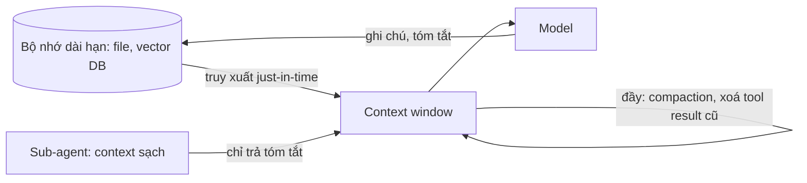

## 1. Core Concept

Model chỉ "nhớ" những gì nằm trong **context window** của lần gọi hiện tại; mọi thứ khác là **bộ nhớ ngoài** mà bạn phải tự nạp lại. **Context engineering** là việc chọn **đúng thông tin, đúng lúc, đúng chỗ** để đưa vào context ở mỗi bước, vì context vừa **đắt** (trả tiền theo token), vừa **chậm** (độ trễ tăng theo độ dài), vừa **có thể làm chất lượng giảm** khi quá dài và nhiễu.

**Mental model:** context là **RAM nhỏ và đắt**, bộ nhớ dài hạn là **ổ đĩa lớn và rẻ**. Việc của bạn giống hệ điều hành: **paging** đúng dữ liệu vào RAM khi cần, đẩy dữ liệu cũ ra đĩa dưới dạng tóm tắt, và đừng bao giờ cố nhét cả ổ đĩa vào RAM.

## 2. How It Works

**Context window → Giới hạn và chi phí**
- Context gồm system prompt, định nghĩa tool, lịch sử hội thoại, tài liệu truy xuất và kết quả tool. **Chi phí tỉ lệ với số token** và agent nhiều bước **gửi lại toàn bộ context mỗi bước**. Ví dụ: agent chạy 100 bước, mỗi kết quả tool 5.000 token → lịch sử có thể lên **~500K token** nếu không dọn.
- Chất lượng có thể giảm khi context dài và nhiễu: thông tin nằm giữa dễ bị bỏ sót (**lost in the middle**), hiện tượng thường gọi là **context rot**.

**Bộ nhớ ngắn hạn → Giữ cuộc hội thoại gọn**
- **Sliding window** (chỉ giữ N lượt gần nhất) rẻ nhưng mất đầu; **summarization/compaction** tóm tắt lịch sử cũ, **giữ lại quyết định, ràng buộc, TODO còn mở, đường dẫn/tên file**; **xoá kết quả tool cũ** (giữ lại kết luận) là cách dọn có hiệu quả cao nhất.

**Bộ nhớ dài hạn → Lưu ngoài và truy xuất**
- Loại: **episodic** (sự kiện từng xảy ra), **semantic** (sự thật/ưu tiên), **procedural** (cách làm, quy tắc). Nơi lưu: **file** (`CLAUDE.md`, `AGENTS.md`, `NOTES.md`), key-value, **vector DB** (truy xuất ngữ nghĩa, xem RAG), knowledge graph. Cần chính sách **ghi** (lưu gì, khi nào), **đọc** (truy xuất thế nào) và **quên** (TTL, xoá).

**Just-in-time retrieval → Giữ tham chiếu, nạp khi cần**
- Thay vì nhét cả repo/tài liệu từ đầu, giữ **định danh nhẹ** (đường dẫn, id, truy vấn) và để agent tự nạp nội dung khi cần (grep, đọc file). Tiết kiệm token và tránh nhiễu.

**Sub-agent → Cô lập context**
- Giao tác vụ ồn ào (tìm kiếm, đọc nhiều file) cho agent con có context sạch; chỉ nhận **bản tóm tắt vài trăm đến vài nghìn token** thay vì toàn bộ dấu vết.

**Prompt caching → Rẻ và nhanh hơn cho phần lặp lại**
- Nhà cung cấp cache **phần đầu (prefix) giống hệt** của prompt: lần gọi sau đọc từ cache với giá và độ trễ thấp hơn nhiều; cache có **thời gian sống ngắn** nếu không được dùng lại. Thứ tự tối ưu: **tool + system → tài liệu ổn định → lịch sử → câu hỏi mới nhất**.

```python
# Cấu trúc để prefix ổn định (cache hit), phần thay đổi đặt cuối
messages = [
  {"role": "system", "content": SYSTEM_PROMPT},        # ổn định
  {"role": "user", "content": f"<docs>{STABLE_DOCS}</docs>"},  # ổn định
  *history_compacted,                                   # đã tóm tắt
  {"role": "user", "content": new_question},            # thay đổi cuối cùng
]
```

## 3. Visual Diagram



## 4. Rules of Thumb & Trade-offs

| Tình huống / Nhu cầu | Chọn gì |
| --- | --- |
| Hội thoại dài làm agent lệch mục tiêu | Compaction + ghim chỉ dẫn quan trọng + ghi chú ngoài |
| Tác vụ ồn ào (tìm kiếm, đọc nhiều file) | Sub-agent trả tóm tắt |
| Tri thức lớn, thay đổi | RAG / truy xuất just-in-time |
| Phần prompt lặp lại nhiều lần | Prompt caching (prefix ổn định) |
| Ưu tiên, quy tắc bền giữa các phiên | File hướng dẫn (CLAUDE.md/AGENTS.md) |

- **Được gì:** chất lượng ổn định, chi phí và độ trễ thấp. **Mất gì:** tóm tắt làm **mất chi tiết**; bộ nhớ dài hạn thêm hạ tầng và rủi ro dữ liệu; long context đắt hơn truy xuất đúng đoạn.

## 5. Must Remember / Production Pitfalls

- **Agent quên ràng buộc ban đầu sau nhiều bước → tóm tắt làm rơi ràng buộc → ghim chỉ dẫn cốt lõi ở đầu và tái nạp sau compaction**.
- **Chi phí/độ trễ tăng dần theo từng bước → kết quả tool thô tích luỹ → cắt/tóm tắt kết quả tool, xoá kết quả cũ**.
- **Prompt caching không giảm chi phí → phần đầu prompt thay đổi mỗi lần (timestamp, id) → đưa phần động xuống cuối, giữ prefix ổn định**.
- **Nhét cả codebase/tài liệu vào context → đắt và kém chính xác → truy xuất đúng phần cần**.
- **Bộ nhớ dài hạn bị nhiễm thông tin sai/độc (memory poisoning) → mọi phiên sau bị ảnh hưởng → kiểm soát nguồn ghi, cho phép xoá, không tự tin tuyệt đối vào nội dung đã lưu**.
- Interview trap: "Context window lớn có thay RAG không?" → **không hoàn toàn**: chi phí, độ trễ và độ chính xác khi tìm kim trong đống rơm; "vì sao caching không hiệu quả?" → **prefix thay đổi**.

## 6. Search Hooks

- `context engineering for agents` — chọn thông tin đưa vào context.
- `lost in the middle LLM` — thông tin ở giữa context dễ bị bỏ sót.
- `prompt caching` — cache phần đầu prompt để giảm chi phí.
- `LLM agent memory episodic semantic procedural` — các loại bộ nhớ của agent.
- `conversation summarization compaction` — nén lịch sử khi đầy context.
