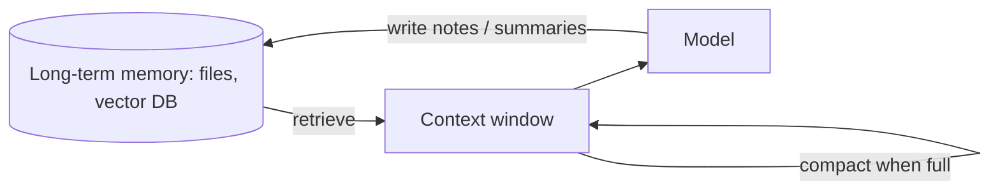

## 1. Core Concept

Model chỉ "nhớ" những gì nằm trong **context window** của lần gọi hiện tại; mọi thứ khác là **bộ nhớ ngoài** bạn tự nạp lại. **Context engineering** là chọn đúng thông tin đưa vào context mỗi bước. Mental model: *context như RAM nhỏ và đắt, bộ nhớ dài hạn như đĩa — việc của bạn là paging đúng thứ vào RAM.*

## 2. How It Works

- **Context window**: giới hạn token (input + output); chi phí và độ trễ tăng theo độ dài; chất lượng có thể giảm khi context quá dài (**lost in the middle**, **context rot**).
- **Bộ nhớ ngắn hạn**: lịch sử hội thoại; khi đầy dùng **summarization/compaction** (tóm tắt rồi giữ quyết định quan trọng) hoặc **cắt cửa sổ trượt**.
- **Bộ nhớ dài hạn**: lưu ngoài (file, DB, **vector store**) rồi **truy xuất (RAG)**; loại: **episodic** (sự kiện), **semantic** (sự thật), **procedural** (cách làm/quy tắc).
- **File-based memory**: file như `CLAUDE.md`/`AGENTS.md`, ghi chú kế hoạch (`todo`, `notes`) được agent đọc lại khi cần.
- **Prompt caching**: phần đầu prompt cố định (system, tài liệu) được cache phía provider, giảm chi phí và độ trễ cho lần gọi sau.
- **Sub-agent cô lập context**: giao tác vụ ồn ào cho agent con, chỉ trả **kết quả tóm tắt** về.
- **Just-in-time retrieval**: giữ tham chiếu (đường dẫn, id) và nạp nội dung khi cần thay vì nhét hết từ đầu.

## 3. Visual Diagram

## 4. Rules of Thumb & Trade-offs

- **Ít mà đúng** thắng nhiều mà nhiễu: mỗi token thêm vào phải đáng.
- Đặt phần **ổn định ở đầu** (để cache), phần thay đổi ở cuối.
- Trade-off: **tóm tắt** (rẻ, mất chi tiết) vs **giữ nguyên** (đắt, đầy đủ); **long context** vs **RAG**.

## 5. Must Remember / Production Pitfalls

- Hội thoại dài lệch mục tiêu: tóm tắt làm **mất ràng buộc ban đầu**; ghim chỉ dẫn quan trọng.
- Nhét cả codebase vào context làm tốn tiền và kém chính xác.
- Bộ nhớ dài hạn bị **nhiễm** thông tin sai hoặc độc hại (memory poisoning).
- Cache bị vô hiệu nếu phần đầu prompt thay đổi từng lần.
- Lưu thông tin cá nhân vào memory cần xoá/chính sách rõ.
- Interview trap: "Context window lớn có thay RAG không?" → không hoàn toàn: chi phí, độ trễ và độ chính xác khi tìm trong context dài.

## 6. Search Hooks

- `context engineering for agents` — chọn thông tin đưa vào context.
- `lost in the middle LLM` — thông tin ở giữa context dễ bị bỏ sót.
- `prompt caching` — cache phần đầu prompt để giảm chi phí.
- `LLM agent memory episodic semantic procedural` — các loại bộ nhớ của agent.
- `conversation summarization compaction` — nén lịch sử khi đầy context.
